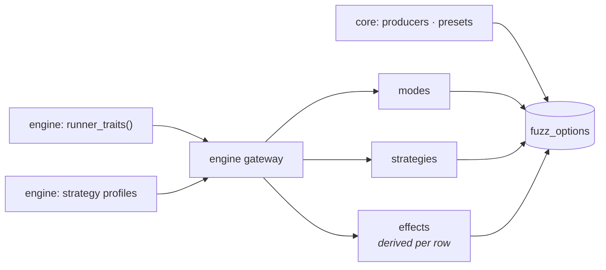

# Fuzz options

A run is shaped by three independent choices: the **execution mode** (how requests
are sent), the **strategy** (which values they carry and which extra checks
judge the answers) and the **producer** (where the endpoint contracts come
from). `fuzz_options`, in the reply to `hello` and to `describe`, says which values
each choice takes and what each strategy changes in each mode, so a client builds
its run picker from data instead of a table of its own.

Everything in it is derived. The engine declares its strategy profiles and, per
runner, what that runner takes from a strategy
([Strategies and runner traits](../../specforge-engine/strategies.md)); the core
reads both through its engine gateway and computes the rest. Nothing is written
twice, so the published options cannot drift from what a run does.



## The object

`fuzz_options` is required in the `hello` result. `modes`, `strategies` and
`effects` come from the engine and are empty when the core runs without it;
`producers` and `presets` are the core's own and always present.

| Key | Items | What it lists |
| --- | --- | --- |
| `modes` | `{name, variants}` | Every `execution` mode, in declaration order. Each variant is `{name, phases, honors_examples_per_endpoint}`: `phases` is `plan` when the runner takes every phase the strategy plans, else the phases it takes (`[]` for none) |
| `strategies` | `{name, phase_split, default_examples_per_endpoint, optional_oracles, attack_families, llm_profile}` | Every [`strategy`](vocabularies.md#strategy), in declaration order |
| `producers` | strings | `none`, `fixture`, `inference` |
| `effects` | `{mode, variant, strategy, producer, changes}` | One row per variant of every mode, every strategy but `default`, and every producer |
| `presets` | `{name, runs}` | Named sequences of `{execution, strategy}` runs |

An excerpt of what this core publishes:

```json
"fuzz_options": {
  "modes": [
    {"name": "stateful", "variants": [
      {"name": "default", "phases": ["transition", "valid"], "honors_examples_per_endpoint": true}]},
    {"name": "performance", "variants": [
      {"name": "flat", "phases": "plan", "honors_examples_per_endpoint": true},
      {"name": "ladder", "phases": ["valid"], "honors_examples_per_endpoint": false}]}
  ],
  "strategies": [
    {"name": "exposure", "phase_split": {"valid": 0.5, "attack": 0.5},
     "default_examples_per_endpoint": 100, "optional_oracles": [],
     "attack_families": ["auth_bypass"], "llm_profile": "security"}
  ],
  "producers": ["none", "fixture", "inference"],
  "effects": [
    {"mode": "stateful", "variant": "default", "strategy": "smoke",
     "producer": "none", "changes": ["examples"]}
  ],
  "presets": [
    {"name": "full", "runs": [
      {"execution": "stateless", "strategy": "default"},
      {"execution": "stateful", "strategy": "default"}]}
  ]
}
```

## The strategies

| `name` | `phase_split` | `default_examples_per_endpoint` | `optional_oracles` | `attack_families` | `llm_profile` |
| --- | --- | --- | --- | --- | --- |
| `default` | `valid` 0.6 · `boundary` 0.25 · `invalid` 0.15 | 200 | — | `null` | `qa` |
| `security` | `valid` 0.4 · `boundary` 0.2 · `invalid` 0.1 · `attack` 0.25 · `mutation` 0.05 | 200 | — | `null` | `security` |
| `conformance` | `valid` 0.7 · `boundary` 0.3 | 200 | `undeclared_response_field` | `null` | `qa` |
| `smoke` | `valid` 1.0 | 20 | — | `null` | `qa` |
| `exposure` | `valid` 0.5 · `attack` 0.5 | 100 | — | `auth_bypass` | `security` |

`attack_families` `null` allows every family. `llm_profile` is the profile an
`inference` producer infers contracts with ([Inference](../inference.md)).

## The effects matrix { #effects }

Each row of `effects` says what one strategy changes **against `default`** in one
runner variant under one producer. `changes` is a list drawn from a closed
vocabulary, in this order; `[]` means the strategy changes nothing there. A row
is published even when its list is empty.

| Code | The row carries it when |
| --- | --- |
| `payloads` | The runner draws from the plan, and the strategy differs from `default` in what it draws: its phases restricted to what the runner takes (with their shares, when it takes every planned phase), its attack families (only where either strategy draws `attack`), its contract type (which changes the fields it may draw, even in `valid`) or whether it omits read-only fields |
| `oracles` | The strategy turns on opt-in oracles `default` does not, and the runner's opt-in oracles judge what it sends |
| `examples` | The examples per endpoint the run would resolve differ from `default`'s, after the runner's own cap; never for a runner that honors no count |
| `llm_profile` | The producer is `inference` and the strategy's LLM profile differs from `default`'s |
| `field_hints` | The producer is `fixture` or `inference`, the runner draws from the plan, and the strategy promotes the fields an attack contract hints at where `default` does not |

Each code is one pure rule over the variant's traits, the two profiles and the
producer (`services/catalog/effects.py`). Comparing every strategy with one
baseline keeps the codes independent: `smoke` in `stateful` changes the example
count and not the payloads, and a single level per row could not say that
([ADR-159](../../specforge-engine/adr/strategies.md#adr-159)).

The matrix this core publishes, under the `none` producer:

| Mode · variant | `security` | `conformance` | `smoke` | `exposure` |
| --- | --- | --- | --- | --- |
| `stateless` · `default` | `payloads` | `payloads`, `oracles` | `payloads`, `examples` | `payloads`, `examples` |
| `stateful` · `default` | `payloads` | `oracles` | `examples` | `payloads` |
| `performance` · `flat` | `payloads` | `payloads`, `oracles` | `payloads`, `examples` | `payloads`, `examples` |
| `performance` · `ladder` | `payloads` | `oracles` | — | `payloads` |
| `resilience` · `default` | `payloads` | `oracles` | — | `payloads` |
| `auth` · `default` | `payloads` | `oracles` | — | `payloads` |

The producers add to it. Under `fixture`, `security` and `exposure` gain
`field_hints` wherever the runner draws from the plan, `resilience` included: its
base request is the endpoint's minimal valid request. Under `inference` they also
gain `llm_profile` in every row. Under `security`, a runner that sends only `valid` values still reads
`payloads`, because the attack contract type widens the fields a valid value may
carry. `exposure` in `stateful` reads no `examples`: the stateful cap of 100
holds both strategies at the same count.

## Presets

A preset is a named sequence of runs. The protocol has no `preset` parameter: one
operation is one run, so the client runs a preset's entries one after the other,
each with the strategy's default examples per endpoint
([ADR-160](../adr/core.md#adr-160)).

| Preset | Runs |
| --- | --- |
| `quick-check` | `stateless` + `smoke` |
| `contract-audit` | `stateless` + `conformance` |
| `security-scan` | `stateless` + `security` |
| `exposure-scan` | `stateless` + `exposure` |
| `load` | `performance` + `default` |
| `full` | `stateless` + `default`, then `stateful` + `default` |

## Choosing a strategy

`fuzz`, `run_pipeline` and `estimate_inference` take `strategy`, one of the five
canonical values; omitted, it is `default`. `hacker`, spelled exactly so, is
accepted as an alias of `security`: it is never listed, never sent back, and the
`started` event of a run asked for with it carries `security`
([ADR-155](../adr/protocol.md#adr-155)).

An analysis carries the strategy twice, in `list_analyses`, `get_analysis`,
`get_run`'s `analysis` and the report document's `analysis`:

| Field | Holds |
| --- | --- |
| `strategy` | The canonical value |
| `strategy_mode` | Its label for older clients: `Hacker` for `security`, every other value capitalized (`Default`, `Conformance`, ...) |

## Examples per endpoint { #examples-per-endpoint }

`fuzz` and `run_pipeline` take `examples_per_endpoint`, an integer of at least 1:
how many examples the run asks of each endpoint. One rule resolves it, in the core,
before the engine compiles anything (`services/fuzz/examples.py`):

1. A runner that honors no count resolves to `null`. Asked explicitly of one, the
   run is refused `INVALID_PARAMS`: the `performance` ladder, `auth` and
   `resilience` send a fixed set of requests, and a count they would ignore is
   never accepted silently.
2. A requested count wins, over the runner's cap too.
3. Otherwise, the strategy's `default_examples_per_endpoint`, held under the
   runner's cap when it has one.

A count below 1 is refused `INVALID_PARAMS`. The resolved count reaches the
engine as the endpoint budget's `max_examples` and, in `stateful`, as
`StatefulOptions.max_examples` ([ADR-161](../adr/core.md#adr-161)).

What a run resolves without the parameter:

| Mode · variant | `default` | `security` | `conformance` | `smoke` | `exposure` |
| --- | --- | --- | --- | --- | --- |
| `stateless`, `performance` flat | 200 | 200 | 200 | 20 | 100 |
| `stateful` (cap 100) | 100 | 100 | 100 | 20 | 100 |
| `performance` ladder, `auth`, `resilience` | `null` | `null` | `null` | `null` | `null` |

The endpoint's risk score still weights its budget, so a single endpoint may plan
more or fewer than the resolved count.

The analysis records the resolved count as `examples_per_endpoint`, beside
`strategy`; it is `null` when the runner honors no count and for an analysis
stored before the count was recorded. `compare_runs` reports two runs of different
strategies with the caveat `strategy_differs`, and two runs that recorded different
counts with `examples_differs`; either makes a defect missing from the later run
`inconclusive`, never `possibly_resolved` ([caveats](vocabularies.md#caveats)).
