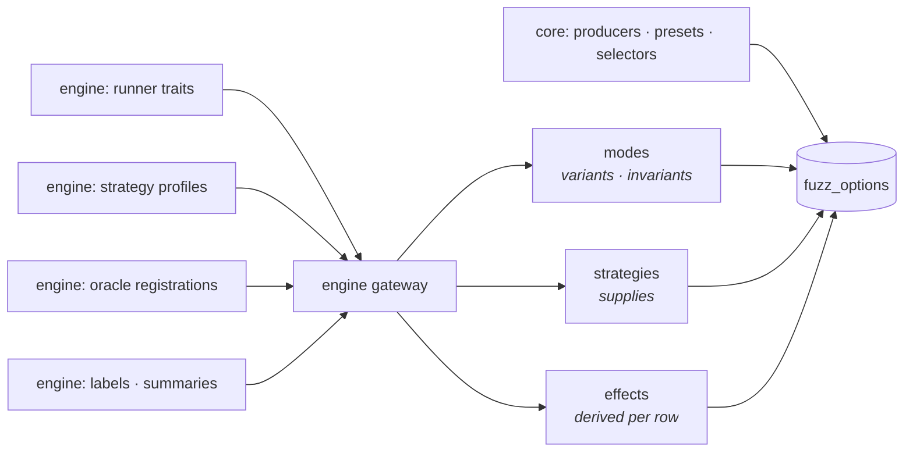

# Fuzz options

A run is shaped by three independent choices: the **execution mode** (how requests
are sent), the **strategy** (which values they carry and which extra checks
judge the answers) and the **producer** (where the endpoint contracts come
from). `fuzz_options`, in the reply to `hello` and to `describe`, says which values
each choice takes, what each one is in words for a person, what each strategy
changes in each mode and what a run can find, so a client builds its run picker
from data instead of a table of its own.

Everything in it is derived. The engine declares its strategy profiles, its
runners' traits, its oracles' registrations and the words for each term
([Strategies and runner traits](../../specforge-engine/strategies.md),
[What a run can find](../../specforge-engine/reportable-invariants.md)); the core
reads them through its engine gateway and computes the rest. Nothing is written
twice, so the published options cannot drift from what a run does.



## The object

`fuzz_options` is required in the `hello` result. `modes`, `strategies`,
`effects` and `phases` come from the engine and are empty when the core runs
without it; `producers`, `presets`, `changes`, `producer_supplies`,
`request_supplies` and `limits` are the core's own and always present, no producer
or parameter meeting a need without the engine.

| Key | Items | What it lists |
| --- | --- | --- |
| `modes` | `{name, label, summary, variants}` | Every `execution` mode, in declaration order. Each variant is `{name, label, summary, phases, honors_examples_per_endpoint, examples_cap, selected_by, requires, invariants, invariants_when}`: `phases` is `plan` when the runner takes every phase the strategy plans, else the phases it takes (`[]` for none); `examples_cap` is the runner's own ceiling when the run asks for no count (`null` for none) |
| `strategies` | `{name, label, summary, phase_split, default_examples_per_endpoint, optional_oracles, attack_families, llm_profile, supplies, omits_read_only, promotes_attack_hints}` | Every [`strategy`](vocabularies.md#strategy), in declaration order |
| `producers` | strings | `none`, `fixture`, `inference` |
| `effects` | `{mode, variant, strategy, producer, changes}` | One row per variant of every mode, every strategy but `default`, and every producer |
| `presets` | `{name, label, summary, runs, requires}` | Named sequences of `{execution, strategy, load, variant}` runs |
| `phases` | `{value, label, summary}` | Every generation phase a `phase_split` or a variant's `phases` can name |
| `changes` | `{value, label}` | Every value an effect's [`changes`](vocabularies.md#changes) can take, in that order |
| `producer_supplies` | `{producer, supplies, meets}` | One row per producer: the [oracle needs](vocabularies.md#oracle-need) the contracts it produces meet (`supplies`), and the values of a variant's [`requires`](#which-variant) they can meet (`meets`); `none` meets neither |
| `request_supplies` | `{need, parameter}` | One row per oracle need a run meets by a parameter it is given, its dotted path among the run's parameters |
| `limits` | `{max_concurrency_default}` | The default of the core's `engine.max_concurrency` option (20): the concurrency a run that leaves `max_concurrency` unset gets, unless the project's config sets the option to another value. A `stress-ladder` step above the value in force when the run starts is refused then, never earlier |

An excerpt of what this core publishes:

```json
"fuzz_options": {
  "modes": [
    {"name": "performance", "label": "Performance", "summary": "Measures how fast …",
     "variants": [
      {"name": "ladder", "label": "Concurrency ladder", "summary": "Sends valid requests …",
       "phases": ["valid"], "honors_examples_per_endpoint": false, "examples_cap": null,
       "selected_by": {"parameter": "load.concurrency_steps", "when": "set"},
       "requires": [],
       "invariants": ["not_a_server_error", "sensitive_data_exposure", "…", "latency_degradation"],
       "invariants_when": [{"need": "rule_witness", "invariants": ["input_validation"]},
                           {"need": "latency_sla", "invariants": ["latency_sla"]}, "…"]}]}
  ],
  "strategies": [
    {"name": "exposure", "label": "Exposure", "summary": "Tries privilege values …",
     "phase_split": {"valid": 0.5, "attack": 0.5},
     "default_examples_per_endpoint": 100, "optional_oracles": [],
     "attack_families": ["auth_bypass"], "llm_profile": "security",
     "supplies": ["poisoned_field", "attack_phase"],
     "omits_read_only": false, "promotes_attack_hints": true}
  ],
  "producers": ["none", "fixture", "inference"],
  "producer_supplies": [{"producer": "none", "supplies": [], "meets": []},
    {"producer": "fixture", "supplies": ["semantic_properties", "rule_witness"],
     "meets": ["access_policies"]}, "…"],
  "request_supplies": [{"need": "latency_sla", "parameter": "load.latency_sla_ms"}],
  "presets": [
    {"name": "stress-ladder", "label": "Stress ladder",
     "summary": "Rising load: who slows down first?", "requires": [],
     "runs": [{"execution": "performance", "strategy": "default", "variant": "ladder",
               "load": {"latency_sla_ms": null, "concurrency_steps": [1, 4, 16],
                        "degradation_tolerance": null}}]}
  ],
  "limits": {"max_concurrency_default": 20}
}
```

## Labels and summaries

Every mode, variant, strategy, phase and preset carries a `label` and a
one-sentence `summary` for a person, and every value of `changes` a `label`. A
client shows them instead of copy of its own. The engine words them, so a count a
summary states is the engine's own and moves with it: the samples of a ladder step,
the broken versions `resilience` sends, the calls of a `stateful` sequence. A
mode's summary says what the mode sends: what a finding means is its invariant's
`summary` in `vocabulary.invariants`, and what the mode needs before it starts is
its variants' `requires`. The handshake's `vocabulary` labels the
[attack families](vocabularies.md#attack-family), the oracle needs and the
[signal causes](vocabularies.md#signal-causes) the same way.

| Mode | Label | What its summary says |
| --- | --- | --- |
| `stateless` | Stateless | Each endpoint on its own: every request generated and judged alone |
| `stateful` | Stateful | Calls chained the way a client does: up to N sequences of about 10 calls, N the examples asked for (100 when none is) |
| `performance` | Performance | How fast clean responses come back under load, and whether they slow down as concurrency rises |
| `resilience` | Resilience | The valid request plus 10 broken versions of it (cut bodies, lying lengths, deep nesting) and 5 repeats of it |
| `auth` | Authorization | Each endpoint sent as the callers its access policy should refuse (other users, anonymous, bad credentials); endpoints with no policy or a public one are skipped |

`performance` has two variants: `flat` (*Steady load*) and `ladder` (*Concurrency
ladder*, at least 120 requests per endpoint at each step). Every other mode has one,
`default`.

## Which variant a run gets { #which-variant }

A run asks for a mode, never a variant. The mode's variant whose `selected_by` is
`null` runs, unless another variant's `selected_by`, `{parameter, when}`, holds.
`parameter` is a dotted path among the run's parameters, and `when` is `set`, the
only condition: the parameter is given. So `performance` runs `ladder` when the
run sets `load.concurrency_steps`, and `flat` otherwise.

`requires` lists what a run of the variant needs besides its parameters before it
can verify anything. It is read off the engine's runners, and it is an open list a
client shows rather than enforces:

| Value | What supplies it |
| --- | --- |
| `identities` | The project's identities file: the callers the run sends requests as. |
| `access_policies` | The endpoints' access policies, which only a producer's contracts declare: a producer meets it when its row of `producer_supplies` lists it in `meets`, as `fixture` and `inference` do. |

Today only `auth` requires anything, and it requires both. An `auth` run with
producer `none` sends nothing: it only crosses an endpoint whose access policy a
contract declares. A client tells a requirement met from the data alone: the
project has an identities file for `identities`, and the run's producer lists the
value in `meets` for `access_policies`.

## What a run can find { #what-a-run-can-find }

A variant's `invariants` are what it can report whatever the strategy, the
producer and the parameters, once its `requires` are met. Each row of `invariants_when`, `{need, invariants}`,
adds what it can report once the run's strategy, its producer or a parameter it
sets meets that [oracle need](vocabularies.md#oracle-need). An invariant more than
one need lets the variant report sits in each of their rows, any one of them being
enough: `input_validation` comes with a strategy that sends a field outside its
schema (`out_of_schema_field`) or with a producer's witness of an inferred rule
(`rule_witness`). A need the runner meets itself is already in `invariants`. A
client works out what a run can find from the data alone:

```
met      = strategy.supplies
         ∪ producer_supplies[producer].supplies
         ∪ { row.need | row ∈ request_supplies, the run sets row.parameter }
can_find = variant.invariants ∪ ⋃ { row.invariants | row ∈ variant.invariants_when, row.need ∈ met }
```

Every list is in vocabulary order (`vocabulary.invariants`,
`vocabulary.oracle_needs`). `can_find` says what the run *can* report, never what
it will find: an invariant outside it is one the run never judges, so its absence
from the findings means nothing. To say what another choice would add, a client
names the rows of `invariants_when` whose need is not in `met`, and who meets each
need.

What the strategies meet:

| Strategy | `supplies` |
| --- | --- |
| `default` | `poisoned_field`, `out_of_schema_field` |
| `security` | `poisoned_field`, `out_of_schema_field`, `attack_phase`, `reflecting_attack` |
| `conformance` | `opt_in`, `poisoned_field`, `out_of_schema_field` |
| `smoke` | — |
| `exposure` | `poisoned_field`, `attack_phase` |

A need in `supplies` may open no row of any variant. `poisoned_field` is one: every
variant that judges the requests it stands for already reports, through a need the
runner meets itself, what it lets an oracle find.

`fixture` and `inference` meet `semantic_properties` and `rule_witness`;
`load.latency_sla_ms` meets `latency_sla`. So `smoke` and `exposure` in
`stateless` report `input_validation` only with a producer, a `stateful` run never
reports an attack-phase invariant, and `reflected_payload` needs `security`.
`resilience` judges without the contract and `auth` sends no caller the endpoint
admits, so neither reports `sensitive_data_exposure`. What each variant
publishes, and the gates that hold every published pair to a real run, are on
[What a run can find](../../specforge-engine/reportable-invariants.md#the-result)
([ADR-199](../../specforge-engine/adr/strategies.md#adr-199)).

## The strategies

| `name` | `phase_split` | `default_examples_per_endpoint` | `optional_oracles` | `attack_families` | `llm_profile` |
| --- | --- | --- | --- | --- | --- |
| `default` | `valid` 0.6 · `boundary` 0.25 · `invalid` 0.15 | 200 | — | `null` | `qa` |
| `security` | `valid` 0.4 · `boundary` 0.2 · `invalid` 0.1 · `attack` 0.25 · `mutation` 0.05 | 200 | — | `null` | `security` |
| `conformance` | `valid` 0.7 · `boundary` 0.3 | 200 | `undeclared_response_field` | `null` | `qa` |
| `smoke` | `valid` 1.0 | 20 | — | `null` | `qa` |
| `exposure` | `valid` 0.5 · `attack` 0.5 | 100 | — | `auth_bypass` | `security` |

`attack_families` `null` allows every family. `llm_profile` is the profile an
`inference` producer infers contracts with ([Inference](../inference.md)).
`security` and `exposure` send `readOnly` fields (`omits_read_only` `false`) and
promote the fields an attack contract hints at (`promotes_attack_hints` `true`);
the other three do neither.

## The effects matrix { #effects }

Each row of `effects` says what one strategy changes **against `default`** in one
runner variant under one producer. `changes` is a list drawn from a closed
vocabulary, in this order; `[]` means the strategy changes nothing there. A row
is published even when its list is empty.

| Code | The row carries it when |
| --- | --- |
| `payloads` | The runner draws from the plan, and the strategy differs from `default` in what it draws: its phases restricted to what the runner takes (with their shares, when it takes every planned phase), its attack families (only where either strategy draws `attack`), its contract type (which changes the fields it may draw, even in `valid`) or whether it omits read-only fields |
| `oracles` | The strategy turns on opt-in oracles `default` does not, and the runner's opt-in oracles judge what it sends |
| `examples` | The examples per endpoint the run would resolve differ from `default`'s, after the runner's own cap; never for a runner that honors no count |
| `llm_profile` | The producer is `inference` and the strategy's LLM profile differs from `default`'s |
| `field_hints` | The producer is `fixture` or `inference`, the runner draws from the plan, and the strategy promotes the fields an attack contract hints at where `default` does not |

Each code is one pure rule over the variant's traits, the two profiles and the
producer (`services/catalog/effects.py`). Comparing every strategy with one
baseline keeps the codes independent: `smoke` in `stateful` changes the example
count and not the payloads, and a single level per row could not say that
([ADR-159](../../specforge-engine/adr/strategies.md#adr-159)).

The matrix this core publishes, under the `none` producer:

| Mode · variant | `security` | `conformance` | `smoke` | `exposure` |
| --- | --- | --- | --- | --- |
| `stateless` · `default` | `payloads` | `payloads`, `oracles` | `payloads`, `examples` | `payloads`, `examples` |
| `stateful` · `default` | `payloads` | `oracles` | `examples` | `payloads` |
| `performance` · `flat` | `payloads` | `payloads`, `oracles` | `payloads`, `examples` | `payloads`, `examples` |
| `performance` · `ladder` | `payloads` | `oracles` | — | `payloads` |
| `resilience` · `default` | `payloads` | `oracles` | — | `payloads` |
| `auth` · `default` | `payloads` | `oracles` | — | `payloads` |

The producers add to it. Under `fixture`, `security` and `exposure` gain
`field_hints` wherever the runner draws from the plan, `resilience` included: its
base request is the endpoint's minimal valid request. Under `inference` they also
gain `llm_profile` in every row. Under `security`, a runner that sends only `valid` values still reads
`payloads`, because the attack contract type widens the fields a valid value may
carry. `exposure` in `stateful` reads no `examples`: the stateful cap of 100
holds both strategies at the same count.

## Presets

A preset is a named sequence of runs, with a `label` and a one-line `summary` of
what it finds out. The protocol has no `preset` parameter: one operation is one
run, so the client runs a preset's entries one after the other, each with the
strategy's default examples per endpoint
([ADR-160](../adr/core.md#adr-160)).

Each run is `{execution, strategy, load, variant}`. `load` is the `load` parameter
to send with it (`null` for none), and `variant` the variant it selects (`null` for
the mode's default). `requires` is what the variant each of its runs takes requires,
in the order of the table above. `variant` is
worked out from the same variants `modes` publishes, by the rule of
[Which variant a run gets](#which-variant): an engine whose `performance` mode
registers no `ladder` variant gives `stress-ladder` a `variant` of `null`.

| Preset | Label | Runs | Summary |
| --- | --- | --- | --- |
| `quick-check` | Quick check | `stateless` + `smoke` | Does every endpoint answer? |
| `contract-audit` | Contract audit | `stateless` + `conformance` | Do responses match the contract? |
| `security-scan` | Security scan | `stateless` + `security` | Attack and mutated inputs on every endpoint. |
| `exposure-scan` | Exposure scan | `stateless` + `exposure` | Can clients set privileged fields like role or is_admin? |
| `load` | Load | `performance` + `default` | Steady load; set a latency limit to judge speed. |
| `full` | Full | `stateless` + `default`, then `stateful` + `default` | Each endpoint alone, then call sequences. |
| `stateful-flows` | Call sequences | `stateful` + `default` | Create, read, change, delete in order. |
| `resilience-check` | Resilience check | `resilience` + `default` | Broken traffic: rejected cleanly? |
| `access-check` | Access check | `auth` + `default`; requires `identities`, `access_policies` | Can a caller reach what its access policy refuses? |
| `stress-ladder` | Stress ladder | `performance` + `default`, `load.concurrency_steps` `[1, 4, 16]`, variant `ladder` | Rising load: who slows down first? |

`access-check` crosses each endpoint as another user, as an anonymous caller and
with bad credentials, not only as another user.

**Send the run's `load` as given.** A preset run that sets a selector's parameter
names the variant it selects: `stress-ladder` sends `load.concurrency_steps` and
says `"variant": "ladder"`. A client that drops `load` runs `flat` instead, so a
client that does not send `load` checks `variant` against the variant it would run
([Which variant a run gets](#which-variant)) and refuses the preset when they
differ.

**An older client is not offered what it would run differently.** A client that
asked `hello` for a version before `0.2.4` reads neither `load` nor `variant`, so
`hello` and `describe` leave out of its `presets` every preset with a run that
carries either. Today that is `stress-ladder`, which such a client would run as
plain `flat` load.

## Choosing a strategy

`fuzz`, `run_pipeline` and `estimate_inference` take `strategy`, one of the five
canonical values; omitted, it is `default`. Any other value is refused
`INVALID_PARAMS`, and the `started` event of a run carries the value it runs with
([ADR-155](../adr/protocol.md#adr-155), [ADR-189](../adr/protocol.md#adr-189)).

An analysis carries it as `strategy`, the canonical value, in `list_analyses`,
`get_analysis`, `get_run`'s `analysis` and the report document's `analysis`.

## Examples per endpoint { #examples-per-endpoint }

`fuzz` and `run_pipeline` take `examples_per_endpoint`, an integer of at least 1:
how many examples the run asks of each endpoint. One rule resolves it, in the core,
before the engine compiles anything (`services/fuzz/examples.py`):

1. A runner that honors no count resolves to `null`. Asked explicitly of one, the
   run is refused `INVALID_PARAMS`: the `performance` ladder, `auth` and
   `resilience` send a fixed set of requests, and a count they would ignore is
   never accepted silently.
2. A requested count wins, over the runner's cap too.
3. Otherwise, the strategy's `default_examples_per_endpoint`, held under the
   runner's cap when it has one.

A count below 1 is refused `INVALID_PARAMS`. The resolved count reaches the
engine as the endpoint budget's `max_examples` and, in `stateful`, as
`StatefulOptions.max_examples` ([ADR-161](../adr/core.md#adr-161)).

What a run resolves without the parameter:

| Mode · variant | `default` | `security` | `conformance` | `smoke` | `exposure` |
| --- | --- | --- | --- | --- | --- |
| `stateless`, `performance` flat | 200 | 200 | 200 | 20 | 100 |
| `stateful` (cap 100) | 100 | 100 | 100 | 20 | 100 |
| `performance` ladder, `auth`, `resilience` | `null` | `null` | `null` | `null` | `null` |

The endpoint's risk score still weights its budget, so a single endpoint may plan
more or fewer than the resolved count.

The analysis records the resolved count as `examples_per_endpoint`, beside
`strategy`; it is `null` when the runner honors no count and for an analysis
stored before the count was recorded. `compare_runs` reports two runs of different
strategies with the caveat `strategy_differs`, and two runs that recorded different
counts with `examples_differs`; either makes a defect missing from the later run
`inconclusive`, never `possibly_resolved` ([caveats](vocabularies.md#caveats)).
