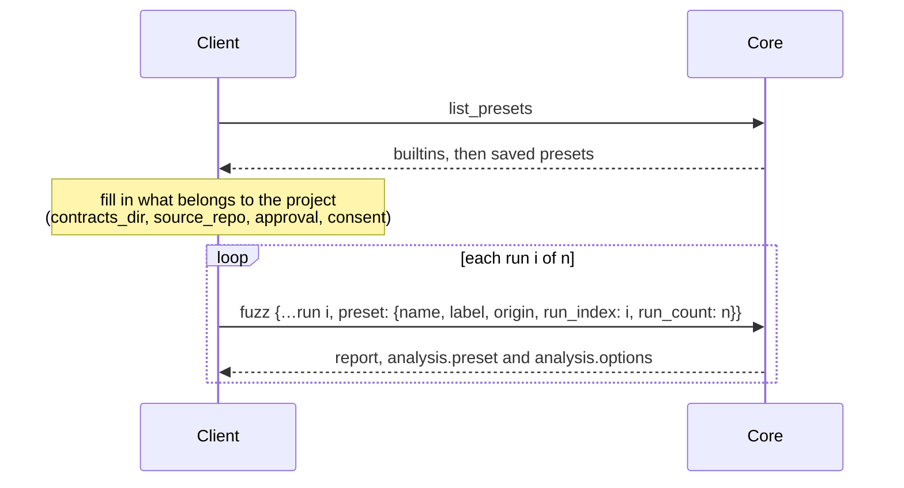

# Saved presets

A user keeps presets of their own beside the builtins that
[`fuzz_options.presets`](fuzz-options.md#presets) publishes. A saved preset is a
named sequence of one to five runs, each keeping **how** it is run and never
**what** it runs against, so one preset serves every project. Three operations
of the `presets` family list, save and delete them; a `preset` parameter on
`fuzz` and `run_pipeline` tags each run with the preset it belongs to, and the
run's analysis answers that tag back with the options the run used.

The core never runs a preset. As with a builtin, the client chains a preset's
runs into `fuzz` calls, one call per run
([ADR-160](../adr/core.md#adr-160), [ADR-218](../adr/core.md#adr-218)).



## The operations { #the-operations }

None needs an open project: saved presets live in the user's own store (their
data directory, or `SPECFORGE_DATA_DIR`), so every project sees them.
`fuzz_options.presets` in `hello` and `describe` still lists the builtins alone; a
client that offers saved presets calls `list_presets`.

| Operation | `requires` | Parameters | Answers |
| --- | --- | --- | --- |
| `list_presets` | none | none | Every preset: the builtins in `fuzz_options.presets` order, then the saved ones by `name` |
| `save_preset` | none | `name`, `label`, `summary` (default `""`), `runs`, `replace` (default `false`) | The preset as saved, in the shape `list_presets` lists it |
| `delete_preset` | none; destructive | `name` | The deleted preset, as it was |

A core without storage lists the builtins alone, and refuses `save_preset` and
`delete_preset` with `DEPENDENCY_UNAVAILABLE` (`data.dependency` `storage`).
`hello` says so beforehand in [`capabilities.storage`](handshake.md#capabilities),
so a client can hide saving before it is refused. A core without the fuzzing stack
refuses `save_preset` with `DEPENDENCY_UNAVAILABLE` too, as it refuses `fuzz`: it
could not check the runs.

## A listed preset { #listed-preset }

A listed preset is a `fuzz_options.presets` entry with three more keys:
`origin`, `created_at` and `updated_at`.

| Field | Meaning |
| --- | --- |
| `name`, `label`, `summary` | As in `fuzz_options.presets`. |
| `origin` | `builtin` or `user`. |
| `runs` | The preset's runs, in order ([below](#listed-run)). |
| `requires`, `holds_back` | Derived for a saved preset exactly as for a builtin ([Fuzz options](fuzz-options.md#presets)), but for a run that keeps `allow_side_effects: true`: it lifts every hold (`fuzz_options.holds_lifted_by`), so `holds_back` leaves out what that run alone would hold. |
| `recommended` | As in `fuzz_options.presets`: `true` for `standard` alone, always `false` for a saved preset. |
| `created_at`, `updated_at` | When a saved preset was saved first and last, as UTC ISO 8601 text with an offset (`2026-11-14T21:03:11+00:00`); `null` for a builtin. |

### A listed run { #listed-run }

Each run is the catalog's run plus the `fuzz` parameters a saved run keeps.

| Field | Meaning |
| --- | --- |
| `execution`, `strategy`, `load` | As in `fuzz`. |
| `variant`, `asks_for` | Derived for a saved run exactly as for a builtin's ([Which variant a run gets](fuzz-options.md#which-variant), [What a preset run asks for](fuzz-options.md#asks-for)). |
| `examples_per_endpoint`, `max_concurrency`, `timeout_s`, `deadline_ms` | As in `fuzz`; `null` when the run leaves them to the project and the strategy. |
| `allow_side_effects` | As in `fuzz`; `false` unless saved `true`. |
| `producer` | `{kind, max_cost_usd}`: the producer the run asks for and its spend cap (`null` for none); `null` for a run that checks the spec alone. |

A builtin's kept parameters are all `null`, and its `allow_side_effects` is
`false`.

```json
{"jsonrpc":"2.0","id":7,"method":"list_presets","params":{}}
```

```json
{"jsonrpc":"2.0","id":7,"result":[
  {"name":"standard","label":"Standard check",
   "summary":"Each endpoint alone, with every kind of input.",
   "origin":"builtin","created_at":null,"updated_at":null,
   "runs":[{"execution":"stateless","strategy":"default","load":null,"variant":null,
            "asks_for":[],"examples_per_endpoint":null,"max_concurrency":null,
            "timeout_s":null,"deadline_ms":null,"allow_side_effects":false,
            "producer":null}],
   "requires":[],"holds_back":["external_side_effects"],"recommended":true},
  …
  {"name":"nightly-security","label":"Nightly security",
   "summary":"Security with the LLM, capped at two dollars.",
   "origin":"user","created_at":"2026-11-14T21:03:11+00:00",
   "updated_at":"2026-11-14T21:03:11+00:00",
   "runs":[{"execution":"stateless","strategy":"security","load":null,"variant":null,
            "asks_for":[],"examples_per_endpoint":200,"max_concurrency":null,
            "timeout_s":null,"deadline_ms":null,"allow_side_effects":false,
            "producer":{"kind":"inference","max_cost_usd":2.0}}],
   "requires":[],"holds_back":["external_side_effects"],"recommended":false}
]}
```

## Saving a preset { #save-preset }

```json
{"jsonrpc":"2.0","id":8,"method":"save_preset","params":{
  "name":"nightly-security","label":"Nightly security",
  "summary":"Security with the LLM, capped at two dollars.",
  "runs":[{"strategy":"security","examples_per_endpoint":200,
           "producer":{"kind":"inference","max_cost_usd":2.0}}]}}
```

A run takes the fields of [a listed run](#listed-run) that a client sets:
`execution` and `strategy` (default `stateless` and `default`, as in `fuzz`),
`load`, `examples_per_endpoint`, `max_concurrency`, `timeout_s`, `deadline_ms`,
`allow_side_effects` and `producer` (`{kind, max_cost_usd}`). `variant` and
`asks_for` are derived, never sent.

| Parameter | Rule |
| --- | --- |
| `name` | Lowercase letters and digits joined by single hyphens (`[a-z0-9]+(-[a-z0-9]+)*`), up to 48 characters. |
| `label` | One line of 1 to 60 characters, not blank. |
| `summary` | One line of up to 200 characters. |
| `runs` | One to five runs, each refused for every setting `fuzz` refuses before it runs. |
| `replace` | `true` overwrites a saved preset of the same name, which keeps its `created_at`. |

One line means no line feed or carriage return anywhere, at the end included.

**A run is refused for everything `fuzz` refuses before it runs.** Each run goes
through the very checks `fuzz` applies before it runs, so
a preset that saves is a preset a client can send. A refusal is `INVALID_PARAMS`
with the reason `fuzz` gives and `data.parameter` the path to what it refuses: the
field when the rule names one, else the run (`runs[0]`).

| Refused | `data.parameter` |
| --- | --- |
| A `load` outside execution mode `performance`, or a ladder or latency limit the engine refuses | `runs[N].load` |
| An `examples_per_endpoint` on a runner that honors no count (`resilience`, `auth`, the `performance` ladder), or below 1 | `runs[N].examples_per_endpoint` |
| A `max_concurrency` below 1 | `runs[N].max_concurrency` |
| A `timeout_s` the engine refuses | `runs[N].timeout_s` |
| A `deadline_ms` below 1 | `runs[N].deadline_ms` |
| A ladder step above the run's own `max_concurrency` | `runs[N].load.concurrency_steps` |
| A `max_cost_usd` not above `0`, or with a producer other than `inference` | `runs[N].producer.max_cost_usd` |
| A combination that contradicts itself | `runs[N]` |

A run that leaves `max_concurrency` to the project is held to the project's when
it is sent. `fuzz` refuses the same settings with the same reason and the same
`data.parameter`, without the `runs[N].` prefix
([settings refused before a run](operations.md#settings-refused)). A `name`,
`label`, `summary` or `runs` that breaks its rule is refused the same way, with
`data.parameter` that parameter.

**A run keeps how it is run, never what it runs against.** These `fuzz`
parameters are unknown fields to `save_preset`, refused `INVALID_PARAMS`, the
message naming the run and the field (`runs[0]`, `target`):

| Left out | Why |
| --- | --- |
| `target`, `endpoint`, `method`, `base_url`, `identities_path`, `project_name`, `save` | They point a run at one project's API. |
| `preset` | It says which preset run a run is; the client sets it when it runs one ([below](#preset-parameter)). |
| `producer.contracts_dir`, `producer.source_repo`, `producer.refresh`, `producer.approval_token` | They belong to one project or one estimate. |

**A name is unique across both origins.** A `name` a builtin has is refused
`PRESET_NAME_TAKEN` with `data.origin` `builtin`, even with `replace`. A `name` a
saved preset has is refused `PRESET_NAME_TAKEN` with `data.origin` `user`, unless
`replace` is `true`.

**`replace: true` overwrites for good.** The saved preset it replaces cannot be
brought back, so a client confirms it as it confirms a destructive action.

## A preset this core cannot read { #unreadable }

A saved run is read back with a field it was stored without at that field's
default. A saved preset whose runs this core cannot read at all (a field it does
not keep, or a value it cannot take, such as one a newer core wrote) is still
listed, after the builtins and by `name` like any other, with its `name`, `label`,
`summary` and save times, and `runs`, `requires` and `holds_back` empty.

- **`runs: []` marks it.** A preset this core can read holds one run at least, so
  an empty `runs` is never a readable preset.
- **A client shows it as unreadable and never chains it.** There is nothing to
  send.
- **It can be deleted.** `delete_preset` deletes it by name and answers it in the
  same shape.
- **It never hides the rest.** The other saved presets and the builtins are listed
  as usual. `PRESETS_STORE_FAILED` is a store that could not be read at all.

## Deleting a preset { #delete-preset }

```json
{"jsonrpc":"2.0","id":9,"method":"delete_preset","params":{"name":"nightly-security"}}
```

`delete_preset` is `destructive`, so a client confirms it before sending. It
answers the preset as it was. Builtins
are read-only: deleting one is refused `PRESET_READ_ONLY`. A name no saved preset
has is `PRESET_NOT_FOUND`.

## Errors { #errors }

| `error.code` | `data.code` | When | `data` |
| ---: | --- | --- | --- |
| -32602 | `INVALID_PARAMS` | A parameter breaks its rule, a run `fuzz` would refuse, a field a run never keeps, a line break in a `label` or `summary` | `parameter`, as a path, when a rule refuses it |
| -32602 | `PRESET_NAME_TAKEN` | `save_preset` with a builtin's name, or a saved preset's without `replace` | `name`, `origin` |
| -32602 | `PRESET_READ_ONLY` | `delete_preset` of a builtin | `name` |
| -32000 | `PRESET_NOT_FOUND` | `delete_preset` of a name no saved preset has | `name` |
| -32000 | `PRESETS_STORE_FAILED` | The store could not be read at all, or written; never one preset it cannot read ([above](#unreadable)) | `reason` |
| -32000 | `DEPENDENCY_UNAVAILABLE` | `save_preset` or `delete_preset` on a core without storage, or `save_preset` on one without the fuzzing stack | `dependency` |

See [Errors](errors.md#presets) for how the two integers are chosen.

## Running a saved preset { #running }

A client runs a saved preset as it runs a builtin: one `fuzz` per run, in order,
each with the run's fields as listed. What the preset leaves out, the client
supplies from the project at hand.

- **A producer needs the project's source.** A run with `producer.kind`
  `fixture` needs `contracts_dir`; one with `inference` needs `source_repo`, and
  is estimated and approved as any run with an LLM
  ([The `producer` object](operations.md#producer)).
- **A kept `allow_side_effects: true` is not consent.** The client shows it and
  asks before it sends each `fuzz` with it. Nor is a stored
  `analysis.options.allow_side_effects: true` sent back to repeat a run
  ([below](#run-options)).
- **The target is the project's.** `base_url`, `identities_path` and the endpoint
  selection come from the run the user is setting up, never from the preset.

### The `preset` parameter { #preset-parameter }

`fuzz` and `run_pipeline` take an optional `preset`, which preset the run is one
of, as the client chains it. Omitted, the run is a custom one. The core never
interprets it: it checks its shape, keeps it with the run and answers it back as
[`analysis.preset`](#run-options).

| Field | Rule |
| --- | --- |
| `name` | A preset's name rule. It need not name a preset that exists, so a run of a deleted preset still counts. |
| `label` | One line of 1 to 60 characters, not blank: what a client shows once the preset is gone. |
| `origin` | `builtin` or `user`. |
| `run_index` | This run's place in the chain, at least `0` and below `run_count`. |
| `run_count` | How many runs the chain holds, 1 to 5. |

A malformed one is refused `INVALID_PARAMS` with `data.parameter` the field, such
as `preset.run_index`.

```json
{"jsonrpc":"2.0","id":10,"method":"fuzz","params":{
  "strategy":"security","examples_per_endpoint":200,
  "producer":{"kind":"inference","max_cost_usd":2.0,
              "source_repo":".","approval_token":"…"},
  "preset":{"name":"nightly-security","label":"Nightly security",
            "origin":"user","run_index":0,"run_count":1}}}
```

## What a run keeps: `analysis.preset` and `analysis.options` { #run-options }

Every analysis carries `preset` and `options` (report `1.29`): in the report
document `fuzz`, `replay` and `run_pipeline` answer with, in `get_run`'s and
`get_analysis`'s `analysis`, and in each row of `list_analyses`.

**`preset`** is the `preset` the run was asked with, as it came, or `null` for a
custom run and for a run stored before it was kept.

**`options`** is what the analysis's original run used, after the project's and
the strategy's defaults. A replay of the analysis shows those of the run it
replays, not the `base_url` or the `allow_side_effects` the replay itself was sent
with.

| Field | Meaning |
| --- | --- |
| `examples_per_endpoint` | The count the run asked of each endpoint, `null` when its runner honors none ([Examples per endpoint](fuzz-options.md#examples-per-endpoint)). |
| `max_concurrency`, `timeout_s` | As the run sent its requests. |
| `deadline_ms` | The time budget per endpoint as asked, `null` for no budget. |
| `allow_side_effects` | Whether the run lifted the safety guard. |
| `base_url_override` | The `base_url` asked for this run alone, without its credentials; `null` when the run used the project's. |
| `producer` | `{kind, max_cost_usd}`; `null` without a producer, and `max_cost_usd` `null` without a cap. |

```json
"analysis":{…,
  "preset":{"name":"nightly-security","label":"Nightly security","origin":"user",
            "run_index":0,"run_count":1},
  "options":{"examples_per_endpoint":200,"max_concurrency":20,"timeout_s":10.0,
             "deadline_ms":null,"allow_side_effects":false,"base_url_override":null,
             "producer":{"kind":"inference","max_cost_usd":2.0}}}
```

**Sending these options back repeats the original run.** A client that sends
`options` back, with the same `preset`, runs again with the same values even after
the project's configuration changed. A stored `allow_side_effects: true` is not
consent, as a saved preset's is not: the client shows it and asks before it sends
the run again.

A run stored before these were kept reads `preset` `null`, and `options` with what
its analysis knew: `null` in `deadline_ms`, `base_url_override` and
`producer.max_cost_usd`.
