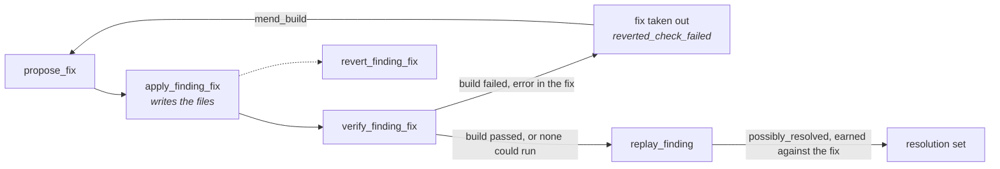

# Replay and fixes

A finding is checked, explained and fixed one at a time. `replay_finding` re-sends
the one request a finding was reported from; `inspect_service` says what answers
on the API's port and whether it can be rebuilt; `set_finding_trace` and
`inspect_finding_source` say what is known about the code that failed; and
`apply_finding_fix`, `verify_finding_fix` and `revert_finding_fix` put a proposed
fix in the tree, build and replay it, and take it out. Each operation's family and
`requires` are on [Operations](operations.md); the options they read are the
`replay.*` and `fix.*` rows of [Configuration](../configuration.md#the-options).

## `replay_finding` { #replay-finding }

`replay_finding` takes `finding_id`, `rebuild` (default `false`), and
`identities_path`, `base_url` and `allow_side_effects` as `replay` takes them. It
finds the finding's request in its analysis's recorded trace and sends it at once,
under the analysis's recipe, behind up to two recorded reads that vouch for the
server's environment, its **witnesses**: how a fix applied since is checked. How
the verdict is reached, and what each `inconclusive` reason asks of you, is on
[Finding replay verdicts](finding-replay.md). An unknown finding is
`FINDING_NOT_FOUND`.

A confirmed finding of a `stateful` run stored from protocol `0.2.6` on, whose
every step reached the wire, is replayed through its minimal sequence: its steps
in order, each bound to the values the steps before it returned this time, the
finding's own request last, and no witnesses of its own
([stateful findings](finding-replay.md#stateful)).

Any other finding that needed earlier requests to build its state, a `refuted`
one, one whose analysis's trace was pruned, and one whose request is not in the
trace are `REPLAY_NOT_REPRODUCIBLE`, with `data.reason` `stateful`, `refuted`,
`trace_pruned` or `not_in_trace`. A `stateful` finding stored before `0.2.6`, and
an unconfirmed one, are refused as `stateful`. Each finding announces that
answer ahead in [`replay_alone`](run-detail.md#replay-alone), by the same rule. The
trace is looked up before the consent the recording needs is checked: a finding
whose request is not there is `REPLAY_NOT_REPRODUCIBLE` even when the call also
lacks `allow_side_effects`. A recording that needs consent, called without it, is
then [`SIDE_EFFECTS_CONSENT_REQUIRED`](operations.md#replay-consent).

A `flaky` or `unverified` finding of a stateless run has no minimal payload, so its
replay re-sends the first recorded request at its endpoint, in its phase, under its
identity and with its status that broke an invariant: the one it was first seen in.
A `present` verdict then says that request still breaks a rule, not that a
reproducer was confirmed.

With `rebuild`, the service is built and started again first, with
`replay.rebuild_command`, else Docker Compose from the container's labels, and the
replay waits until the URL answers HTTP. A rebuild that fails is `REBUILD_FAILED`
(`reason` `exit_code`, `timed_out` or `not_ready`, `command`, `exit_code`, the last
40 lines in `output`) and no request is sent. A service nothing can rebuild is
replayed anyway.

| Field | Holds |
| --- | --- |
| `status` | `completed`, or `cancelled` while rebuilding: no request sent, `analysis_id` `null`, `verdict` `inconclusive`, `fidelity` `none`. |
| `finding_id`, `analysis_id` | The finding, and the analysis whose trace held its request. |
| `verdict` | [`present`](vocabularies.md#replay-verdicts) while the request still breaks the rule, `possibly_resolved` once it answers otherwise and nothing gives a reason to doubt it, `inconclusive` otherwise ([how it is reached](finding-replay.md#verdict)). |
| `inconclusive_reason` | Why the replay could not tell: one of the seven [reasons](vocabularies.md#inconclusive-reason); `null` unless `verdict` is `inconclusive`. |
| `judged` | What the verdict judged: `oracle_scope`, `requests_sent`, `controls_resent`. `null` only when cancelled. |
| `witnesses` | The recorded reads sent before the finding's request, each with its recorded and observed status and whether it `diverged` ([what is sent](finding-replay.md#what-it-sends)). `[]` for a finding replayed through its sequence. |
| `steps` | For a `stateful` finding replayed through its sequence, every step as it was sent again: `sequence`, `method`, `path`, `recorded_status`, `observed_status`, `rebound`, `diverged` ([stateful findings](finding-replay.md#stateful)). `[]` for a finding whose request is sent alone. |
| `failed_step` | The `sequence` of the step that kept a sequence's replay from going on; `null` otherwise. |
| `recorded_status`, `observed_status` | The status recorded and the one received. |
| `fidelity`, `run_status`, `duration_ms` | How faithful the re-send was (`reduced` when a witness diverged), how it ended (the worse of the witnesses' run and the finding's), and how long it took. |
| `acceptance` | For a finding recorded as a crash: `expected_statuses` (the 4xx the contract declares for the operation), `observed_status` and `met`. `met` is `false` for a `401` or `403` to a request recorded with credentials that nothing proves still pass ([credentials](finding-replay.md#credentials)). `null` for any other finding. |
| `server_log` | `not_configured`, `captured`, `no_trace` or `unavailable`: whether the server's log was read while the request was in flight. `unavailable` when no witness answered or one diverged. |
| `server_trace`, `server_log_detail` | The stack trace kept as the finding's evidence, and why the log could not be read or the trace kept. |
| `service` | What answered on the port; see [`inspect_service`](#inspect-service). |
| `rebuild` | `status` (`not_requested`, `succeeded`, `unavailable` with `reason`, `cancelled`), `runner` (`compose` or `command`), `command`, `duration_ms`. |
| `fix_applied_at`, `stale_reason` | When the newest fix applied over the finding's handler files was applied, the finding's own or another finding's, and why the server runs the code from before it: `trace_before_fix`, else `image_before_fix`, else `started_before_fix`; `null` when it does not ([stale builds](finding-replay.md#stale)). |
| `stale_target` | `fix_id`, `file`, `line`, `line_after_fix`: the server logged a trace naming a line one of those fixes, the newest first, moved or rewrote. `null` otherwise. |
| `resolution` | What resolves the finding once this replay earned `possibly_resolved` against a fix in its tree: `fix_id`, `fix_finding_id`, `replayed_at`. `null` otherwise. |
| `exchange` | What the finding's request sent and got back this time, in `get_finding`'s evidence shape and redacted the same way; `null` when the request was not sent or the stored contract cannot be read ([the exchange](finding-replay.md#exchange)). |

The log read is `replay.log_container` when set, else `replay.log_file`, else the
container found publishing the port, else, on Linux, the files a host process on
the port writes its output to. A replay is kept against the finding's own applied
fix, else the newest other finding's applied fix over its handler's files; a
revert of that fix, or a later replay that does not earn `possibly_resolved`,
takes `resolution` away.

## `inspect_service` { #inspect-service }

`inspect_service` takes an optional `base_url` (else the project's) and
`finding_id`, and sends nothing. It looks for a container publishing the URL's port
before a host process listening on it, never by a container name.

| Field | Holds |
| --- | --- |
| `service` | `status` (`found`; `not_found`; `not_local`, the URL names another machine; `unavailable`, nothing could look), `port`, `runtime` (`docker` or `host`), `name` (the container's, or the executable's; never a command line), `compose_service`, `started_at`, `image_created_at`, `source_mounted`, `hot_reload` and `hot_reload_source` (`config` or `command`), `detail`. |
| `rebuild_available`, `rebuild_command`, `rebuild_unavailable_reason` | Whether `replay_finding` could rebuild it, with what, or why not. |
| `fix_applied_at`, `stale_reason` | With `finding_id`: whether the service runs the code from before the newest fix applied over that finding's handler files, its own or another finding's, before any replay; as `replay_finding` answers them. |

## `set_finding_trace` { #set-finding-trace }

`set_finding_trace` takes `finding_id` and `trace`, for a server whose log the core
cannot read. A stack trace is kept as a captured one is: its message and frames,
the credentials of the identities file and the headers blanked as `***`, read by
the next `explain_finding` and `propose_fix`. Text with no stack frame is kept as
the finding's `notes`, its first lines blanked the same way, which the next
`propose_fix` shows the model; `server_trace` is then `null`. Blank text is
`INVALID_PARAMS`. The answer carries `finding_id`, `server_trace`, `source`
(`manual`) and `notes`.

## `inspect_finding_source` { #inspect-finding-source }

`inspect_finding_source` takes `finding_id` and answers whether its handler code
can be reached, before an explanation with code or a fix needs it. The tree is the
one the finding's run traced, else the project root; the session's analysis answers
when it traced that tree, otherwise the endpoint alone is traced, and the session's
analysis is left as it was.

| Field | Holds |
| --- | --- |
| `finding_id`, `source` | Whether the code can be reached. Without it the finding is diagnosed and explained, never fixed. |
| `reason` | Why not, as `STATIC_ANALYSIS_REQUIRED` would say it; `null` when it can. |
| `tree`, `files` | The tree a fix is applied to, and the handler's files relative to it. |
| `server_trace` | Whether the server's stack trace is known, captured by a replay or pasted. |
| `notes` | What was last pasted about the finding with no stack frame in it. |
| `covering_fixes` | Other findings' applied fixes that edit the handler's files, oldest first: `finding_id`, `fix_id`, `files`. |
| `rule_source` | Where the code states the rule the finding cites: `file` (relative to the same `tree`), `function`, `start_line`, `end_line` (counted from 1), so a client opens the file at the rule in one call. `null` unless the rule's [`grounds.origin`](run-detail.md#grounds) is `code`; present even when the handler cannot be reached. |

## The code the model sees { #code-shown }

`explain_finding` with `include_code`, and `propose_fix`, send the model excerpts
of the tree the finding's run traced: the handler and what it calls, where the
server crashed when its stack trace is known, and the places that call the crashing
function. They also send the lines around **where the code registers the finding's
route**, eight on each side, when no other excerpt shows them already. A request
the router refuses, such as a `404` no handler answered, can then be explained and
fixed where it fails.

- **Which registration.** A route of the finding's method whose path is exactly a
  server path plus the finding's path, each parameter matched whatever it is named
  or however it is written (`{id}`, `:id`, `<id>`).
- **Which server path.** The one the finding's request URL went to: what its path
  holds before the finding's path. When the finding has no URL, or its URL does not
  end in the finding's path, every server path the contract's `servers` declare for
  the operation is tried, and routes matching under more than one add nothing.
- **When nothing matches exactly.** The one route whose path ends in the finding's
  path counts, and only when that path has a literal segment: the code may mount a
  base path the contract leaves out. Two such routes, or a path made only of
  parameters, add nothing rather than a wrong route.
- **Which frameworks.** A router that registers routes in a table or a group, as
  gin does, adds an excerpt. A route declared by a decorator on its handler, as in
  FastAPI or Flask, adds nothing: the handler's excerpt already shows it.
- **What it costs.** `estimate_finding_explanation` and `estimate_finding_fix`
  price the longer prompt: a registration in gin's RealWorld example adds about 240
  input tokens for an Anthropic model, and `propose_fix` also sends that file's
  header when no other excerpt shows the file.
- **The cache.** The code is part of the explanation's and the fix's cache key, so
  a finding whose registration is shown is explained and fixed again once.

## Fixing a finding { #fixing-a-finding }

A fix goes through four operations: `propose_fix` asks the model for it,
`apply_finding_fix` writes it, `verify_finding_fix` builds it and replays the
finding, `revert_finding_fix` takes it out.

- **`apply_finding_fix`** takes `finding_id`, `fix_id` (else the current fix) and
  `create_backup` (default `true`). In a Git work tree the diff goes through
  `git apply --check`, then `git apply`; elsewhere each edit is checked against its
  file and replaced, with a `.bak` beside it unless `create_backup` is false. It
  answers `status` (`applied` or `conflict`, the tree untouched), `strategy` (`git`
  or `direct_replace`), `tree`, `modified_files`, `backups` and `details`. A fix with
  nothing to apply is `FIX_EMPTY_OR_UNAPPLICABLE`.
- **`verify_finding_fix`** takes `finding_id`, `rebuild` (default `false`), and
  `identities_path`, `base_url` and `allow_side_effects` as `replay_finding` takes
  them. It builds the applied fix once, by one of four runners (`build.runner`):
  with `rebuild`, `rebuild_command` (`replay.rebuild_command`) or `compose`
  (`docker compose up -d --build` of the service on the port), which also restart
  the service; otherwise, or when nothing can rebuild it, `check_command`
  (`fix.check_command`) or `host` (the toolchain the manifest nearest the edited
  file names). A build that passed, or none that could run, is followed by the
  replay `replay_finding` sends. A replay that would be refused is refused before
  anything is built, with the same code: `REPLAY_NOT_REPRODUCIBLE` for a `refuted`
  or a stateful finding, or one whose request is not in the trace, and
  `SIDE_EFFECTS_CONSENT_REQUIRED` for a recording that needs consent.
- **`revert_finding_fix`** takes `finding_id` and `fix_id`, undoes the fix the same
  two ways, and answers `reverted` or `conflict`.

**The code is read again after a fix.** Once a fix is applied, reverted, or taken
out because its build failed, the core forgets what it read of the files the fix
rewrote: the static analysis caches, and the current analysis's endpoints whose
code came from one of them. The next explanation or fix reads the code as it is
now, line numbers included.

`verify_finding_fix` answers:

| Field | Holds |
| --- | --- |
| `status` | `completed` or `cancelled`; cancelling stops the build and leaves the fix in. |
| `finding_id`, `fix_id`, `details` | The finding, its applied fix, and a note for a person. |
| `fix_status` | `applied`, or `reverted_check_failed` when a compiler error is in a file the fix edited and the fix was taken out again. Any other failure leaves the fix in. |
| `build` | `status` (`passed`, `failed`, `skipped`), `runner`, `command`, `reason` (why skipped), `failure` (`exit_code`, `timed_out`, `not_ready`), `output` (the last 40 lines), `errors` (the compiler's lines at the tree's paths), `in_fix`, `repeated` (the same errors the previous refused fix had), `duration_ms`. `null` when cancelled. |
| `replay` | `replay_finding`'s answer; `null` when the build failed or the operation was cancelled. |

## Explaining and fixing an unconfirmed finding { #unconfirmed }

`estimate_finding_explanation`, `explain_finding`, `estimate_finding_fix` and
`propose_fix` take a finding in any state: `confirmed`, `flaky`, `unverified` or
`refuted`. The wire is the same for all four states; what changes is what the model
is told.

- **The model is told what the state means.** A `refuted` finding is probably not a
  bug: its control request showed the same signal without the suspicious input. A
  `flaky` or `unverified` one is a possible defect that could not be confirmed. A
  `confirmed` one is presented as a defect. The explanation reads accordingly, so a
  client needs no warning of its own.
- **No reproducer, no payload.** An unconfirmed finding usually has no minimal
  payload; the model is told it was not kept.
- **A refuted finding's fix may be empty.** `propose_fix` may conclude there is
  nothing to change: the answer is `completed`, the fix's `diff` is `""` and its
  `files` `[]`, and `rationale` says why. Show `rationale` as the answer and offer
  no "apply": `apply_finding_fix` refuses such a fix with
  `FIX_EMPTY_OR_UNAPPLICABLE`.
- **Verifying needs a replay.** `verify_finding_fix` refuses a `refuted` or a
  stateful finding with `REPLAY_NOT_REPRODUCIBLE` before anything is built, as
  `replay_finding` does.
- **The state and the control are part of the cache key.** An explanation, the
  fixed template's one included, and a fix are reused only for a finding in the
  same state, judged by the same kind of control: whether it had one, where its
  answer came from, and whether it failed, never the status it got back. A
  `refuted` finding never reuses what a `confirmed` one with the same signature
  was answered, and a chaos attack whose clean request after it failed too never
  reuses what one that recovered was answered.
- **Stored answers are paid for once more.** The prompts carry the state and the
  control, so explanations and fixes a model gave before are asked for again the
  first time they are needed; the fixed template's explanations are rewritten at no
  cost.

## Mending a fix the build refused { #mend-build }

What a failed build refused the fix with is kept on the proposed fix as
`build_failure`, cleared once a build of it passes. `propose_fix` and
`estimate_finding_fix` take `mend_build` (default `false`): the model is shown the
current fix's diff and its `build_failure` and asked for the whole fix again. A
current fix no build refused, or one still in the tree, is `INVALID_PARAMS`.
