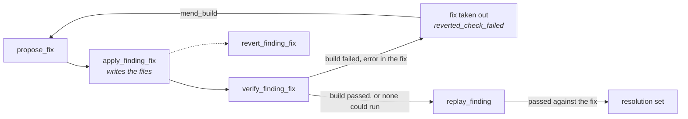

# Replay and fixes

A finding is checked, explained and fixed one at a time. `replay_finding` re-sends
the one request a finding was reported from; `inspect_service` says what answers
on the API's port and whether it can be rebuilt; `set_finding_trace` and
`inspect_finding_source` say what is known about the code that failed; and
`apply_finding_fix`, `verify_finding_fix` and `revert_finding_fix` put a proposed
fix in the tree, build and replay it, and take it out. Each operation's family and
`requires` are on [Operations](operations.md); the options they read are the
`replay.*` and `fix.*` rows of [Configuration](../configuration.md#the-options).

## `replay_finding` { #replay-finding }

`replay_finding` takes `finding_id`, `rebuild` (default `false`), and
`identities_path`, `base_url` and `allow_side_effects` as `replay` takes them. It
finds the finding's request in its analysis's recorded trace and sends it alone,
at once, under the analysis's recipe: how a fix applied since is checked. A finding
that needed earlier requests to build its state, or whose request is not in the
trace, is `REPLAY_NOT_REPRODUCIBLE`, and so is a `refuted` one; an unknown one is
`FINDING_NOT_FOUND`.

A `flaky` or `unverified` finding of a stateless run has no minimal payload, so its
replay re-sends the first recorded request at its endpoint, in its phase, under its
identity and with its status that broke an invariant: the one it was first seen in.
A `present` verdict then says that request still breaks a rule, not that a
reproducer was confirmed.

With `rebuild`, the service is built and started again first, with
`replay.rebuild_command`, else Docker Compose from the container's labels, and the
replay waits until the URL answers HTTP. A rebuild that fails is `REBUILD_FAILED`
(`reason` `exit_code`, `timed_out` or `not_ready`, `command`, `exit_code`, the last
40 lines in `output`) and no request is sent. A service nothing can rebuild is
replayed anyway.

| Field | Holds |
| --- | --- |
| `status` | `completed`, or `cancelled` while rebuilding: no request sent, `analysis_id` `null`, `verdict` `inconclusive`, `fidelity` `none`. |
| `finding_id`, `analysis_id` | The finding, and the analysis whose trace held its request. |
| `verdict` | [`present`](vocabularies.md#replay-verdicts) while the request still breaks the rule, `possibly_resolved` once it answers otherwise, `inconclusive` when no answer came back or the replay was not faithful. |
| `recorded_status`, `observed_status` | The status recorded and the one received. |
| `fidelity`, `run_status`, `duration_ms` | How faithful the re-send was, how it ended, and how long it took. |
| `acceptance` | For a finding recorded as a crash: `expected_statuses` (the 4xx the contract declares for the operation), `observed_status` and `met`. `null` for any other finding. |
| `server_log` | `not_configured`, `captured`, `no_trace` or `unavailable`: whether the server's log was read while the request was in flight. |
| `server_trace`, `server_log_detail` | The stack trace kept as the finding's evidence, and why the log could not be read or the trace kept. |
| `service` | What answered on the port; see [`inspect_service`](#inspect-service). |
| `rebuild` | `status` (`not_requested`, `succeeded`, `unavailable` with `reason`, `cancelled`), `runner` (`compose` or `command`), `command`, `duration_ms`. |
| `fix_applied_at`, `stale_reason` | When the finding's fix was applied, and why the verdict judges the code from before it: `trace_before_fix`, else `image_before_fix`, else `started_before_fix`; `null` when it does not. |
| `stale_target` | `fix_id`, `file`, `line`, `line_after_fix`: the server logged a trace naming a line the fix moved or rewrote. `null` otherwise. |
| `resolution` | What resolves the finding once this replay passed against a fix in its tree: `fix_id`, `fix_finding_id`, `replayed_at`. `null` otherwise. |

The log read is `replay.log_container` when set, else `replay.log_file`, else the
container found publishing the port, else, on Linux, the files a host process on
the port writes its output to. A replay is kept against the finding's own applied
fix, else the newest other finding's applied fix over its handler's files; a
revert of that fix, or a later replay that fails, takes `resolution` away.

## `inspect_service` { #inspect-service }

`inspect_service` takes an optional `base_url` (else the project's) and
`finding_id`, and sends nothing. It looks for a container publishing the URL's port
before a host process listening on it, never by a container name.

| Field | Holds |
| --- | --- |
| `service` | `status` (`found`; `not_found`; `not_local`, the URL names another machine; `unavailable`, nothing could look), `port`, `runtime` (`docker` or `host`), `name` (the container's, or the executable's; never a command line), `compose_service`, `started_at`, `image_created_at`, `source_mounted`, `hot_reload` and `hot_reload_source` (`config` or `command`), `detail`. |
| `rebuild_available`, `rebuild_command`, `rebuild_unavailable_reason` | Whether `replay_finding` could rebuild it, with what, or why not. |
| `fix_applied_at`, `stale_reason` | With `finding_id`: whether the service runs the code from before that finding's applied fix, before any replay. |

## `set_finding_trace` { #set-finding-trace }

`set_finding_trace` takes `finding_id` and `trace`, for a server whose log the core
cannot read. A stack trace is kept as a captured one is: its message and frames,
the credentials of the identities file and the headers blanked as `***`, read by
the next `explain_finding` and `propose_fix`. Text with no stack frame is kept as
the finding's `notes`, its first lines blanked the same way, which the next
`propose_fix` shows the model; `server_trace` is then `null`. Blank text is
`INVALID_PARAMS`. The answer carries `finding_id`, `server_trace`, `source`
(`manual`) and `notes`.

## `inspect_finding_source` { #inspect-finding-source }

`inspect_finding_source` takes `finding_id` and answers whether its handler code
can be reached, before an explanation with code or a fix needs it. The tree is the
one the finding's run traced, else the project root; the session's analysis answers
when it traced that tree, otherwise the endpoint alone is traced, and the session's
analysis is left as it was.

| Field | Holds |
| --- | --- |
| `finding_id`, `source` | Whether the code can be reached. Without it the finding is diagnosed and explained, never fixed. |
| `reason` | Why not, as `STATIC_ANALYSIS_REQUIRED` would say it; `null` when it can. |
| `tree`, `files` | The tree a fix is applied to, and the handler's files relative to it. |
| `server_trace` | Whether the server's stack trace is known, captured by a replay or pasted. |
| `notes` | What was last pasted about the finding with no stack frame in it. |
| `covering_fixes` | Other findings' applied fixes that edit the handler's files, oldest first: `finding_id`, `fix_id`, `files`. |

## Fixing a finding { #fixing-a-finding }

A fix goes through four operations: `propose_fix` asks the model for it,
`apply_finding_fix` writes it, `verify_finding_fix` builds it and replays the
finding, `revert_finding_fix` takes it out.

- **`apply_finding_fix`** takes `finding_id`, `fix_id` (else the current fix) and
  `create_backup` (default `true`). In a Git work tree the diff goes through
  `git apply --check`, then `git apply`; elsewhere each edit is checked against its
  file and replaced, with a `.bak` beside it unless `create_backup` is false. It
  answers `status` (`applied` or `conflict`, the tree untouched), `strategy` (`git`
  or `direct_replace`), `tree`, `modified_files`, `backups` and `details`. A fix with
  nothing to apply is `FIX_EMPTY_OR_UNAPPLICABLE`.
- **`verify_finding_fix`** takes `finding_id`, `rebuild` (default `false`), and
  `identities_path`, `base_url` and `allow_side_effects` as `replay_finding` takes
  them. It builds the applied fix once, by one of four runners (`build.runner`):
  with `rebuild`, `rebuild_command` (`replay.rebuild_command`) or `compose`
  (`docker compose up -d --build` of the service on the port), which also restart
  the service; otherwise, or when nothing can rebuild it, `check_command`
  (`fix.check_command`) or `host` (the toolchain the manifest nearest the edited
  file names). A build that passed, or none that could run, is followed by the
  replay `replay_finding` sends. A replay that would be refused
  `SIDE_EFFECTS_CONSENT_REQUIRED` is refused before anything is built.
- **`revert_finding_fix`** takes `finding_id` and `fix_id`, undoes the fix the same
  two ways, and answers `reverted` or `conflict`.

`verify_finding_fix` answers:

| Field | Holds |
| --- | --- |
| `status` | `completed` or `cancelled`; cancelling stops the build and leaves the fix in. |
| `finding_id`, `fix_id`, `details` | The finding, its applied fix, and a note for a person. |
| `fix_status` | `applied`, or `reverted_check_failed` when a compiler error is in a file the fix edited and the fix was taken out again. Any other failure leaves the fix in. |
| `build` | `status` (`passed`, `failed`, `skipped`), `runner`, `command`, `reason` (why skipped), `failure` (`exit_code`, `timed_out`, `not_ready`), `output` (the last 40 lines), `errors` (the compiler's lines at the tree's paths), `in_fix`, `repeated` (the same errors the previous refused fix had), `duration_ms`. `null` when cancelled. |
| `replay` | `replay_finding`'s answer; `null` when the build failed or the operation was cancelled. |

What a failed build refused the fix with is kept on the proposed fix as
`build_failure`, cleared once a build of it passes. `propose_fix` and
`estimate_finding_fix` take `mend_build` (default `false`): the model is shown the
current fix's diff and its `build_failure` and asked for the whole fix again. A
current fix no build refused, or one still in the tree, is `INVALID_PARAMS`.
