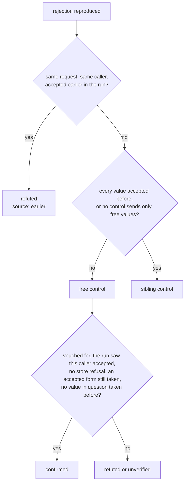

# Control requests

A finding that reproduced can still be wrong: the server may have refused a value
because the run already stored it, or a rule the contract inferred may be one the
server never applies. A **control request** is a second request that tells those
cases apart. This page covers the controls of a rejection and of an inferred rule,
what a control may send, and what each one leaves in the report. The list of
checks is `CONTROL_CHECKS` (`runtime/fuzzers/stateless/control_checks.py`); the
states they lead to are on [Findings](findings.md#states).

## Which control applies

A finding gets the first check of its invariant that applies to it.

| Invariant | Applies to | Control |
| --- | --- | --- |
| `mass_assignment` | every finding | The minimal payload without the smuggled key |
| `input_induced_timeout` | every finding | The poisoned field at its minimal valid value |
| `contract_completeness` | a rejection citing `request`; on an unsafe method, also one with no poisoned field, whichever field it cites | The strings rotated |
| `contract_completeness` | a poisoned value only an inferred rule forbids | The [plain request](#inferred-rule) |
| `input_validation` | a poisoned value only an inferred rule forbids | The [plain request](#inferred-rule) |

Stateless and stateful runs share these checks. A stateful step re-sends its whole
minimal sequence first, then runs the control at the last step. If the re-send
does not reproduce, the finding is flaky. If a send is blocked, it is `unverified`.
Values a step took from a bundle never move, so the control addresses the same
resource.

## Rotating a string { #rotation }

A rotation moves each character within its class, by a count drawn from a salt
unique to the run and the finding. Length and classes stay, so a rotated string
keeps meeting its schema.

| Rule | Behaviour |
| --- | --- |
| Where it applies | Body and query strings. A path or header value addresses a resource or a credential, and is kept. |
| Character classes | Alphanumeric first; hexadecimal when the wider class breaks the schema. |
| `uuid` | Rotates, and keeps its version and variant positions. |
| `date`, `date-time`, `time`, `uri`, `uri-reference`, `hostname`, `ipv4`, `ipv6` | Never rotate: the syntax would survive, but the order, clock or address would not. |
| `enum`, a binary `format`, composed schemas | Never rotate. |
| Steps | `CONTROL_ROTATIONS` (3) steps, tried in turn while each is rejected like the reproduction. |

## What "free" means { #free-values }

`AcceptedValues` (`runtime/http/accepted_values.py`) records what the target
accepted during the run. A rejection's control reads it, so it does not send a value
the run itself may have taken.

| Property | Value |
| --- | --- |
| What enters | A 2xx to an unsafe method |
| What it holds | The whole request by caller, and each body and query scalar by field name, array indexes ignored |
| Scope | One record per endpoint, for one run |
| Bound | `ACCEPTED_ENTRIES_PER_ENDPOINT` (4096) entries; a full record treats every value as taken |

A value is **free** at a field when the record does not hold it there. Free is a
statement about this run, not about the server's store: a value stored by an
earlier run, or through another endpoint, reads as free.

## Judging a rejection on an unsafe method

A **free control** for a whole-request rejection is a rotation that moves every
body and query value to a free one, each string by at least
`MIN_ROTATING_POSITIONS` (4) characters. A number or a boolean cannot rotate, so a
request holding one goes to the sibling control. For an inferred rule, it is the
plain request, unless the value it isolates was accepted at that field.

Three conditions stop a free control from confirming, and leave the finding
`unverified`:

- The run never saw the endpoint accept anything from this caller. A target left
  dirty or a quota spent from the first request reads the same way.
- The rejection shows a store refusing a write for what it already holds (a
  [state-refusal marker](disclosure.md#markers)).
- Every free control was rejected, and a rotated form of a request the run saw
  accepted is now refused too. A quota spent since that acceptance reads the same
  as the rule, so nothing vouches. That last request is reported as
  `control.attribution`; without a form to send, the finding is `unverified` too.

**A value the run already took.** A whole-request rejection that reproduces is
`unverified`, never confirmed, when a value in question was accepted at its field
before the controls sent theirs: a value the rejection names or, when it names
none, any value the request chose. Accumulated state, such as a capacity rule,
may be what refuses it, and the rotated control, the re-send and a peer would all
be accepted alike.

### The sibling control { #sibling }

A **sibling** is the same request with every movable value changed. Candidates come
in order: free rotations, rotations of values the run accepted, the simplest free
valid value, free values of at least 4 and 16 characters, then accepted values. It
sends up to `SIBLING_TRIES` (4) and is judged by the first the target accepts.

| What happens | Verdict |
| --- | --- |
| No sibling can be built | `unverified`, `source` `reproduction` |
| Every sibling is rejected | `unverified`: the tries ran out, and nothing vouches either way |
| An answer other than 400, 422 or a 2xx | `unverified` |
| Accepted, and the finding shows a store refusal | `refuted` |
| Accepted, the resend accepted, another identity accepts | `confirmed` |
| Accepted, the resend accepted, another identity rejected alike | `refuted`, unless the [named values](#named-value) are rejected for their content, then `confirmed` |
| Accepted, the resend accepted, no other identity | `unverified` |
| Resend rejected in other words | `confirmed` if the named values are rejected for their content, else `unverified` |
| Resend rejected alike, on a creation | `refuted` when the value that collides is the one that could not rotate; otherwise one more sibling decides |
| Resend rejected alike, on an update | `unverified` |

A rejection that names only other fields than the finding's rule never confirms it.

### Rotating a named value alone { #named-value }

When a rejection names fields, each of those values can be tested on its own. The
values must never have been accepted during the run. Each is then rotated alone
in the accepted sibling, and the target must reject it as it rejected the finding.
Rejected every time, the rule reads the value's content. Accepted once, the
rejection depended on that value being taken. A value with no rotation, such as an
empty string, is one nothing can hold as taken and is skipped.

## Judging an inferred rule { #inferred-rule }

A value only an inferred rule forbids can be wrong in two directions: the server
may reject it for another reason, or accept it because the rule is not real.

| Request | What it sends | Reported as |
| --- | --- | --- |
| **Plain** | The rest rotated, the poisoned field as sent, its value rotated when that still breaks exactly the same inferred rules | `control` |
| **Attribution** | The same rest, the field at a valid value | `control.attribution` |
| **Known answer** | Another valid value the whole contract takes, beside a rest of its own | `control.known_answer` |
| **Occupancy** | The attribution's value again, the rest rotated once more | `control.occupancy` |

The plain request decides first. Accepted, the finding is `refuted`. Rejected as
invalid (400 or 422), the attribution is sent; unless it is accepted, the finding
is `unverified`, as it is with no valid value to send. Any other answer to the plain
request also leaves it `unverified`.

### The known answer { #known-answer }

An accepted attribution shows the field takes some valid value, not that the rule
is what refused the poisoned one: the value may belong to another caller, or match
nothing. So, on every method, the **known answer** goes next, under the finding's
caller, with its own rest, its strings rotated when a rotation still meets the
field's contract.

| Its value | When |
| --- | --- |
| Just inside the edge the poisoned value crossed | a numeric or `minItems`/`maxItems` rule |
| Up to `KNOWN_ANSWER_EDGE_DISTANCES` (10, then 5, then 2) steps further inside | the attribution's value already sits on that edge: one step away, a lookup of the two values would take it too |
| A simple value meeting the whole contract | any other rule |

With no such value, or with the known answer not accepted, the finding is
`unverified` whatever callers are declared: the rejection is not shown to be the
rule's.

With the known answer accepted, a plain request that isolated the value confirms
the finding. Otherwise (an empty text, a value that does not rotate) the target may
hold that value already, and the **occupancy** control decides. On a creation it
goes under the finding's caller, then another identity; on an update, under another
identity alone. A refusal shaped like the plain request's leaves the finding
`unverified`, never `refuted`: the value was taken, and that says nothing about the
rule. With no caller to send it under, a safe method is `confirmed` and a write is
`unverified`.

### A write that moved its resource { #moved-resource }

A write's accepted answer can move the resource it addressed: a `PUT` that renames
an article answers its new slug. When the attribution's answer holds a path
parameter's name, at its top level or one object down, with another value, the
known answer and any later occupancy control are sent to that new address, so a
404 at the old one does not leave the rule `unverified`. The known answer must
still be accepted. The same rule moves the occupancy control after the known
answer's own accepted answer (`followed` in `moved_resource.py`).

## Bounds { #bounds }

A finding sends at most `CONTROL_SEND_CAP` (10) controls, and passing that count is
a programming error. Controls also spend the shrink's
[wall budget](shrink-limits.md#bounds). The first control always goes out; a later
one the wall cuts leaves the finding `unverified`, with the last answer as evidence.

## What the report shows { #evidence }

`ControlEvidence` (`models/runtime/evidence.py`) reaches the report as `control`,
with every field below since report `schema_version` 1.24.

| Field | Holds |
| --- | --- |
| `status_code`, `latency_ms`, `error` | What the control got back |
| `source` | `sent`; `reproduction`, when no control could be built and the answer is the reproduced rejection; `earlier`, when nothing was sent because the same request from the same caller was accepted earlier in the run; `not_tried`, on an `unverified` finding standing for the members of a group never retried because the group's representatives had already used its tries and were refuted: nothing was sent for it, and the evidence is what the first representative's control got |
| `latency_samples_ms` | The latency of each time a `latency_sla` finding's request was sent alone after the load, in order, `latency_ms` being their median ([ADR-210](adr/findings.md#adr-210)); `[]` on any other control |
| `attribution` | The request sent after a rejected control: for an inferred rule, the field at a valid value; for a whole-request rejection, the rotated form of an accepted request |
| `peer` | The same control under another identity, once the finding's caller had it accepted twice |
| `occupancy` | The attribution's value sent again; its own `peer` is the same request under another identity |
| `known_answer` | Another valid value, sent under the finding's caller |
| `identity_label` | The caller of a `peer`, `occupancy` or `known_answer` control |

## Known limits { #known-limits }

- **A store outside the record.** A value held since an earlier run reads as free.
  Its rejection can look like a rule when the run has no sibling that says otherwise.

## Where to change it

| To change | Edit |
| --- | --- |
| Which control judges an invariant | `CONTROL_CHECKS` in `control_checks.py` |
| How many rotations or siblings are tried | `CONTROL_ROTATIONS`, `SIBLING_TRIES` in `runtime/fuzzers/stateless/constants.py` |
| Which formats never rotate | `_KEPT_FORMATS` in `rotated_strings.py` |
| How much of a run is remembered | `ACCEPTED_ENTRIES_PER_ENDPOINT` in `runtime/http/constants.py` |
| How far inside an edge the known answer moves | `KNOWN_ANSWER_EDGE_DISTANCES` in `runtime/fuzzers/stateless/constants.py` |
| Where a moved resource is read from an answer | `moved_value` in `runtime/state_link/moved.py` |

Decisions: [ADR-186](adr/findings.md#adr-186), [ADR-182](adr/findings.md#adr-182),
[ADR-183](adr/runners.md#adr-183).
