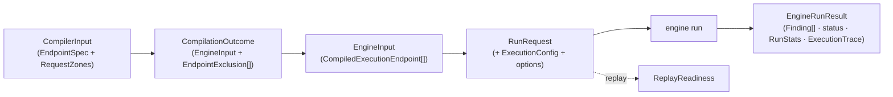

# Data flow

Data crosses the engine as frozen DTOs at the boundaries (pydantic,
`extra="forbid"`) and frozen value objects inside (`@dataclass(frozen=True)`).
This page follows those types top to bottom — from the orchestrator's
`CompilerInput` to the `EngineRunResult` — and states the invariant each one
carries. Every type named here lives in `models/`.

## The vocabulary enums

Every closed set of names travels as a `StrEnum` member, never a bare string.
The kernel owns the vocabularies shared with the rest of the pipeline; the
engine owns the ones that are its own.

| Enum | Owner | Members (`.value`) |
|---|---|---|
| `Zone` | kernel | `path` · `query` · `header` · `body` |
| `Criticality` | kernel | `low` · `medium` · `high` · `critical` (declaration order is the rank) |
| `Sensitivity` | kernel | `public` · `internal` · `pii` · `financial` · `auth` |
| `AttackFamily` | kernel | `injection` · `ssrf_filesystem` · `auth_bypass` · `input_validation` · `deserialization` · `information_disclosure` · `resource_abuse` · `business_logic` · `headers_cookie` · `parser_compatibility` · `path_traversal` · `xss` · `sql_injection` |
| `ExecutionMode` | `models/execution_mode.py` | `stateless` · `stateful` · `replay` · `performance` · `resilience` · `auth` |
| `Strategy` | `models/strategy.py` | `default` · `security` · `conformance` · `smoke` · `exposure` ([Strategies](strategies.md)) |
| `Phase` | `models/phase.py` | `valid` · `boundary` · `invalid` · `attack` · `transition` · `mutation` · `semantic` |
| `SchemaType` | `models/schema.py` | `string` · `integer` · `number` · `boolean` · `array` · `object` · `null` |
| `SchemaKeyword` | `models/schema.py` | the 24 JSON Schema keywords the engine reads, by wire spelling: `type` · `enum` · `const` · `nullable` · `required` · `properties` · `items` · `format` · `pattern` · `multipleOf` · `minimum` · `maximum` · `exclusiveMinimum` · `exclusiveMaximum` · `minLength` · `maxLength` · `minItems` · `maxItems` · `minProperties` · `maxProperties` · `allowExtraFields` · `default` · `examples` · `example` |
| `SchemaFormat` | `models/schema.py` | the string formats: `email` · `uuid` · `date` · `date-time` · `uri` · `ipv4` · `hostname` · `byte` |
| `NumericFormat` | `models/schema.py` | the numeric formats: `int32` · `int64` · `float` · `double` |
| `ZoneWire` | `models/wire.py` | how a zone carries a value: `structured` · `text` · `segment` |
| `TextAlphabet` | `models/wire.py` | the characters a compiled string draws from: `open` · `printable` · `wire` |

The engine-side outcome vocabularies follow the same rule:

| Enum | Members (`.value`) |
|---|---|
| `ErrorCategory` | `success` · `client_error` · `server_error` · `contract_violation` · `timeout` · `availability` · `unsendable_request` · `connection_dropped` |
| `InvariantViolation` | `not_a_server_error` · `status_code_conformance` · `response_schema_conformance` · `content_type_conformance` · `state_transition` · `latency_sla` · `latency_degradation` · `resilience_degradation` · `semantic_property` · `access_control` · `input_validation` · `information_disclosure` · `sensitive_data_exposure` · `reflected_payload` · `mass_assignment` · `input_induced_timeout` · `contract_completeness` · `undeclared_response_field` |
| `TruncationReason` | `infrastructure_abort` · `deadline_exceeded` · `target_down` · `state_link_abort` · `generation_exhausted` · `cancelled` · `engine_failure` |
| `FidelityLevel` | `exact` · `reduced` |

### Enums serialize as their wire value

Every vocabulary enum is `enum.StrEnum`, never `class X(str, Enum)`: `str()` of
a `StrEnum` member is its `.value` (`"valid"`), whereas `str()` of the mixin
form is its qualified name (`"Phase.VALID"`). `Phase`, `Zone` and
`ErrorCategory` travel as keys in `phase_split`, `examples_per_phase`,
`by_phase` and `by_category`, so this is what keeps an enum-keyed map
serializing to the same JSON as a string-keyed one. A parametrised test pins
the property for every vocabulary ([Testing](testing.md)).

## Boundary DTOs

The types that cross a stage line, all validated with `extra="forbid"`:

| DTO | Direction | Notes |
|---|---|---|
| `CompilerInput` | in | endpoints plus a single global `strategy` (never per-endpoint), and the `withheld` endpoints the caller keeps out of the run |
| `EndpointSpec` | in | one endpoint; its request zones are a `RequestZones` value object, the body a `BodySpec` |
| `BaseStrategyContract` / `HackerStrategyContract` | in | per-value generation knobs (hacker is a pydantic subclass, dispatched by type) |
| `ResponseContract`, `StateLinkContract` (+ `StateProduction` / `StateConsumption`) | in | expected responses, stateful links |
| `EndpointRisk`, `EndpointAttack`, `EndpointAccess` | in | kernel semantic DTOs, re-exported through `models/contracts`, never duplicated |
| `EndpointBudgetContract` | in | adaptive example budget; engine-only, no kernel twin |
| `CompilationOutcome` | out | Result object: `EngineInput` plus a tuple of `EndpointExclusion` |
| `EngineInput` | out → in | `CompiledExecutionEndpoint[]`; the engine consumes this alone |
| `RunRequest` | in | one run's inputs: `engine_input` + `ExecutionConfig` + mode `options` |
| `EngineRunResult` | out | the `findings` union, terminal `status`, `RunStats`, `ExecutionTrace`, optional `ReplayFidelity` |
| `Finding` (`ConfirmedFinding` / `FlakyFinding` / `UnverifiedFinding` / `RefutedFinding`) | out | discriminated union on `state`; a confirmed finding carries a `CrashReport`, the other three a `signature` and their `occurrences`, a refuted one also the `control` that refuted it |
| `CrashReport`, `ViolatedRule`, `RunStats`, `EndpointStats`, `LatencyStats` | out | serialized to columns by `core/` — field names are stable; `ViolatedRule` is the rule a `CrashReport` broke, declared by the contract or intrinsic to its invariant |
| `ExecutionTrace`, `TracedRequest`, `TruncationRecord` | out | the replayable record |
| `ReplayReadiness` | out | outcome of the pre-replay readiness check |



## The compiler input: `EndpointSpec` and `RequestZones`

`EndpointSpec` is endpoint identity (`method`, `path_url`, optional `base_url`)
plus everything needed to shape and judge its requests: the request zones and
the optional endpoint-level controls — `risk`,
`budget`, `attack`, `responses` (keyed by status-code string), `state_link`,
`semantic_properties` and `access`. The controls are independently optional and
stay flat on the spec ([ADR-009](adr/models.md#adr-009)).

The engine reads `semantic_properties`: the compiler copies them from the
`EndpointSpec` onto the `CompiledExecutionEndpoint`, `check_response` carries
them onto the `ResponseContext`, and the `semantic_property` oracle evaluates
each declared business rule against the 2xx request/response pair
([Engine internals](engine-internals.md#how-a-semantic-property-is-evaluated),
[ADR-048](adr/engine.md#adr-048)).

`access` rides the same way — compiled onto the `CompiledExecutionEndpoint` — but
only the `auth` runner reads it: it uses the policy to decide which identities to
cross an endpoint with, and the `access_control` oracle judges the crossings. An
ordinary run carries `access` and never acts on it
([Execution modes](execution-modes.md#auth), [ADR-050](adr/engine.md#adr-050),
[ADR-053](adr/engine.md#adr-053)).

The zones are a `RequestZones` value object: a frozen pydantic model with one
field per `Zone`. `path`, `query` and `header` are each a `ParamMap`
(`dict[str, HackerStrategyContract | BaseStrategyContract]`) defaulting to
empty; `body` is a `BodySpec` or `None`. `parameter_zones()` yields the non-empty
parameter zones in `path, query, header` order as `(Zone, ParamMap)` pairs, and
`by_zone()` adds the body's fields when its root is an object, so callers iterate a
`Zone`-keyed structure instead of loose fields. The same `Zone`-keyed shape
reappears on the engine side, so one concept lives on both sides of the compile
([ADR-008](adr/models.md#adr-008)).

`BodySpec(media_type, required, root)` is the declared body as a whole: the media
type the producer chose, whether the body is required (default `False`), and the
root contract. `fields` is derived from the root's properties and is empty when
the root is not an object, which then compiles as the single field `$`
([ADR-122](adr/models.md#adr-122), [Requests](requests.md#the-body)).

The two kernel DTOs an endpoint may carry:

| DTO | Fields |
|---|---|
| `EndpointRisk` | `risk_score` (0–100, default 50), `criticality`, `sensitivity`, `auth_surface`, `write_operation`, `external_side_effects` |
| `EndpointAttack` | `focus_fields`, `sensitive_fields`, `aggressiveness` (0–10), `mutation_depth` (0–10), `field_hints` keyed by zone-qualified field path — each hint carries that field's `attack_profiles` |

`EndpointBudgetContract` is the engine's own: `max_examples` (default
200; left unset, the compile plans the strategy's `default_max_examples`
instead), an optional `phase_split` (`dict[Phase, float]`,
fractions ≥ 0 summing to at most 1), `max_combinations_per_case`, and an
optional `deadline_ms`.

## Strategy contracts

`BaseStrategyContract` is the per-value generation contract every strategy
shares; it uses `populate_by_name=True` and camelCase aliases so a JSON Schema
fragment validates directly (`type`, `exclusiveMinimum`, `minLength`, …).
`HackerStrategyContract` is a pydantic subclass that adds `attack_profiles` and
the eight `include_*` payload-variant toggles; the compiler dispatches on it by
type, not by a mode flag. Its `properties` and `items` are re-typed so nested
values keep the hacker knobs ([ADR-010](adr/models.md#adr-010)).

Two invariants are enforced in the model itself, so the compiler never sees a
contract that breaks them:

- **Dialect normalization** (`normalize_dialect`, a `mode="before"` validator
  at every nesting level, [ADR-112](adr/models.md#adr-112)):
    - a JSON Schema `type` array collapses to one scalar `type` plus an explicit
      `nullable`. An empty array (`type: []`) raises `StrategyCompilationError`;
      a union of more than one concrete type raises (the compiler models one type
      per value); a null-only array becomes `type: null`; a null member alongside
      one concrete type sets `nullable: true`, outranking a contradictory
      `nullable: false`;
    - an OpenAPI 3.0 boolean exclusive bound becomes a numeric one: `true` moves
      the inclusive bound into the exclusive keyword, and `false` (or `true` with
      no inclusive bound) is dropped. `exclusiveMinimum` and `exclusiveMaximum`
      are then strictly numeric, so a boolean that skipped the dialect is a
      validation error, never `0` or `1`;
    - a singular `example`, and an `examples` map whose entries hold a `value`,
      fold into one `examples` list, each value once by `same_seed`.
- **Mistyped bounds** (`mode="after"`): a string `minimum` / `maximum` is
  legal only as an ISO `date` / `date-time` range on a string contract;
  anything else raises, so a stray string bound never reaches strategy
  compilation. The policy layer then checks the range itself: the two bounds
  are parsed and compared chronologically (a lexicographic compare would be
  wrong for date-time values carrying different offsets), so an inverted range
  (`minimum` later than `maximum`), an unparseable bound, or a naive/aware
  mismatch is rejected with a `PolicyError` rather than surfacing as a raw
  generation error.

The allowed-field matrix `ALLOWED_FIELDS_BY_TYPE` lists, per `SchemaType`, the
`SchemaKeyword`s the policy layer accepts. `ALLOWED_FIELDS_BY_TYPE_HACKER`
extends each entry with `HACKER_EXTRA_FIELDS`, derived from the model aliases
(`wire_names(HackerStrategyContract) - wire_names(BaseStrategyContract)`) so a
new hacker field extends the allow-list on its own. The hacker table's value
type is `frozenset[SchemaKeyword | str]` because those extra names are the
hacker contract's own snake_case wire names, not JSON Schema keywords; the
base table is a plain `frozenset[SchemaKeyword]`. `default` and `examples` are
allowed for every type: they are the spec's seeds for the valid phase
([ADR-121](adr/compiler.md#adr-121)).

## Responses and state links

`ResponseContract` declares the expected `content_type` and `body_schema` for
a status code. `resolve_response_contract` resolves a status to its contract
by precedence — exact key (`"404"`) → status-class key (`"4xx"`, case-folded)
→ `"default"` — and never raises, returning `None` when nothing matches.

A stateless run tests each endpoint in isolation with synthetic data. A
stateful run chains requests: it captures real values from a response into
named *bundles* and injects them into later requests, so a flow like `POST →
GET → DELETE → GET` runs against the same resource. `StateLinkContract` is the
declarative mapping that drives this:

- `StateProduction` captures `response_field` (a dotted path) into `bundle` on
  success; `on_status=None` means any 2xx.
- `StateConsumption` injects a bundled value into `target_zone` /
  `target_field`, optionally `invalidates`-ing the bundle so a deleted
  resource cannot be operated on again.
- `TransitionInvariant` (kernel) asserts that a follow-up request
  (`follow_up_method`, `follow_up_path`, with the bundled value injected into
  `target_field`) returns one of `expected_statuses`; `echoed_fields` names
  request fields the follow-up must reflect, and `trigger_statuses` restricts
  which triggering statuses arm it (never a 5xx: a server error is the defect
  itself).

Each list defaults independently to empty, so an endpoint may only produce,
only consume, or both. The whole contract is optional and additive: an
endpoint without one is fuzzed statelessly.

## The compiler outcome and the compiled input

`CompilationOutcome` is a frozen Result object: the `EngineInput` plus one
`EndpointExclusion` (`method`, `path_url`, `reason`) per endpoint that failed
to compile.

`EngineInput` carries `CompiledExecutionEndpoint`s. Each pairs endpoint
identity with its `CompiledEndpointStrategies` (one `CompiledRequestPart` per
non-empty zone — `path_parameters`, `query_parameters`, `header_parameters`,
`body` — each holding the per-`Phase` `SearchStrategy`s and the
`poisoning_phases` among them; the body is a `CompiledBody` that also carries its
`media_type` and `file_fields` — plus the `generation_plan` and the endpoint's
`poisoning_phases`) and the contract DTOs the engine still
needs (`risk`, `attack`, `budget`, `responses`, `state_link`,
`semantic_properties`, `access`), and the `optional_oracles` its strategy turns
on ([Strategies](strategies.md#opt-in-oracles)). Its
`endpoint_id` is `format_endpoint_id(method, path_url)` —
`"{METHOD}:{path_url}"`, method uppercased — the stable key that groups every
result, stat and trace row. `CompiledRequestPart` raises
`StrategyCompilationError` in `__post_init__` if it is built with no per-phase
strategies: an empty zone is a bug, not a silent no-op.

`GenerationPlan` is the per-endpoint budget the compiler hands the engine — a
frozen value object with exactly four fields: `estimated_combinations`,
`allowed_combinations`, `max_examples`, `examples_per_phase` (a
`Mapping[Phase, int]`). Because it is frozen, performance mode scales it
through `GenerationPlan.scaled(factor)`, which multiplies `examples_per_phase`
and returns `self` when `factor == 1`
([ADR-011](adr/models.md#adr-011)).

## Execution runtime

`ExecutionConfig` holds the runtime controls (frozen): `base_url` is required
— without it the engine cannot build absolute requests, and failing at
construction is clearer than reporting synthetic availability errors later.
It is validated as a `BaseUrl`, as is the optional `EndpointSpec.base_url`: an
`http` or `https` URL that names a host and, when it writes a port, one from 1 to
65535, and whose fragment holds no `@` (a URL split by hand would read it as
userinfo). A refusal never echoes the URL, since it may carry `user:pass@`. Otherwise
a mistyped port would fail every connection and read as a dead target.
The rest have defaults: `timeout_s`, `max_concurrency` (also the exploration
batch size), `max_retries`, `headers`, `backoff_base`, `identities`, and
`allow_side_effects` (default `False`: endpoints the producer marked as writing
or side-effecting are held back by the
[safety guard](engine-internals.md#safety-guard) instead of probed). A
`mode="after"` validator rejects duplicate identity labels, because a label
keys findings, reports and replays.

`Identity` is a `label` plus credential `headers`, an optional `role`, and a
`credential` kind. It comes from the user's execution config, never from the
contract producer, so it carries no contract fields. `headers={}` models an
anonymous identity — no credentials at all, still worth a label so a 2xx from it
is as accountable as any other. `role` names the role the identity acts under; an
empty string is rejected, and an identity that declares no role never satisfies a
`role_only` endpoint's `required_role`. `credential` (`CredentialKind`, default
`valid`) marks whether the target should accept the identity's headers; an
`invalid` identity carries a token the target must reject, and `ExecutionConfig`
splits the pool into `valid_identities` and `invalid_identities` for the consumers
that need one or the other.

`RequestBlueprint` is the immutable request built from a compiled endpoint and
a payload: method, URL, headers, query, `path_params`, the `body` with its
`media_type` and `file_fields`, the `intent` (a `RequestIntent`: the phase, the
one poisoned zone and field, if any, and the `attack_family` of the value drawn
into it; `phase` is a derived property), `endpoint_id`,
the `config_header_names` (whose values are credentials and are never recorded),
the `identity_label`, and an `unsendable_reason` when the request must not be
sent. A parameter or body drawn as `None` is not on it: it records what went out. `path_params` holds the raw path-parameter values as
drawn, typed as drawn, before URL interpolation — the URL still carries the
percent-encoded segment, but the semantic oracle reads the typed value.
`generated_headers` is the subset the fuzzer produced.

`ExecutionResult` is the canonical record of one request
([Architecture](architecture.md#executionresult-is-the-canonical-record-of-a-request)).
`category` maps `error=None` to `ErrorCategory.SUCCESS`; `was_sent` is false
only for `UNSENDABLE_REQUEST` — a blueprint the injector flagged before sending,
or a request the client refused at send time: a body JSON cannot encode, a header
name that is not a token, or a header value that is not ASCII or carries a NUL, a
line break or edge whitespace.

Two category sets overlap without either containing the other:

| Set | Members | What it means |
|---|---|---|
| `INFRA_CATEGORIES` | `availability`, `timeout`, `unsendable_request` | no response from the target: recorded in stats, never a finding |
| `TARGET_FAILURE_CATEGORIES` | `availability`, `timeout`, `connection_dropped` | evidence the target may be failing: what the abort streak counts |

A request that could not be sent says nothing about the API — neither that it
misbehaved nor that it is down — so it is in the first set only. A connection the
server accepted and dropped is a crash, so it is a finding, and it also counts
toward the streak, in the second set only.

## Per-mode options

Mode-specific settings travel in `RunRequest.options` (a `BaseModel | None`),
so the runner signature stays stable across modes instead of growing a
parameter per mode. `None` means the mode's defaults.

| Options | Fields |
|---|---|
| `StatelessOptions` | `include_repeated_requests` (validated, not yet wired to generation) |
| `StatefulOptions` | `max_examples` and `step_count` bound the breadth and length of each generated sequence; `max_distinct_bugs` caps the loop-until-dry depth: the run keeps passing until one finds nothing new, and stops early once that many distinct defects, or distinct flaky signatures, are found (default `STATEFUL_MAX_DISTINCT_BUGS`, 25; `1` reports the first defect only) |
| `PerformanceOptions` | `latency_sla_ms` (the SLA the oracle enforces) and `load_factor`, a multiplier applied to each phase's example budget to sustain load; `concurrency_ladder` (a `ConcurrencyLadder` of strictly increasing `steps` and a degradation `tolerance`) replays the valid phase once per step and flags latency that grows with concurrency |
| `ReplayOptions` | `trace` to re-send and `preserve_timing` (wait between requests to match the recorded schedule) |

`StatefulOptions` is persisted by the orchestrator as part of a run's recipe,
so its field names are stable.

## Replay

Before replaying, the readiness check returns a `ReplayReadiness` value object
with four tuples — `missing_identities`, `missing_credentials`,
`missing_url_userinfo` (recorded hosts whose omitted `user:pass@` the live
`base_url` cannot supply) and `host_mismatches` (recorded hosts that differ from
the live host, checked for every request) — and an `is_ready` property that is
true only when all four are empty
([ADR-022](adr/engine.md#adr-022), [ADR-046](adr/engine.md#adr-046)). A replay
pointed at another host is therefore refused before any request is sent, even
when the trace kept its own userinfo. After a replay,
`ReplayFidelity` reports the run-level verdict: a `FidelityLevel` (`exact` /
`reduced`) and the list of `ResponseDivergence`s (a request whose observed
status differed from the recorded one; its `violated` flag says whether the
recorded request was itself a finding).

## The trace

`ExecutionTrace` is the ordered record of the exploration requests one run
actually sent — the recipe for reproducing it. Shrinking requests are absent:
their conclusion is the crash report. Each `TracedRequest` is an observed fact,
so no field has a default but `poisoned_family`; credentials are omitted rather than redacted (only
the config header *names* are recorded), `omitted_url_userinfo` flags a
stripped `user:pass@`, the raw `path_params` sent before URL interpolation are
recorded alongside the query and the body (with its `media_type` and
`file_fields`), the intent is recorded as `phase`, `poisoned_zone`,
`poisoned_field` and `poisoned_family`, and `sent_at_ms` is excluded from
anything hashed. A trace missing any required field fails validation on load;
`poisoned_family` defaults to `None`, so a trace written without it still loads
([ADR-130](adr/engine.md#adr-130)).
`TruncationRecord` records where and why a run, or one endpoint, was cut short:
a `TruncationReason`, the `endpoint_id`, the `requests_sent` before the cut and
an optional `detail`.

## Results, findings and their counters

Inside the engine, an exploration pass produces `RawFinding`s (a finding needs
at least one `ObservedViolation`; `primary_violation` is the first the oracles
reported). The stateless fold records one raw finding per violated rule, each
carrying that one violation ([ADR-137](adr/engine.md#adr-137)). An `ObservedViolation` is what one oracle saw: the `InvariantViolation`
it broke and the `ViolatedRule` naming the rule — the business rule the contract
declared, or the requirement the invariant enforces on its own — reduced to its
`id` and `description`. Findings are grouped by
`FindingSignature` (endpoint, phase, invariant, status, identity label, rule id,
body fingerprint) into `FindingGroup`s, then shrunk into `CrashReport`s. The
identity label is part of the comparison only for an identity-scoped invariant
(`access_control`); every other finding keeps the label it was observed under
without being split by it. A
`CrashReport` carries the `minimal_payload` keyed by zone (the smallest payload
the shrink reached within its request budget, not an absolute minimum), the
`invariant_violated`, an optional `rule` (the `ViolatedRule` the response broke,
with a `rule_id` shortcut to its id), `sanitized_headers`, the `identity_label`,
the `status_code` and `response_body` (with sensitive field values redacted by
name to `***`), the `observation` the oracle made, the `request`, `response` and
`control` evidence ([Findings](findings.md#evidence)), the
`transition_sequence` for stateful findings (the steps before the violating one,
minimized to those it needs and verified on the wire), and `represented_findings` — how
many raw findings it stands for, adjusted through `standing_for`. Its `category`
and `severity` are properties read from `INVARIANT_TAXONOMY`, never stored
([ADR-148](adr/findings.md#adr-148)).

`RunStats` is the aggregated counter set of one run. Its three maps are
`by_endpoint` (keyed by `endpoint_id`), `by_phase` (`Phase`-keyed) and
`by_category` (`ErrorCategory`-keyed); the enum-keyed ones accept a wire string
and dump back to the same string. Each counter has one meaning and one
producer:

| Counter | Meaning |
|---|---|
| `findings_raw` | violations observed during exploration, before shrinking: a response that breaks two rules counts twice |
| `findings_confirmed` | shrink attempts that reproduced and became a crash report; in a mode that never shrinks (`performance`, `resilience`, `auth`), each defect observed |
| `findings_unique` | distinct defects after collapsing reports with the same minimal reproducer (and, for `access_control`, the same identity); equal to the count of `ConfirmedFinding`s, never above `findings_confirmed` |
| `findings_flaky` | attempted during shrinking and did not reproduce; in `resilience`, a server error its resent attacks did not get back on every resend |
| `findings_refuted` | reproduced, and its control request showed it is not a defect: the input was not the cause, or the rejection was a state conflict ([ADR-151](adr/findings.md#adr-151), [ADR-167](adr/findings.md#adr-167)) |
| `findings_collapsed` | not shrunk because a faithful representative of their signature stands for them |
| `findings_unverified` | never judged: the run was cut before shrinking, no candidate could be produced, or the control request got no answer |
| `requests_shrink` | requests the shrinking phase put on the wire (in a stateful run, Hypothesis's shrink re-sends plus the sequence minimizer's; in `resilience`, the confirmation's resends, controls and provisioning); not part of `total_requests` |

`EndpointStats` mirrors the per-endpoint subset (`requests`,
`examples_planned`, `findings_raw`, `findings_confirmed`; the rows of the last two
sum to the run's totals in every mode) plus a `LatencyStats`
whose fields all default to zero, so `LatencyStats()` is a valid "no samples"
value — an endpoint can carry a confirmed crash report with no surviving
requests to time. It also carries `starved_identities`: the labels of declared
identities whose share of the endpoint's budget rounded to zero, so they got no
requests. It is empty unless the endpoint declares more identities than its
per-phase budget can fund, and only modes that split budget by identity
(`stateless`, `performance`) ever populate it — the others leave it empty. This
turns an identity that would otherwise be dropped in silence into a reported
signal. It also carries `undecided_rules`: the ids of any declared rules the
oracle evaluated at the endpoint and could never decide — undetermined on every
response — populated by the same two modes and empty in the rest, turning a rule
that could never be checked into the same kind of reported signal. Two more
fields follow the same rule of saying out loud what did not happen or what was
measured: `held_back_by` names the risk flag that kept the
[safety guard](engine-internals.md#safety-guard) from probing the endpoint and
`held_back_via` the endpoint id of the entry that raised it, its own id when its
own flag did (both `None` for a probed one), and `load_profile` is a tuple of `LoadStepStats` — one per
completed step of a performance run's
[concurrency ladder](execution-modes.md#the-load-profile), empty in every other
case; a step measured twice to confirm a degradation carries the second window as
`remeasured`, and a step measured on no samples has `degraded` `None`. Four maps say where the endpoint's traffic and budget went, phase by
phase ([ADR-144](adr/engine.md#adr-144)):

| Field | Holds |
|---|---|
| `by_phase` | the endpoint's requests per `Phase`; they sum to `requests` |
| `findings_by_phase` | its `findings_raw` per phase of the traffic that produced them, a load step's verdict counted under `valid`; empty where raw findings are not observed (`stateful`, `replay`) |
| `by_attack_family` | its requests whose intent names an attack family, per `AttackFamily` |
| `budget_by_phase` | each planned phase's `PhaseBudget`: `planned`, the share it was planned, and `carried_in`, what an earlier pass of the same identity left it ([ADR-142](adr/engine.md#adr-142)); empty in modes that do not plan by phase |

Last, `truncation` is the `EndpointTruncation` (a `reason` and an optional
`detail`) that ended the endpoint's own pass; it is `None` when the pass ran to
completion, and in the modes that do not explore endpoint by endpoint (`stateful`,
`replay`).

The lifecycle mechanics — one producer per counter, the flaky count measured in
the shrinker rather than derived by subtraction — are the engine's finding
pipeline ([Engine internals](engine-internals.md#the-finding-pipeline),
[ADR-018](adr/engine.md#adr-018)).

`EngineRunResult.findings` reifies those counters as a closed union. `Finding`
is discriminated on `state` (`FindingState`): a `ConfirmedFinding` wraps its
`CrashReport`; a `FlakyFinding`, an `UnverifiedFinding` and a `RefutedFinding`
each carry a `FindingSignature` and the raw `occurrences` they stand for — one
object per signature — and a refuted one also the `ControlEvidence` that refuted
it. The confirmed findings are the deduplicated reproducers
(`findings_unique`), the summed flaky occurrences are `findings_flaky`, the
summed unverified occurrences are `findings_unverified`, and the summed refuted
occurrences are `findings_refuted`; `findings_collapsed`
stays a counter only, since a collapsed finding is a duplicate a confirmed
reproducer already stands for ([ADR-044](adr/engine.md#adr-044)).

A stateful run shrinks inside each pass rather than in a separate phase over
grouped findings, so it reaches its flaky findings differently: a sequence step
whose violation does not reproduce when it is replayed — by Hypothesis's own
final replay, or by the engine's verifying re-send of a pass the shrink budget cut
short — becomes a `FlakyFinding`, keyed by the same
`FindingSignature` and counting its `occurrences`. `build_stateful_stats` sums
those into `findings_flaky` (plus the flaky events that recovered no violation to
sign), and `reconcile_flaky_with_confirmed` drops any flaky finding whose
signature already has a confirmed report, so a symptom the run also confirmed is
shown once, as a defect. `findings_unverified` stays 0 for a stateful run, which
confirms or minimizes every step as it goes. A signature's `status_code` of `0`
records a step that got no response at all (a transport failure).

`EngineRunResult.status` is the run's terminal outcome as a `RunStatus`:
`completed` when nothing truncated it, `aborted` when a `TARGET_DOWN` or
`STATE_LINK_ABORT` cut it, `cancelled` when the caller stopped it (a `CANCELLED`
cut, see [Progress and cancellation](progress-and-cancellation.md)), `truncated`
for every other cut. The engine derives it from the truncation reason; the
orchestrator persists it as recorded ([ADR-045](adr/engine.md#adr-045)).

## Failures, not `None`

Expected alternative results are Result objects (`CompilationOutcome`,
`ReplayReadiness`); genuine failures are typed domain exceptions rooted at
`SpecforgeEngineError` (`exceptions.py`), so no builtin `ValueError` /
`RuntimeError` crosses a package boundary
([ADR-001](adr/foundations.md#adr-001)):

```text
SpecforgeEngineError
├── PolicyError                      # boundary validation failed
├── StrategyCompilationError         # a contract cannot become a strategy
│   └── EndpointCompilationError     # …for a specific endpoint (carries endpoint_id + the reason)
└── EngineError                      # an execution invariant was violated
    ├── StatefulLinkError            # a state link could not be honored (carries partial_exploration)
    ├── AccessIdentityError          # the auth runner has no valid identity to run against
    ├── AccessUncrossableError       # an auth run crossed none of the access policies it had to cross
    ├── SafetyGuardBreachError       # a route the safety guard held back was reached (carries the result)
    └── ConcurrencyLadderError       # a performance run's concurrency ladder cannot be honored
```

## Runtime value objects

The value objects a strategy draws and the engine passes internally (the zoned
payload, the exploration cut, oracle verdicts, budget shares, the schema view,
the chaos requests) never cross the public boundary; `CrashReport.minimal_payload`
and `transition_sequence` are their flat `dict` / `list` projections at the
edge. Each is documented next to the layer that owns it in
[Engine internals](engine-internals.md).
