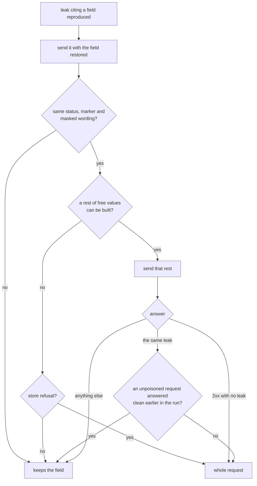

# Information disclosure

An error response that names a table, a stack frame or a server path tells an
attacker how the target is built. The `information_disclosure` oracle reports it,
and the engine then decides whether the leak belongs to one field or to the whole
request. This page covers the catalogue of markers, the scope of a leak and how
leaks are grouped. The code is `runtime/oracles/security/` and
`runtime/fuzzers/stateless/leak_scope.py`.

## What the oracle judges

The oracle reads every text of a non-2xx response body. A text shows a marker when it
holds all the fragments of one of the marker's signatures. What the request sent
never counts as its own leak: every sent text holding a fragment is discounted from
the response first, longest first, and replaced by a separator so the texts around
it never join into a fragment.

### The request's own path { #own-path }

A debug page or a router's 404 often prints the path it was asked for, in the form
the server read it. A path that carries a probe such as `../../../etc/passwd` would
otherwise read as a leak of `/etc/`. So the discount holds the path in every form a
server shows it:

| Sent text | Discounted as |
| --- | --- |
| The URL path | as sent; percent-decoded; decoded with its dot-segments removed (RFC 3986 §5.2.4); that resolved path without its leading `/` |
| Each path parameter | as sent; percent-decoded; percent-encoded as its segment; percent-encoded keeping `/`, as a server re-encodes its decoded path |
| Query, header and body values | as sent |

A fragment outside the echoed text, such as a stack frame printed beside it, still
counts.

## The catalogue { #markers }

`DisclosureMarker` is the closed vocabulary, and `DISCLOSURE_MARKERS` holds each
member's signatures. A marker's name is the observation's `marker`.

| Marker | Shown by | Refuses for state |
| --- | --- | --- |
| `sql_state` | `SQLSTATE` | |
| `sql_driver_error` | `OperationalError` | |
| `sql_syntax_error` | `syntax error` with `near "` | |
| `mysql_syntax_error` | `in your SQL syntax` | |
| `sql_statement` | `SELECT ` with ` FROM ` | |
| `sql_constraint_error` | SQLite, PostgreSQL, MySQL, SQL Server and Oracle refusing a write (`UNIQUE constraint failed`, `violates foreign key constraint`, `ER_DUP_ENTRY`, `ORA-00001`, ...) | yes |
| `sql_schema_error` | The same engines naming a table or column they do not hold (`no such table: `, `Unknown column '`, `ORA-00942`, ...) | |
| `mongo_error` | `E11000 duplicate key`, `MongoServerError` | yes |
| `orm_error` | Exception classes of drivers and ORMs (`IntegrityError`, `SequelizeDatabaseError`, `PrismaClientKnownRequestError`, `QueryFailedError`, `ActiveRecord::RecordNotUnique`, `PG::UniqueViolation`, `DbUpdateException`, ...) | yes |
| `python_traceback` | `Traceback (most recent call last)` | |
| `python_frame` | `.py", line ` | |
| `java_frame` | a tab, then `at java.` | |
| `node_frame` | `    at ` with `.js:` | |
| `unix_etc_path` | `/etc/` | |
| `unix_var_path` | `/var/` | |
| `unix_srv_path` | `/srv/` | |
| `windows_drive_path` | `C:\` | |
| `django_debug_page` | `Django Version:` | |
| `werkzeug_debugger` | `Werkzeug Debugger` | |
| `php_error` | `Fatal error` with ` on line ` | |

A **state refusal** is the store's answer about what it already holds, not a rule. A
rejection showing one is never [confirmed by a control](control-requests.md).

### Adding a marker

Add the member and its signatures in `disclosure_markers.py`. A signature is a tuple
of fragments a text must all hold:

```python
class DisclosureMarker(StrEnum):
    ...
    REDIS_ERROR = "redis_error"

DISCLOSURE_MARKERS = MappingProxyType({
    ...,
    DisclosureMarker.REDIS_ERROR: (("WRONGTYPE Operation",),),
})
```

Add the member to `_STATE_REFUSAL_MARKERS` too if it means a store refused a write.

## The scope of a leak { #scope }

A poisoned request's leak first cites the poisoned field. Many leaks have nothing to
do with that field: a unique constraint fails on another value, and every field the
pass poisoned would report the same text. So a stateless shrink tests the cause.



The second request guards against a poison that stuck. Restoring the field only shows
what the target does now; if the poison changed the target, it would keep leaking
after the field is restored. A clean answer earlier in the run is the evidence of
that, and keeps the finding on the field. A shrink out of time also keeps the field.

| Scope | `rule_id` | `phase` | `location` | Trigger fields |
| --- | --- | --- | --- | --- |
| Field | `<zone>.<path>` | as drawn | the poisoned field | as drawn |
| Whole request | `request` | `valid` | none | none |

The report's reproducer is the request with the field restored, which also joins the
trace ([the trace contract](shrink-limits.md#trace)).

## Grouping { #grouping }

A stateless run keeps one whole-request leak per endpoint, status, marker and wording,
the strings the request sent masked out (`dedupe_stateless_reports`). Reproducers do
not separate them, and the kept report's `represented_findings` counts the rest. Field
leaks still go one per reproducer, and so does every leak of an `auth` or `resilience`
run.

## Known limits

- **A target already dirty.** A poison stored by an earlier run leaks in every answer,
  and this run has no clean answer to compare with. The leak reduces to the whole
  request although a field caused it. Reset the target between runs to avoid it.
- **No free rest.** A request with no rest of free values keeps its field unless a
  store refused it, so one leak can report once per field. A number or a boolean the
  run already took cannot rotate, so an endpoint that holds one never reduces to
  `request`: it reports more findings, never a false one.
- **The field cited is where the leak was seen.** A leak that keeps its field cites
  the poisoned field, even when its text names another: a unique constraint failing
  on `email` can be reported at `body.user.image`, the field that pass was poisoning.
  The leak is real; the field it cites is not its cause.

Decisions: [ADR-186](adr/findings.md#adr-186), [ADR-131](adr/engine.md#adr-131).
