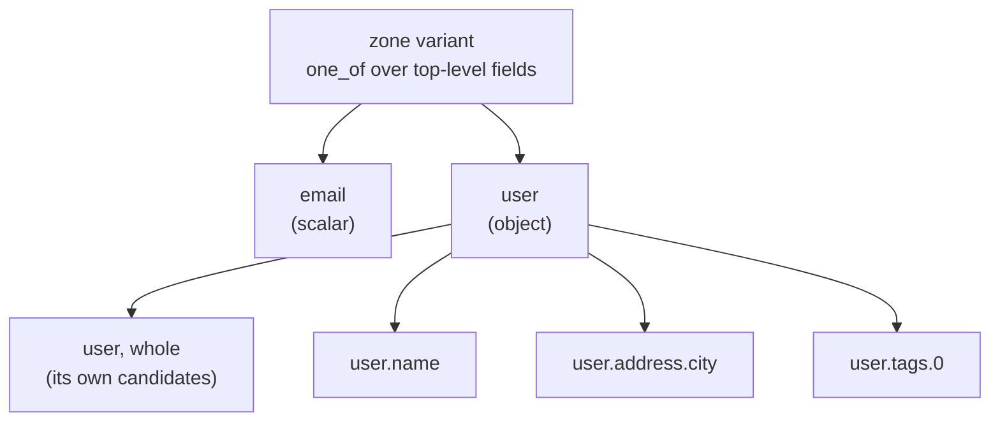

# Field addressing

A request poisons one field, and that field can sit anywhere inside the body: a
property of a wrapping object (`user.email`), a field of an array element
(`items.0.price`), or a field of a body sent as an array (`0.price`). This page
covers how the engine names such a field, which fields of a body it poisons, how
the split between them is drawn, and how focus entries, mass assignment, mutation
and control requests address them. How a single value is judged once it is sent is
on [Proving a violation](provable-violation.md); how a zone becomes a strategy is
on [Requests](requests.md).

## A field's path

`FieldPath(segments)` (`models/runtime/field_path.py`) is the value object that
says where a field lives inside a zone's values. Each segment is an object key
(`str`) or an array index (`int`), so `items.0` and a key literally named `"0"`
are two different paths. The empty path is the body itself.

| Member | What it gives |
| --- | --- |
| `spelled` | The segments joined by `.` (`FIELD_PATH_SEPARATOR`), unescaped, an index in decimal |
| `parent`, `leaf` | The path one level up, and the last segment; the root has neither |
| `child(segment)` | The path one level down |
| `is_prefix_of(other)` | Whether `other` is this path or lies beneath it |
| `is_root` | Whether the path is the body itself |

`FieldAddress(zone, field)` names one field of one zone. Built from a name, it
addresses one literal top-level key, and `$` (`BODY_ROOT`) addresses a body that
is itself the field. `FieldAddress.at(zone, path)` addresses a nested field and
spells it with `path.spelled`. Two addresses are equal when their zone and
spelling are, so a top-level field reads and compares the way it always has.

The spelled path is what every reader sees:

| The poisoned field | `request.poisoned_field` | `rule_id` and `location.path` |
| --- | --- | --- |
| a top-level `email` | `email` | `body.email` |
| `email` inside `{"user": {...}}` | `user.email` | `body.user.email` |
| `price` inside the elements of `items` | `items.0.price` | `body.items.0.price` |
| `price` inside a body sent as an array | `0.price` | `body.0.price` |
| a body that is not an object, whole | `$` | `body.$` |

Findings group by the poisoned field ([Findings](findings.md#signature)), so a
nested field is a finding of its own. A declared name that holds a dot
(`"user.email"` as one key) is cited by its whole name, never by what follows its
last dot.

**The replay reads the path back from the recorded values.** A trace stores the
spelled path. `TracedRequest` resolves it against the values it recorded for the
zone: it tries the whole text as one key first, then splits it at each `.`, and
reads a numeric segment as an index where the value is a list (`nested_path`).
The poisoned leaf and a mass-assignment key are always sent, so the recorded
values always hold the path. The core renders a finding's field by the same rule.

## Every leaf of a JSON body

A body sent as JSON carries objects and arrays as such, so the engine poisons each
of its **leaves**, not only its top-level fields
([ADR-174](adr/compiler.md#adr-174)). Form and multipart bodies send an object as
one text, and path, query and header values do not nest: those zones keep one
field per parameter.

`field_leaves(field, contract)` (`strategy_compiler/fields/field_tree.py`) walks a
field in preorder:

- **Objects.** It enters every declared property, required or optional. An object
  with properties is not a leaf itself: its leaves cover what it can vary.
- **Arrays.** It enters the element schema at index `0`. An array is also a leaf,
  because its size has edges of its own (`minItems`, `maxItems`). An array of
  scalars has the element as its leaf (`tags.0`).
- **Depth.** `MAX_FIELD_DEPTH` (8) is a guard against a pathological schema, not a
  policy: a holder at that depth is treated as a leaf.
- **No leaves** for a field that declares `enum`, or holds neither properties nor
  elements.

A leaf variant draws the field valid around its poisoned leaf. Every object and
array on the way to the leaf is sent, optional or not; its siblings are drawn
valid. An array on the way is drawn with at least one element and keeps its
declared `minItems`, `maxItems` and `uniqueItems`, compared by JSON equality
(`[1, 1.0]` is not unique). Element `0` holds the leaf. An array whose `maxItems`
is `0` has no leaf inside. An object keeps its `minProperties` and
`maxProperties`, the forced keys counted, and a leaf the declared maximum leaves no
room for is not offered.

### The split is drawn in two levels

A draw first picks a top-level field, with the same `one_of` over top-level
fields as a body without nesting. Then, inside that field, it picks one of the
field's own candidates or one of its leaf variants. A scalar beside an object of
ten leaves keeps its share of the draws; the object's share is divided among its
leaves. `PoisonTarget` (`strategy_compiler/poison_target.py`) holds one field and
its leaves, and builds that second level.

What each phase does with an object that has leaves:

| Phase | The object, whole | Its leaves |
| --- | --- | --- |
| `invalid` | kept: an object of the wrong type is a test of its own | added |
| `boundary` | replaced by its leaves (`leaves_replace_whole`); an array keeps its size edges | added |
| `attack` | kept with whatever candidates its type has (an object with required properties has none) | added |
| `mutation` | kept: the object operators (`drop_key`, `extra_key`, `pollute`) vary it whole | added |

An object whose leaves have no boundary edge (only booleans, for instance) has no
`boundary` variant. A `boundary` finding on a bound of a leaf names that leaf,
never its object: an over-long `user.email` is reported on `body.user.email`,
not on `body.user`.

## Focus entries name a path

An endpoint's `attack.focus_fields` and `sensitive_fields` name fields by the same
path ([ADR-175](adr/api.md#adr-175)). An entry is a bare top-level name or a zone
followed by a dotted path:

| Entry | Addresses |
| --- | --- |
| `email`, `body.email` | the top-level field, and everything inside it |
| `body.article.title` | that leaf only |
| `body.article` | every field inside the object |
| `body.items.0.price` | `price` in the elements of `items` |
| `body.0.price` or `body.$.0.price` | `price` in a body sent as an array |

A bare name never reaches a nested field. Under focus, a field no entry addresses
compiles `valid` instead of `attack`, and an object that holds an addressed leaf
is compiled as its carrier: its leaf is attacked and the object is never attacked
whole. `is_field_addressed` and `leads_to_addressed_field`
(`shared/field_addressing.py`) are the two predicates the compiler reads.

Under a strategy that plans `attack`, the policy boundary checks each
`focus_fields` entry along its whole path against the declared properties and
elements. A misspelled name, a path through a scalar, or a key into an array
without its index is a `PolicyError`. `sensitive_fields` entries are not checked.

## Mass assignment inside each object

The `attack` phase also slips an undeclared privileged key into the body's
objects, not only beside its top-level fields
([ADR-181](adr/compiler.md#adr-181)). `mass_assignment_variant` is one branch per
body zone. Inside it, one draw picks the place, the top of the body or one of its
objects, and one key of `MASS_ASSIGNMENT_KEYS` (`role`, `is_admin`, `admin`,
`owner`, `owner_id`, `balance`) that place does not declare.

- **Where.** Every object that declares properties and no `enum`, at any depth
  under the guard, the elements of an array included (`items.0.role`). A body sent
  as an array gets the same branch through `mass_assignment_root_variant`, into the
  objects of its elements (`0.role`). An object without properties has nothing to
  compare an echo against and gets no key.
- **Not where extra keys are allowed.** An object whose contract admits undeclared
  keys (`allow_extra_fields`) gets no key, and the oracle judges no key under such
  an object (`holder_admits_extra_keys`, `shared/extra_keys.py`). The top of the
  body follows the same rule.
- **Room.** The object's own declared draw is capped one key below its
  `maxProperties` (`MASS_ASSIGNMENT_KEY_ROOM`); `minProperties` is never lowered,
  and an object with no room left gets no key.
- **Focus.** Under focus, only the objects on a focused path are candidates.

The poisoned field is the key's path (`user.role`), and the rule id follows
(`body.user.role`). The oracle looks for the key's echo at any depth of the
response. On a JSON body the echo matches by plain equality, so a stored `true`
echoed as `1` is still the value sent. On a form or multipart body the key went as
text, and the echo is compared with that text: a server that parses the `true` it
received and echoes `true` is a finding.

The control request sends the minimal payload without the key at its path, its
other open strings rotated and the values it took from the run's corpus held, so a
resource the run created is still addressed ([Findings](findings.md#states)).

## Mutation varies one field

`mutation` breaks a valid value with one operator ([Strategy
compiler](strategy-compiler.md#the-mutation-phase)). Each mutated request varies
**one** field, an object or one of its leaves, and keeps every other field valid
([ADR-180](adr/compiler.md#adr-180)). The mutated value is then classified: when,
as it travels on its wire, it provably breaks the field's contract, the field is
the request's poisoned field and the oracles judge it. When it does not (an
incremented integer still in range), the request is judged as a valid one:
`contract_completeness` can speak on it, and its signature names no field.

`ZoneDraw` keeps the two apart. `varied_field` is the field drawn outside valid
values, which the corpus overlay never overwrites; `poisoned_field` is set only
when that value provably breaks the contract. `PoisonCandidate.poisons` carries the
classification from the candidate to the draw.

- **A zone with nothing to vary** keeps the plain mutation: every field mutated at
  once and nothing judged (`plain_fallback`), so the phase's share is still spent.
- **Reserved headers are never mutated** (`spares_reserved_headers`): a header
  whose name is the transport's (`Content-Type`) or reads as a credential belongs
  to the identity, and the injector would drop it. `invalid` and `attack` still
  reach those headers.

## Controls on a nested field

The `input_induced_timeout` control sends the poisoned field at its minimal valid
value ([Findings](findings.md#states)). For a nested field it takes from the
endpoint's minimal valid payload the outermost ancestor that payload leaves out,
or else the outermost array on the way, or else the field itself. A leaf under an
optional object is restored with that object whole, so the control is a valid
request, and an element is never duplicated against `uniqueItems`.

## Known limits

- **Mass assignment counts one finding per key.** A server that echoes every
  undeclared key yields up to six findings for one defect, one per key, at every
  object it echoes.
- **Leaves on a text wire.** A form or multipart field that is an object, or an
  array of objects, goes as one text and is not entered; its value is unreadable to
  the oracles ([Proving a violation](provable-violation.md#reading-a-value-as-it-travels)).
- **The reserved-header rule for mutation is by name.** A declared `x-api-key`
  header that is not a credential of the run is still never mutated.
