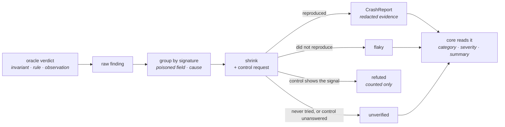

# Findings: taxonomy and evidence

A **finding** is one response that broke one of the engine's invariants. This page
says how a finding is classified, what it records about the breach, what evidence
travels with it, which states it can end in, and what is withheld from it before
it leaves the engine. The pipeline that groups and shrinks findings is in
[Engine internals](engine-internals.md#the-finding-pipeline); the wire shape of a
finding is in the [Run Report](../../user-guide/reports.md#the-reportjson-schema).

## One registry classifies every invariant { #taxonomy }

`INVARIANT_TAXONOMY` (`models/runtime/taxonomy.py`) holds one `InvariantInfo` per
`InvariantViolation` member. An entry fixes the invariant's `category`, its
`severity`, the `label` a frontend shows, its `rule_source` and, for an intrinsic
rule, the rule's text. Nothing is stored per finding: the core reads the registry
when it reads a finding, so a stored run is classified as the registry says today
([ADR-148](adr/findings.md#adr-148)).

The table is in registry order, which breaks ties within one severity. **Replay**
says whether a replay's contract-free oracles can see the invariant again
([ADR-154](../core/adr/core.md#adr-154)).

| Invariant | Category | Severity | Label | Rule source | Replay |
| --- | --- | --- | --- | --- | --- |
| `not_a_server_error` | `crash` | `high` | Server error | intrinsic: a response must never be a 5xx server error | yes |
| `access_control` | `access` | `critical` | Access control bypass | declared | no |
| `mass_assignment` | `security` | `high` | Privileged field accepted | declared | no |
| `sensitive_data_exposure` | `security` | `high` | Sensitive data in response | declared | yes, when the request was poisoned |
| `information_disclosure` | `security` | `medium` | Internal details leaked | declared | yes |
| `reflected_payload` | `security` | `medium` | Input reflected unescaped | declared | yes |
| `input_induced_timeout` | `security` | `medium` | Input-induced timeout | declared | yes, except rule `request` |
| `semantic_property` | `business_rule` | `high` | Business rule broken | declared | no |
| `state_transition` | `business_rule` | `high` | Broken state transition | intrinsic: a follow-up request on a produced resource must return the status the transition expects and echo the values it set | no |
| `input_validation` | `contract_hygiene` | `medium` | Invalid input accepted | declared | no |
| `response_schema_conformance` | `contract_hygiene` | `medium` | Response breaks its schema | intrinsic: a response body must match the schema declared for its status code | no |
| `contract_completeness` | `contract_hygiene` | `low` | Valid request rejected | declared | no |
| `content_type_conformance` | `contract_hygiene` | `low` | Content-Type mismatch | intrinsic: a response body must carry the declared Content-Type | no |
| `undeclared_response_field` | `contract_hygiene` | `low` | Undeclared response field | declared | no |
| `status_code_conformance` | `contract_hygiene` | `info` | Undeclared status | intrinsic: a response must carry a status code the contract declares | no |
| `latency_sla` | `performance` | `medium` | SLA exceeded | intrinsic: a clean response must arrive within the run's latency SLA | no |
| `latency_degradation` | `performance` | `medium` | Degrades under load | intrinsic: a clean response's latency must not grow with concurrency beyond the run's tolerance | no |
| `resilience_degradation` | `crash` | `medium` | Breaks on malformed transport | intrinsic: a deliberately broken request must be rejected cleanly, never with a 5xx or a dropped connection | no |

A **declared** rule comes from the contract: a business rule, an access policy, or
the field the finding names as `<zone>.<field>` (`body.role`). Its id is the
finding's `rule_id`, so one endpoint reports one finding per rule. An
**intrinsic** rule is the invariant's own; its id repeats the invariant. Only
`access_control` is **identity-scoped**: the identity that sent the request tells
two of its findings apart ([ADR-106](adr/engine.md#adr-106)).

`undeclared_response_field` is **opt-in**: it judges only under a strategy that
turns it on, which among the built-ins is `conformance`
([Strategies](strategies.md#opt-in-oracles)). A JSON response breaks it when an
object whose declared schema names its properties, and does not admit extra ones,
holds a key it does not declare; a secret-looking key is left to
`sensitive_data_exposure`. Its rule is the schema path of the shallowest such
object, built from declared names only: `response` for the body's root,
`response.owner` for a declared nested object, never a key the server chose
([ADR-157](adr/strategies.md#adr-157)).

`sensitive_data_exposure` judges every successful response whose status declares
a body schema, and the successful response to a poisoned request whether or not
one is declared. A secret-looking key is undeclared when the object that holds it
does not declare it. A replay, which judges without a contract, can see it again
only when the recorded request was poisoned
([ADR-158](adr/findings.md#adr-158)).

`FindingCategory` and `Severity` are closed; their meanings are in the
[result vocabularies](../core/protocol/vocabularies.md#category). `Severity` is
declared from the most severe to the least, and its `rank` is that position: the
report sorts its defects by it.

## The observation { #observation }

Every oracle verdict carries an `Observation`: four slots that say what broke, in
the same shape for every invariant ([ADR-149](adr/findings.md#adr-149)).

| Slot | Holds |
| --- | --- |
| `expected` | What the contract or the invariant expected: a declared keyword and its value, the declared statuses, an SLA, an access policy. |
| `observed` | What the response, or the request as the server read it, actually held. |
| `location` | Where in the exchange the observed value lives: a `scope` and a `path`, or `null` when the observation names no place. |
| `marker` | What kind of breach it is, when the invariant has several: an access policy, a disclosure marker, an attack family, `echo` or `status`, `loc` or `message_key`, `connection_dropped`, `confirmed`. |

`LocationScope` fixes how `location.path` reads:

| Scope | `path` is |
| --- | --- |
| `request_field` | `<zone>.<dotted.path>`, spelled as a rule id (`body.user.email`) |
| `response_body` | An RFC 6901 pointer into the response body; `""` is the whole body |
| `response_header` | The lower-case header name |
| `load_step` | The concurrency of the load step |
| `caller` | The label of the identity that sent the request |
| `follow_up` | `<METHOD> <path>` of the follow-up request |

What each invariant puts in the slots:

| Invariant | `expected` | `observed` | `location` | `marker` |
| --- | --- | --- | --- | --- |
| `not_a_server_error` | — | the status, or the transport error | — | `connection_dropped` when the connection was cut |
| `access_control` | `{policy, owner}`, `{policy, role}` or `{policy, invalid_credential}` | the status | `caller` (none when anonymous) | the policy |
| `mass_assignment` | — | the value echoed back | `request_field` `body.<key>` | — |
| `sensitive_data_exposure` | — | the pointer of every undeclared secret key, in order of appearance | `response_body` `""` | — |
| `undeclared_response_field` | each schema path holding an undeclared key, with the property names it declares | `{pointers, omitted}`: the first 20 pointers of undeclared keys, and how many more | `response_body` `""` | — |
| `information_disclosure` | — | the fragment that leaked | the poisoned field | the disclosure marker |
| `reflected_payload` | — | the reflected text | the poisoned field | the attack family |
| `input_induced_timeout` | — | the elapsed ms | the poisoned field (none for a valid value) | — |
| `semantic_property` | — | `{field: value}` for each field the rule references | — | the property class |
| `state_transition` | the expected statuses, or the value sent | the status, or the value echoed | `follow_up`, or `response_body` | `status` or `echo` |
| `input_validation` | `{keyword: declared}` of the first mismatch | the value as the server read it | the poisoned field | — |
| `response_schema_conformance` | `{keyword: declared}` | the value at the pointer | `response_body` pointer | — |
| `contract_completeness` | — | the server's message for the field it blames | the blamed field (none: the whole request) | `loc` or `message_key` |
| `content_type_conformance` | the declared type | the received type, or `null` | `response_header` `content-type` | — |
| `status_code_conformance` | the declared status keys | the status | — | — |
| `latency_sla` | the SLA in ms | the latency in ms | — | — |
| `latency_degradation` | `{p95_ms, baseline_concurrency, baseline_p95_ms}` | the confirmed step's p95 | `load_step` | `confirmed` |
| `resilience_degradation` | — | the status, or the transport error | — | the chaos attack |

### The summary sentence

The core turns the observation into one sentence, `summary`, each time it reads a
finding ([ADR-153](../core/adr/core.md#adr-153)): in the report, in `get_run` and
`get_finding`, and in the `finding` event. For example:

- `` `GET /users/{id}` answered 200 with undeclared secret fields: `/password_hash`, `/user/tokens`. ``
- `` `GET /articles` returned `/articles/0/body`, which its contract does not declare. ``
- `` `GET /search` did not answer within 10007.5 ms to `query.factor = 127`; the control request answered 200 in 402.4 ms. ``

A value is shown as compact JSON, clipped to 48 characters; a withheld value reads
`***`. A finding that did not confirm says so at the end: "observed once; it did
not reproduce", "observed once; the run stopped before retrying it", or "observed
once; nothing to judge it against" when its control request got no answer. A
finding stored without an observation still gets a sentence:
"`` `METHOD /path` `` broke *label* with *status*."

## The evidence { #evidence }

Besides its reproducer (`minimal_payload`, `sanitized_headers`, `response_body`),
a `CrashReport` carries three evidence objects (`models/runtime/evidence.py`).
They are built in `build_crash_report` and nowhere else, so they pass through the
same redaction.

| Object | Fields | What it says |
| --- | --- | --- |
| `RequestEvidence` | `url`, `poisoned_zone`, `poisoned_field`, `attack_family`, `trigger_fields` | Where the request went (no userinfo, no query, no fragment: the query is in the payload), the field it drew outside its schema, the payload family it used, and the fields whose values the shrink found the finding needs. |
| `ResponseEvidence` | `content_type`, `headers`, `latency_ms` | What the response carried besides its status and body. |
| `ControlEvidence` | `status_code`, `latency_ms`, `error` | What the control request the finding was judged against got back; `null` when none was sent. |

`trigger_fields` are the top-level fields where the minimal payload differs from
the simplest payload the same phase draws, spelled `<zone>.<field>`. A stateful
finding's `transition_sequence` lists the steps before the failing one; each step
carries its `method`, `path`, `status`, its `payload` by zone and its
`response_body`, both redacted.

An unconfirmed finding carries the `observation`, `request` and `response` of the
first member of its group (`FirstSeenEvidence`), redacted the same way.

## Signature and cause { #signature }

Raw findings group by `FindingSignature`: endpoint, phase, invariant, status,
identity (for `access_control` only), rule id, body fingerprint and the
**poisoned field**. Two fields that break one endpoint the same way are two
findings.

A sent credential never reaches a signature: the body fingerprint reads a JSON
body's top-level keys, and the rule id, with every credential the request sent
scrubbed.

A group whose requests poisoned no field (a finding of the `valid` phase, for
instance) can still hide two causes. After the first faithful representative is
shrunk, the engine walks the other members ([ADR-150](adr/findings.md#adr-150)):

1. A member that sent the representative's values in every trigger field is
   explained, at no cost.
2. Otherwise a probe sends the representative's minimal payload with the member's
   values in the trigger fields. If it still reproduces, the member is explained.
3. Otherwise the member is shrunk as a second representative, holding those
   fields, on half the shrink budget. It becomes a report of its own only if its
   trigger fields differ from the first one's.

A group spends at most `CAUSE_PROBES_PER_SIGNATURE` (3) probes and
`MAX_REPRESENTATIVES_PER_SIGNATURE` (2) shrinks. Every request the walk sends
counts in `requests_shrink`.

## Finding states { #states }

| State | Meaning | Counted in |
| --- | --- | --- |
| `confirmed` | The shrunk payload reproduced the finding, and a control request, when its invariant has one, did not show the same signal. | `findings_confirmed` |
| `flaky` | The shrunk payload did not reproduce it. | `findings_flaky` |
| `unverified` | Never checked: the run stopped first or the member was never attempted, or its control request got no answer (a timeout, a refused connection), so there is nothing to judge it against. | `findings_unverified` |
| refuted | The shrunk payload reproduced it, and so did the control request: the input was not the cause. Never listed as a finding. | `findings_refuted` |

**Control requests** ([ADR-151](adr/findings.md#adr-151)). Two invariants are
confirmed against one, in the stateless mode:

| Invariant | Control payload | Refuted when the control |
| --- | --- | --- |
| `mass_assignment` | The minimal payload without the smuggled key | Echoes the key all the same |
| `input_induced_timeout` | The poisoned field at its minimal valid value; without a poisoned field, the endpoint's minimal valid payload | Times out too |

An unverified finding whose control got no answer carries that control's
`ControlEvidence`, so a reader sees why it stayed unverified.

**A timeout on a valid value.** When a streak of timeouts no oracle judged reaches
the infrastructure threshold with the target alive, the engine sends the
endpoint's minimal valid payload as a control. If it answers in time, each timeout
of the streak becomes an `input_induced_timeout` finding with the rule `request`,
and the exploration goes on. If it does not, the endpoint stops with
`infrastructure_abort`. The stateful mode does not do this: its streak spans
endpoints, so there is no single request to control against.

## Redaction { #redaction }

A finding is meant to be shared. Before it leaves the engine, every value it
carries passes four filters ([ADR-152](adr/findings.md#adr-152)). The trace keeps
the raw exchange.

**By name.** One predicate, `is_sensitive_field_name` (`shared/sensitive_names.py`),
decides whether a field or header name holds a secret. The
`sensitive_data_exposure` oracle uses the same predicate, so what the engine
reports as a leaked secret is exactly what it withholds from its own evidence. A
name is sensitive when:

- after folding case, `_` and `-`, it is a known credential (`password`, `token`,
  `access_token`, `api_key`, `authorization`, `cookie`, `session_id`,
  `private_key`, ...);
- one of its words holds a secret stem (`password`, `passwd`, `passphrase`,
  `passcode`, `totp`, `secret`, `token`, `session`, `sessid`, `credential`, `jwt`,
  `bearer`, `csrf`, `xsrf`), in snake, kebab or camel case, plural or run together;
- it spells a compound stem once its separators are removed (`apiKey`,
  `signing_key`, `client-assertion`, `recovery_code`, `connection_string`, ...);
- it has `pwd`, `otp` or `sid` as a word of its own, or names a hashed secret such
  as `password_hash` or `pin_salt`.

A token beside `count`, `page`, `next`, `cursor`, `limit`, `total`, `usage` and
similar words is a counter or a cursor (`next_page_token`, `max_tokens`), and a
session beside `count`, `name`, `length`, `duration` or `timeout` is an attribute
of one: neither is withheld, and neither is `secretary`. The endpoint's declared
`sensitive_fields` are withheld too.

**By location and slot.** An observation is withheld slot by slot. When its
`location` names a sensitive request field, response pointer or response header,
the slots that hold a value the exchange carried read `***`; a latency, a status,
a declared keyword or an SLA is never withheld. `EXCHANGED_SLOTS`
(`runtime/findings/redaction/exchanged_slots.py`) fixes, per invariant, which slots carry an
exchanged value: `observed` for `mass_assignment`, `reflected_payload`,
`semantic_property`, `input_validation`, `response_schema_conformance` and
`contract_completeness`; both for `state_transition`; none for the rest. A dotted
key in a semantic rule's `observed` map is withheld when any of its segments is
sensitive.

**By credentials.** Response headers named `set-cookie`, `www-authenticate`,
`proxy-authenticate`, `authorization`, `cookie` or `x-api-key`, the run's
credential headers and any header with a sensitive name read `***`. Every
credential a request of the finding sent (its credential headers and URL userinfo,
in every derived form and per-character encoding,
[ADR-109](adr/engine.md#adr-109)) is scrubbed wherever it appears.

**By value.** Every value withheld by name from the request, from the failing
response (its body and its headers), and from the earlier steps of a stateful
finding (what they sent and what their responses returned, `Set-Cookie`
included), is scrubbed from the rest of the finding: a token the response returns
under `token` and copies under a neutral key or into a `Location` header reads
`***` in both places. A value the response returned is scrubbed by value only
when it is a text of at least 8 characters; a shorter one stays withheld by name. A text equal to
a withheld text is replaced whatever its length; a withheld value of at least 8
characters is also scrubbed wherever a text spells it. A number or a boolean is
never withheld for equalling one.

**The reproducer rule.** `minimal_payload` and `sanitized_headers` withhold their
sensitive fields by name and every credential, and scrub what earlier steps
exchanged, but keep the failing request's other values: they are what reproduces
the finding.

**The URL.** `request.url` drops userinfo, query and fragment, and spells the
route with the path values as the redacted payload shows them: a sensitive path
parameter reads `***` in the URL as it does in the payload.

## Adding a new invariant

1. Add the member to `InvariantViolation` (`models/runtime/invariant.py`).
2. Add its entry to `INVARIANT_TAXONOMY`, at the place that ranks it within its
   severity: `_intrinsic(category, severity, label, rule, contract_free=...)` for a
   rule the invariant states, `_declared(category, severity, label,
   contract_free=...)` for one the contract states.
3. Add its entry to `EXCHANGED_SLOTS`: which slots hold a value the exchange
   carried.
4. Have its oracle return an `Observation`, and test what each slot holds.
5. In the core, add the member to `finding_summary.Invariant` and a
   `SentenceStrategy` to `SENTENCES`. Without one, the finding reads the fallback
   sentence.
6. If the invariant should judge only when a strategy asks for it, register its
   oracle with `opt_in=True` and name it in that strategy's `optional_oracles`
   ([Adding an opt-in oracle](strategies.md#adding-an-opt-in-oracle)).

`TestNewInvariant`, in the engine's extensibility gate, fails while step 2 or 3 is
missing, and a core test holds `finding_summary.Invariant` to the engine's
members. The catalog's `vocabulary.invariants` lists the new invariant with no
change to the core.
