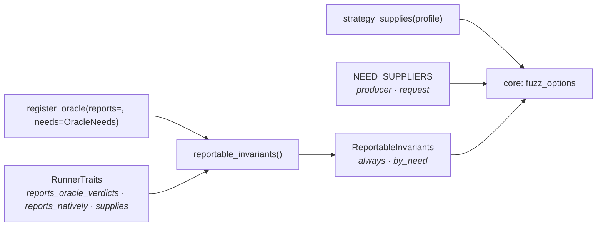

# What a run can find

Every runner variant can say which invariants it is able to report, and which
choices of the run add more. Nobody writes that list. It is derived from two
declarations the engine already holds to its behaviour:

- each **oracle registration** says which invariants the oracle reports and what a
  response must come with before it can judge it: its **needs**, as alternatives;
- each **runner variant's traits** say whether the oracles' verdicts on its
  responses become findings, which invariants the runner judges itself, outside the
  oracles, and which needs it meets on the responses it judges.

A need the runner does not meet is left to the run's strategy, its producer or one
of its parameters. The core publishes the result per variant, with who meets each
need, so a client computes what a run can find from data
([What a run can find](../core/protocol/fuzz-options.md#what-a-run-can-find)).



## Oracle needs { #oracle-needs }

`OracleNeed` (`models/runtime/oracle_need.py`) is the closed vocabulary of what a
response can come with. `NEED_SUPPLIERS` names who meets each one (`NeedSupplier`):
a runner meets its needs on every response it judges; a strategy, a producer or
the run's request meets a need only when it declares what the need asks for.

| `OracleNeed` | Supplier | Met when |
| --- | --- | --- |
| `contract` | runner | The runner judges the response against the endpoint's declared responses and field schemas |
| `semantic_properties` | producer | A producer declared business rules for the endpoint |
| `opt_in` | strategy | The strategy names the oracle in its `optional_oracles` |
| `poisoned_field` | strategy | The strategy plans a phase that poisons one field per request, within its declared schema or outside it |
| `out_of_schema_field` | strategy | The strategy plans a phase that can send a declared field outside its schema |
| `rule_witness` | producer | A producer infers a rule the spec does not declare, so the valid pass sends a [witness](witnesses.md) that breaks only that rule |
| `seed_case_expectation` | producer | A producer offers a seed case that says whether the server should reject or accept it, so the valid pass sends that case, judged when every one of its values was sent ([ADR-203](adr/findings.md#adr-203)) |
| `attack_phase` | strategy | The strategy plans the `attack` phase |
| `reflecting_attack` | strategy | The strategy plans `attack` and allows a family in `REFLECTING_FAMILIES` |
| `chaos_expectation` | runner | The runner knows what the chaos attack behind the response tolerates |
| `access_expectation` | runner | The runner knows which caller the endpoint's access policy admits |
| `admitted_caller` | runner | The runner sends as a caller the endpoint admits, so no access violation names a 2xx first |
| `latency_sla` | request | The run sets a latency SLA |

`REFLECTING_FAMILIES` is `xss`, `injection` and `sql_injection`: the families
whose payload is dangerous when a page echoes it unescaped. The
`reflected_payload` oracle gates on the same set, so the need and the check cannot
disagree. Each need has a label in `VOCABULARY_LABELS`, which the core publishes as
`vocabulary.oracle_needs`.

`auth` never meets `admitted_caller`: it sends only callers the policy refuses, so
a 2xx it gets is an access violation before it is anything else.

## What each oracle declares { #what-each-oracle-declares }

`register_oracle(oracle, *, reports=, needs=)` records both on the
`OracleRegistration`. `needs` is an `OracleNeeds`: a set of **alternatives**, each a
set of needs. The oracle can report once every need of any one alternative is met.
Three expressions build one:

- `OracleNeeds.all_of(a, b)` is one alternative: `a` and `b`;
- `x | y` is either: the alternatives of `x` and those of `y`;
- `x & y` is both: every alternative of `x` joined with every alternative of `y`.

`NO_NEEDS` is `all_of()`, one empty alternative: the oracle judges every response.
The two flags the pipeline reads are properties of the needs: `opt_in` and
`requires_contract` hold when **every** alternative waits on `opt_in` or on
`contract` (`needs.requires(need)`). The built-ins, from `register_builtin_oracles`:

| Oracle | Reports | Needs, as alternatives |
| --- | --- | --- |
| server error | `not_a_server_error` | — |
| information disclosure | `information_disclosure` | — |
| status code | `status_code_conformance` | `contract` |
| content type | `content_type_conformance` | `contract` |
| schema | `response_schema_conformance` | `contract` |
| contract completeness | `contract_completeness` | `contract` |
| undeclared response field | `undeclared_response_field` | `contract` + `opt_in` |
| semantic | `semantic_property` | `admitted_caller` + `contract` + `semantic_properties` |
| mass assignment | `mass_assignment` | `admitted_caller` + `contract` + `attack_phase` |
| input validation | `input_validation` | `admitted_caller` + `contract` + `out_of_schema_field`; or `admitted_caller` + `contract` + `rule_witness` |
| sensitive data | `sensitive_data_exposure` | `admitted_caller` + `contract`; or `admitted_caller` + `poisoned_field`; or `admitted_caller` + `rule_witness` |
| input-induced timeout | `input_induced_timeout` | `poisoned_field`; or `rule_witness` |
| reflected payload | `reflected_payload` | `reflecting_attack` |
| resilience | `resilience_degradation` | `chaos_expectation` |
| access control | `access_control` | `access_expectation` |
| latency SLA | `latency_sla` | `latency_sla` |
| seed case expectation | `expected_rejection`, `expected_acceptance` | `admitted_caller` + `contract` + `seed_case_expectation` |

The infrastructure oracle reports no invariant: it stops the pipeline on a
transport failure.

## What each runner declares { #runner-supplies }

Three fields of `RunnerTraits` carry the runner's side
([Runner traits](strategies.md#runner-traits)):

- `reports_oracle_verdicts`: whether the oracles' verdicts on its responses become
  findings. `replay` sets it `False`: its verdicts only mark the request it re-sent;
- `reports_natively`: the invariants the runner judges outside the oracle
  pipeline;
- `supplies`: the needs met for the oracles that reach its responses. A need a
  strategy, a producer or the request supplies is listed there when the runner
  lets it through: it is met only once that supplier declares it.

Four constants name the usual sets. `ENDPOINT_JUDGEMENT` (`contract`,
`semantic_properties`, `opt_in`) is what judging a response against its endpoint
meets; `ADMITTED_JUDGEMENT` adds `admitted_caller`. `POISONING_DRAWS`
(`poisoned_field`, `out_of_schema_field`, `attack_phase`, `reflecting_attack`) is
what requests drawn from every planned phase meet. `STREAK_INVARIANTS`
(`input_induced_timeout`) is what a streak of unpoisoned timeouts becomes once a
control request answers in time; every runner built on the stateless fuzzer
reports it natively.

| Mode · variant | `reports_natively` | `supplies` |
| --- | --- | --- |
| `stateless` · `default` | `STREAK_INVARIANTS` | `ADMITTED_JUDGEMENT` ∪ `POISONING_DRAWS` ∪ `VALID_PASS_SENDS_AS_BUILT` (`rule_witness`, `seed_case_expectation`) |
| `stateful` · `default` | `state_transition` | `ADMITTED_JUDGEMENT` ∪ `rule_witness` |
| `performance` · `flat` | `STREAK_INVARIANTS` | `ADMITTED_JUDGEMENT` ∪ `latency_sla` ∪ `POISONING_DRAWS` ∪ `VALID_PASS_SENDS_AS_BUILT` |
| `performance` · `ladder` | `STREAK_INVARIANTS`, `latency_degradation` | `ADMITTED_JUDGEMENT` ∪ `latency_sla`: each step sends the strategy's `valid` traffic alone, nothing a contract adds |
| `resilience` · `default` | — | `chaos_expectation`, `admitted_caller` |
| `auth` · `default` | — | `ENDPOINT_JUDGEMENT` ∪ `access_expectation` |
| `replay` · `default` | — | — (`reports_oracle_verdicts` is `False`) |

`stateful` draws only `valid` values and transitions, so no strategy reaches a
poisoning need there. `resilience` judges its chaos responses without the contract
and names no optional oracle.

## The derivation

`reportable_invariants(traits, registrations)` returns a `ReportableInvariants`;
`reportable_for(traits)` runs it against the oracles registered now.

1. A variant whose `reports_oracle_verdicts` is `False` reports only
   `reports_natively`; the oracles add nothing.
2. The runner meets the needs in `supplies` whose supplier is the runner.
3. Each alternative of each registration becomes one entry whose **unmet** needs
   are the alternative minus those.
4. `always` is `reports_natively` plus what every entry with no unmet need reports.
5. For each need in `supplies` that the runner does not meet itself, `by_need` maps
   it to what the entries whose only unmet need is that one report, minus
   `always`. An empty entry is dropped.

An invariant two needs can open sits under each: in `stateless`, `input_validation`
is under both `out_of_schema_field` and `rule_witness`, and either one is enough.
An entry with an unmet need outside `supplies` never appears: `resilience` does
not judge against the contract, so the four conformance oracles are absent from it
whatever the strategy. No alternative waits on two needs a runner cannot meet:
`register_oracle` refuses one with `RegistrationError`, so one need per entry of
`by_need` is enough.

**What a strategy meets** is `strategy_supplies(profile)`
(`strategy_compiler/supplied_needs.py`), one rule per need:

| Need | The profile meets it when |
| --- | --- |
| `poisoned_field` | One of its phases poisons a field for its contract type |
| `out_of_schema_field` | It plans `boundary` (a length one past a bound), `invalid` or `mutation`; or it plans `attack` and allows a family a field is attacked with by its type alone: `injection`, `xss`, `path_traversal`, `input_validation`, `information_disclosure`, `business_logic` or `resource_abuse` |
| `attack_phase` | `attack` is in its `phase_split` |
| `reflecting_attack` | It plans `attack`, and its `attack_families` is `None` or allows one of `REFLECTING_FAMILIES` |
| `opt_in` | Its `optional_oracles` is not empty |

That gives `default` `poisoned_field` and `out_of_schema_field`; `security`
`poisoned_field`, `out_of_schema_field`, `attack_phase` and `reflecting_attack`;
`conformance` `opt_in`, `poisoned_field` and `out_of_schema_field`; `exposure`
`poisoned_field` and `attack_phase` (`auth_bypass` is neither a typed nor a
reflecting family); `smoke` nothing. The needs a producer or the request meets are
read off `NEED_SUPPLIERS`: the core maps each producer-supplied need
(`semantic_properties`, `rule_witness`, `seed_case_expectation`) to the `fixture`
and `inference` producers,
and each request-supplied need to the run parameter that sets it.

A need a strategy meets may open no row. `poisoned_field` opens none: the two
oracles that wait on it, `sensitive_data_exposure` and `input_induced_timeout`,
are already in the `always` of every variant that meets it, the first through
`admitted_caller` + `contract`, the second natively (`STREAK_INVARIANTS`).

## The result { #the-result }

What the built-in variants can report. **Always** holds whatever the strategy,
producer and parameters; **when** adds a set once the named need is met. Two sets
recur:

- the **judged set**: `not_a_server_error`, `sensitive_data_exposure`,
  `information_disclosure`, `response_schema_conformance`,
  `contract_completeness`, `content_type_conformance` and
  `status_code_conformance`;
- the **endpoint rows**: `semantic_properties` adds `semantic_property`, and
  `opt_in` adds `undeclared_response_field`.

| Mode · variant | Always | When |
| --- | --- | --- |
| `stateless` · `default` | the judged set, `input_induced_timeout` | the endpoint rows · `out_of_schema_field`: `input_validation` · `rule_witness`: `input_validation` · `seed_case_expectation`: `expected_rejection`, `expected_acceptance` · `attack_phase`: `mass_assignment` · `reflecting_attack`: `reflected_payload` |
| `stateful` · `default` | the judged set, `state_transition` | the endpoint rows · `rule_witness`: `input_induced_timeout`, `input_validation` |
| `performance` · `flat` | the judged set, `input_induced_timeout` | everything `stateless` adds, plus `latency_sla`: `latency_sla` |
| `performance` · `ladder` | the judged set, `input_induced_timeout`, `latency_degradation` | the endpoint rows · `latency_sla`: `latency_sla` |
| `resilience` · `default` | `not_a_server_error`, `information_disclosure`, `resilience_degradation` | — |
| `auth` · `default` | the judged set but `sensitive_data_exposure`, plus `access_control` | `opt_in`: `undeclared_response_field` |
| `replay` · `default` | — | — |

`auth` lists everything that judges its responses; only `access_control` and a
crash come out `confirmed`, the rest `unverified`
([Findings](findings.md#states)). The core does not publish `replay`: its
`execution` parameter does not accept it, and it reports nothing a client could
pick it for.

## What holds it { #what-holds-it }

Two gates hold the derivation, one to the declarations and one to the runs.

`tests/test_invariant_claims_gate.py` checks that:

- every `InvariantViolation` is reported by a built-in oracle or a runner;
- every `OracleNeed` has a supplier, and every registered mode declares its variants;
- no alternative of an oracle waits on two needs a runner cannot meet;
- each built-in variant derives exactly the table above, so a change to it is
  deliberate.

`tests/test_reachability_gate.py` drives each variant through its real runner:

- every published pair, an invariant in a variant's `always` or in one of its rows,
  runs that variant against a toy target breaking the invariant, with the row's need
  met, and the run must report it;
- every variant runs against every target and reports nothing outside what it
  publishes for the needs that target meets;
- every strategy is held the same way to each need it says it meets: a stateless
  run under it reports what that need opens, and nothing it does not publish;
- every need a strategy says it meets opens a row a run reaches, or is one of the
  needs that open none (today `poisoned_field`), and those are in no variant's rows;
- a replay re-sending a crash reports nothing.

A pair no unit-speed run could reach would be listed with its reason in the gate's
`_UNREACHED`; the list is empty. The runner-traits gate holds the traits themselves
to what each runner sends ([Testing](testing.md)).

Attack families are modelled as a need only where an oracle depends on one:
`reflecting_attack`, and `out_of_schema_field` for the families a field is attacked
with by its type alone. Every other family is covered by `attack_phase`
([ADR-199](adr/strategies.md#adr-199)).

## Adding to it

**A new oracle.** Register it with what it reports and needs, pin the result in
the claims gate's expected table, and give each new pair a target in the
reachability gate:

```python
from specforge_engine.models.runtime import OracleNeed, OracleNeeds

poisoned = OracleNeeds.all_of(OracleNeed.POISONED_FIELD) | OracleNeeds.all_of(OracleNeed.RULE_WITNESS)

register_oracle(
    MyOracle(),
    reports=frozenset({InvariantViolation.MY_INVARIANT}),
    needs=OracleNeeds.all_of(OracleNeed.CONTRACT) & poisoned,
)
```

Each alternative may hold at most one need a runner cannot meet; `register_oracle`
raises `RegistrationError` on one that holds more, naming the oracle. An oracle
registered with `NO_NEEDS` is in the `always` of every variant that reports oracle
verdicts.

**A new need.**

1. Add the `OracleNeed` member, its row in `NEED_SUPPLIERS`, and its label in
   `models/runtime/labels.py`.
2. Make its supplier meet it: a runner lists it in `supplies`; a strategy gets a
   rule in `supplied_needs.py`; a producer need reaches `fixture` and `inference`
   with no further change; a request need gets its parameter in the core's
   `REQUEST_PARAMETERS` (`services/catalog/reportable.py`), without which the
   catalog fails to build.
3. Add its row to the `oracle_need` table of the protocol README §8.1.

**A new runner.** Declare `reports_oracle_verdicts`, `reports_natively`,
`supplies` and `text` on each variant's `RunnerTraits`, and the runner's own
`text` ([Labels and summaries](strategies.md#labels-and-summaries)); then pin its
row in the claims gate and give it a run in the reachability gate's `VARIANT_RUNS`.
