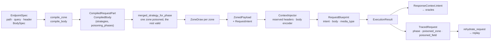

# Requests: zones, wires and intent

A request the engine sends is built in two halves. The compiler turns each
request zone into a strategy that draws the zone's values, and names the one field
a draw poisons. The runtime assembles one draw per zone into a payload, writes it
onto the wire for its zone and media type, and carries what the request was drawn
to test (its **intent**) to the oracles, the trace and the replay. This page
follows a request through both halves. How a single field becomes a strategy is
on [Strategy compiler](strategy-compiler.md); how the run sends and judges it is
on [Engine internals](engine-internals.md).

## Zones and their wires

`RequestZones` holds the three parameter zones as `ParamMap`s (`path`, `query`,
`header`) and the body as a `BodySpec`. Each zone carries values a different way,
and that decides what a server can tell apart. `ZoneWire` names the three ways,
and `zone_wire(zone, media_type)` picks one
([ADR-117](adr/compiler.md#adr-117)):

| `ZoneWire` | Zones | What it carries |
|---|---|---|
| `STRUCTURED` | a body with a JSON media type, or none | types and `null`, as such |
| `TEXT` | query, header, a body of any other media type (form, multipart) | every value as text; `None` is the field left out |
| `SEGMENT` | path | text that can be neither empty nor left out |

A media type is JSON when its essence is `application/json` or ends in `+json`
(`is_json_media_type`, exported by the facade).

## Alphabets

A string draws its characters from one `TextAlphabet`, chosen by the zone and the
phase it is compiled for ([ADR-114](adr/compiler.md#adr-114)):

| Zone | `valid` | every other phase |
|---|---|---|
| `header` | `WIRE_SENDABLE`: printable ASCII without space, `0x21`–`0x7E` | `WIRE_SENDABLE` |
| `query`, `path` | `PRINTABLE`: no control, surrogate or unassigned character | `OPEN` |
| `body` | `OPEN`: every code point but the surrogates | `OPEN` |

The body stays open on purpose: a control character is legal inside a JSON
string. The tables are `VALID_TEXT_ALPHABET`, `NON_VALID_TEXT_ALPHABET` and
`TEXT_ALPHABET_BY_PHASE` in `strategy_compiler/constants.py`.

## What a valid draw holds

The valid phase compiles each zone as a fixed dictionary: the required parameters
in every draw, each optional one in some. A path segment is always present. The
`attack`, `mutation` and `semantic` phases send every parameter
([ADR-115](adr/compiler.md#adr-115)).

**The minimal request comes first.** For every valid pass, `plan_passes` finds the
simplest payload the pass's strategy draws (`minimal_draw`, a Hypothesis `find`
under the shrink settings) and stores it as `Pass.minimal_payload`. The pass runs
it as an explicit `@example`, so it is the first request sent. It counts toward
the pass's share: the pass generates `share - 1` examples, or runs only the
explicit example when its share is 1.

**A fixed share of draws is the spec's own.** A field that declares a `default` or
`examples` draws one of them, copied, in `SEED_SHARE_PERCENT` (20) of its valid
draws, and from its schema in the rest. `SchemaView.seeds` lists them, the
`default` first, each value once by `same_seed`. Seeds are not filtered through
the schema, and `boundary` and `invalid` never seed
([ADR-121](adr/compiler.md#adr-121)).

## One poisoned field per request

`boundary` and `invalid` are the **poisoning phases**: each of their requests
draws exactly one field from the phase and every other field valid
([ADR-116](adr/engine.md#adr-116)).

- **Per zone.** The zone compiles a `one_of` of variants, one per field the phase
  can poison: that field poisoned, every other one valid, with the valid phase's
  required and optional split. The draw is a `ZoneDraw(values, poisoned_field)`;
  outside a poisoned variant `poisoned_field` is `None`.
- **Per request.** `merged_strategy_for_phase` draws one zone that can poison the
  phase in its poisoned variant and every other zone valid.
- **Per endpoint.** A phase no zone can poison is not drawn: `phase_strategies`
  leaves it out and the pass is not planned.

Whether a field can be poisoned, and with what, is the phase's **candidates**,
declared where the phase is registered (`GenerationPhase.candidates`,
[ADR-124](adr/compiler.md#adr-124)). The compiled output records the result:
`CompiledRequestPart.poisoning_phases` names the phases whose strategy poisons one
of the zone's fields, and `CompiledEndpointStrategies.poisoning_phases` the phases
the endpoint's contract type poisons. The runtime reads those sets, never the
registry.

The built-in candidates:

| Phase | A field is poisonable when |
|---|---|
| `boundary` (`boundary_candidates`) | it is an `integer` or `number` with at least one edge inside the declared range and on the declared multiple, a `string` (its length edges), an `array` or an `object` |
| `invalid` (`invalid_candidates`) | its wire can tell at least one value apart from a valid one (below) |

`invalid` offers, per wire:

| Candidate | `STRUCTURED` | `TEXT` | `SEGMENT` |
|---|---|---|---|
| a value of another type for a `string` | `integer`, `boolean` | — | — |
| text for an `integer`, `number` or `boolean` | any text | text no lenient server reads as the type | text no lenient server reads as the type |
| `""` below `minLength` | yes | yes | — |
| `None` | for an `integer`, `number`, `array` or `object` | only for a required parameter | — |
| a wrong `array` | another type; `[]` below `minItems` | `[item]` with an item its schema rejects | `[item]` with an item its schema rejects |
| a wrong `object` | another type | — | — |

Every wire also offers a string past `maxLength`, a text outside an `enum` and an
integer outside the declared range. A path string with no length or `enum`
constraint has no invalid candidate, nor does such a query or header string unless
it is required (its omission is the candidate); a pattern or a format alone is
never a candidate.

## The body

`BodySpec(media_type, required, root)` is the declared body as a whole
([ADR-122](adr/models.md#adr-122)). `fields` is derived from the root's
properties and is empty when the root is not an object. A required body makes its
root required.

- **An object root** compiles its fields as a zone.
- **Any other root** (an array, a string, a number) compiles as the single field
  `BODY_ROOT` (`"$"`): the draw is the value itself, and a poisoning phase poisons
  it under that name.
- **An optional body** is left out of some valid draws, as often as an optional
  parameter (`NO_BODY_DRAWN`), and never out of a poisoning draw.

`compile_body` returns a `CompiledBody`: the compiled part plus the `media_type`
and the `file_fields`, the object root's properties declared `format: binary`.

The producer picks the media type. The core's projection prefers
`application/json`, then any JSON media type, then the first one declared, and
takes that media type's own schema. A body that only an inferred contract
declares is JSON.

### Encoders

`runtime/http/body_encoders.py` writes the body for its media type. `BODY_ENCODERS`
is a closed table keyed by the media type's essence:

| Media type | Client arguments | `Content-Type` sent | Unsendable when |
|---|---|---|---|
| JSON (`application/json`, any `+json`) | `json=` | the declared media type, as declared | the body holds a value JSON cannot encode |
| `application/x-www-form-urlencoded` | `data=`, each field as text | the declared media type | the body is not an object, or a field cannot be encoded |
| `multipart/form-data` | `files=`, every field as a part; only a file field carries a filename | none: the client writes it with the boundary | the body is not an object, has no field to send, or a field cannot be encoded |

On a form or multipart body a string goes as drawn and any other value as its JSON
text (`true`, `3`). A media type with no encoder makes the request an
`unsendable_request` with the reason `no encoder for media type …`, never JSON in
disguise. Adding a media type is one row in that table, reviewed with the
input-validation oracle that reads the body back
([Extension guide](extension-guide.md#add-a-body-encoder)).

### `None` is "not sent"

On every wire, a value drawn as `None` stays off the wire. A body drawn as `None`
is sent as no body and without the body's `Content-Type`; a form or multipart field
drawn as `None` is left out; a query or header parameter drawn as `None` is left
out of the URL and the headers. The blueprint records what went out, so the trace,
the replay and every oracle see the request as sent.

## Reserved headers

Credential headers belong to the identities and `Content-Type` to the transport
([ADR-119](adr/engine.md#adr-119)). `reserved_for(config_headers, identity)` is the
lowercased names of the credentials (config and identity merged) plus
`Content-Type`, and `admit_generated_headers` drops a generated header with a
reserved name unless the intent poisons that very header.

| Header | Who sets it, lowest first |
|---|---|
| a credential | config → identity → the generated value, only as the poisoned field |
| `Content-Type` | the body's encoder, replacing a config one → the generated value, only as the poisoned field |

The identity keeps its label unless an admitted, poisoned header shadows one of
its own. A replay drops a traced reserved credential and refills it from the live
credentials, and keeps the traced `Content-Type`, which is the one that went out.
A state link that writes into a reserved header is a `StatefulLinkError`.

## Where the intent lives

`RequestIntent(phase, poisoned_zone, poisoned_field)` is frozen; the zone and the
field are set together or not at all.

| Holder | Field | Set by |
|---|---|---|
| `ZoneDraw` | `poisoned_field` | the compiled zone strategy |
| `ZonedPayload` | `intent` | `from_mapping`, from the zone draws; `with_field` keeps it |
| `RequestBlueprint` | `intent` (and `phase`, derived) | `ContextInjector.build` |
| `ResponseContext` | `intent` | the oracle context, from the result's blueprint |
| `TracedRequest` | `phase`, `poisoned_zone`, `poisoned_field`; the `intent` property reconstructs the value | the recorder |

The oracles read the intent, never the phase: the input-validation oracle judges
the field it names against the field's declared schema
([Engine internals](engine-internals.md#how-input-validation-is-judged)).
