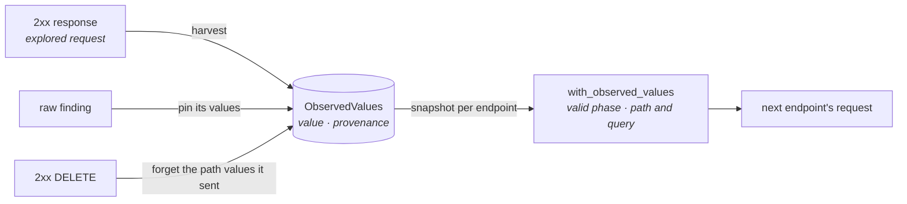
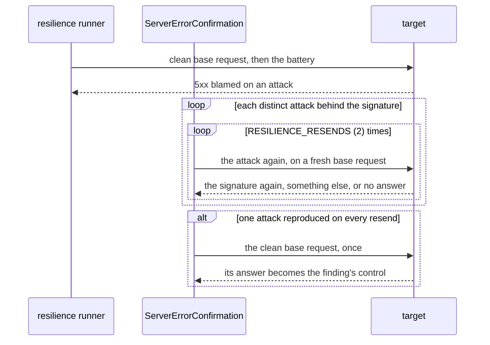

# Run depth

A run that stops at its first defect, or that addresses resources which do not
exist, says little about an API. This page describes what each runner does to get
past the first answer, without asking a model for anything: where stateless takes
the identifiers it puts in a path, how long a stateful run keeps going and how it
tells one defect from another, which values a credential field gets, and how
resilience aims at a real resource and tells a crash from an intermittent error,
and why an endpoint whose link writes into a reserved header is left unprobed.
Each mode's overall sequence is on [Execution modes](execution-modes.md); the
decisions are in the [runner decision records](adr/runners.md).

## Stateless: the run corpus { #run-corpus }

An invented path identifier almost never addresses an existing resource, so most
of a stateless run's valid requests to `GET /articles/{slug}` would be answered
404. The values that would address a real article are in the run's own responses.
A stateless run therefore keeps them in a **corpus** and feeds them back into the
`valid` phase ([ADR-165](adr/runners.md#adr-165)).

**What is kept.** Folding an explored request's 2xx response harvests two kinds of
value:

- the value each of the endpoint's declared state-link productions captures,
  kept under the bundle's name;
- every JSON leaf, at any depth, named `id`, `slug`, `username`, `*_id` or `*Id`,
  kept under its name in snake case.

Only strings and integers that survive as a path segment are kept. Shrink and
control requests do not harvest. The `performance` runner keeps no corpus.

**Provenance.** Each value is `created_by_run` or `read`:

| Provenance | When |
| --- | --- |
| `created_by_run` | a declared production captured it from a `POST`, or from any `201` |
| `read` | anything else, including every identifier leaf found by name |

A value the run created never falls back to `read`.

**How a draw uses it.** `with_observed_values` wraps the `valid` phase's strategy
for the path and query zones. Each field looks up the bundle it consumes first,
then its own name, and takes a corpus value in a share of the draws:

| Zone | Share of draws | Constant |
| --- | --- | --- |
| path | 80 % | `PATH_CORPUS_SHARE_PERCENT` |
| query | 20 % | `SEED_SHARE_PERCENT` |

The remaining draws keep the generated value, so the not-found path is still
probed. The overlay never touches the poisoned field and never adds a field. It
reads a snapshot of the corpus taken once per endpoint, so Hypothesis draws from a
fixed domain.

**Requests that change data.** At an endpoint whose method is not safe, what an
overlaid field may take depends on whether the run allows side effects
(`ExecutionConfig.allow_side_effects`, the same consent that lifts the
[safety guard](engine-internals.md#safety-guard)):

| Method | Without consent | With `allow_side_effects` |
| --- | --- | --- |
| safe (`GET`, `HEAD`, …) | any value | any value |
| not safe | values the run created, unpinned | values it created or read, unpinned |

Without consent, a `POST` that follows a user, or a `DELETE`, never acts on data
the run only read. No request that changes data ever takes a value a finding
pinned.

**Pinning and eviction.** Shrinking runs after every endpoint has been explored,
so a later `DELETE` could remove the value a finding needs. Folding a finding
pins the corpus values it sent; a request that changes data never takes a pinned
value. A 2xx `DELETE` forgets the path values it sent.

**Shrinking.** A draw records which fields took a corpus value
(`ZoneDraw.observed_fields`). The shrink holds them fixed, and they are never
trigger fields.

### Producers first, deletes last

`order_by_state_flow` (`runtime/ordering.py`) orders a stateless run's endpoints
so the corpus fills before it is needed: `DELETE` endpoints go last, and the rest
are sorted by their layer in the state-link graph, a producer before its
consumers. The sort is stable over the risk order (`order_by_risk`), which still
breaks ties. Endpoints that produce for one another in a cycle share a layer.

### A rejection that is a state conflict

Once requests reuse real values, some 400 and 422 answers are conflicts with stored
state, such as a username already taken. A `contract_completeness` finding that
blames the whole request is checked against a control request with fresh string
values, sent twice; it is refuted only when the first is accepted and the second
rejected the same way ([Findings](findings.md#states)).

## Stateful: until a pass finds nothing new { #stateful-depth }

A stateful pass ends at its first violation. The supervisor runs pass after pass,
each looking past the defects already reported, until one changes nothing
([ADR-162](adr/runners.md#adr-162)). A pass counts as progress when it:

| Progress | Bounded by |
| --- | --- |
| reports a defect no report holds yet | the ceiling |
| ends flaky on a new signature | the ceiling |
| widens a range defect's suppression (below) | once per defect |
| ends flaky with no violation to sign | `STATEFUL_UNEXPLAINED_FLAKY_PASSES` (2) |

The run also stops when the distinct confirmed reports, or the distinct flaky
signatures, reach `StatefulOptions.max_distinct_bugs` (default
`STATEFUL_MAX_DISTINCT_BUGS`, 25). Setting it to `1` reports the first defect only.
A cancellation, a dead target, a machine that can draw no sequence and an engine
failure stop it at once.

### Telling defects apart

A defect is its report's `FindingSignature`, body fingerprint included, plus its
**trigger fields** ([ADR-163](adr/runners.md#adr-163)):

- The signature is computed on the **shrunk** step (`step_signature`), so a later
  pass is compared with exactly what was reported.
- The trigger fields are the fields the shrunk step sent off its endpoint's
  simplest draw (`SimplestDraws`, computed once per endpoint, no request sent),
  minus the fields a bundle injected. The report carries them as
  `request.trigger_fields`. A transition probe has none.
- `SuppressedDefects` covers a later violation only when it has a reported
  signature and sent the reported values in each trigger field. Two fields that
  make one endpoint answer the same 500 are two reports.

**Range defects.** A defect that fires on a range of values (any negative
amount) comes back on the next pass with another value. It is folded into its
report (`represented_findings` grows by one), and the suppression is **widened**
once: the signature is covered on any step that sent off the simplest value in
every trigger field and in no other field. A step that also changed another field
escapes the widened entry and is shrunk on its own.

### Deleted resources

Two rules of the core's state links give the stateful run what it needs to check a
delete without a model ([ADR-168](../core/adr/core.md#adr-168)):

- **A `DELETE` invalidates the value it consumes.** Once the step draws it, the
  value leaves its bundle, so no later step addresses a deleted resource. A
  nested consumption does not invalidate its parent: deleting a comment keeps the
  article.
- **A deleted-resource transition is derived.** For a `DELETE` whose only
  placeholder is its last path segment, and a `GET` on the same path template that
  declares `404` or `410`, the run probes the `GET` after a successful `DELETE`
  and expects one of those statuses. A soft delete that still answers 200 is a
  `state_transition` finding.

The compiler rejects an endpoint whose transition's follow-up path names a
placeholder its probe cannot fill; the endpoint is listed in `excluded_endpoints`
with that reason.

### When the shrinker itself fails

An error raised inside Hypothesis while it shrinks, when the pass already holds a
witness, ends the pass on that witness: it is re-sent once and reported, or
counted flaky, and the error is logged. An error raised in the engine's own code
still cuts the run `engine_failure` ([ADR-164](adr/runners.md#adr-164)). The engine
requires `hypothesis>=6.170.3,<6.170.10`.

## Valid values for credential fields { #credential-fields }

A string named like a credential, whose contract constrains it in no other way,
gets a usable value in the `valid` phase ([ADR-171](adr/compiler.md#adr-171)):

| A name matching, whole | Gets |
| --- | --- |
| `email`, `*_email`, `*-email`, `*Email` | `format: email` |
| `username`, `user_name`, `user-name`, `password` | `minLength: 1` |

The rule applies only to a string that declares no `format` other than the
display-only `password`, no `pattern`, no `minLength` and no `enum`, and never past a
declared `maxLength`. A poisoned field keeps its contract.

An object parameter's `example` or `examples` also seed the values of its
properties, as a body's do.

## Resilience: a real target and a confirmed crash { #resilience-depth }

### The base request

Every attack targets one base request per endpoint
([ADR-169](adr/runners.md#adr-169)):

- **Its values** are the endpoint's minimal valid request in every zone; a path
  parameter that draw leaves out keeps a placeholder.
- **For an `owner_only` endpoint**, the owner's resource is provisioned under the
  first valid identity, through the same provisioning package `auth` uses
  (`runtime/runners/provisioning/`), and its values are written into the base
  request. A resource is provisioned once per bundle per run and reused; after the
  battery of an endpoint whose method is not safe it is forgotten, and the next use
  provisions a new one.
- **Its identity** is the one the endpoint's access demands
  ([Execution modes](execution-modes.md#the-base-request-and-its-identity)).

When the base request cannot be built, the endpoint gets nothing and records why:

| `unprobed_reason` | The endpoint is |
| --- | --- |
| `owner_identity_missing` | `owner_only`, and no valid identity is declared to own the resource |
| `owner_producer_missing`, `owner_chain_cyclic`, `owner_resource_unprovisioned` | `owner_only`, and the owner's resource could not be provisioned |
| `required_role_unheld` | `role_only`, and no valid identity holds the role |
| `link_target_reserved` | bound through a state link into a header the owner's credentials or the transport own ([below](#a-link-into-a-reserved-header)) |

Each one makes the run's signal `degraded` with `access_preconditions_unmet`.

### Confirming a server error

A 5xx under attack is not reported on one sighting. After an endpoint's battery is
recorded, and when the target is still answering, each server-error signature
blamed on an attack is settled on its own ([ADR-170](adr/runners.md#adr-170)):

| What the resends showed | The finding is |
| --- | --- |
| one attack got the signature back on every resend | `confirmed`, with the clean base request sent afterwards as its `control` |
| every attack missed it on some resend, and every resend was answered | `flaky` |
| a resend got no status, a target failure, 429, 502, 503 or 504, or could not be sent | left `confirmed`: nothing to judge it against |

A resilience finding is never refuted. It reaches confirmation only after a clean
base request succeeded **before** the battery, so a clean request that fails
**after** it means the attack left the endpoint broken. The finding's summary says
which: the attack left the endpoint broken, or the endpoint recovers and only the
attack breaks it. Confirmation requests count in `requests_shrink` and stay out of
the trace.

## A link into a reserved header { #a-link-into-a-reserved-header }

A state link can write a produced value into a header, such as a login's token
into `Authorization`. Credential headers belong to the identities and
`Content-Type` to the transport, so the injector would drop that value, and the
request would go out with the caller's own credential instead
([ADR-184](adr/runners.md#adr-184)). The runners decide this before sending
anything:

- **The endpoint's own links.** `OwnerResourceRegistry.bind_for(endpoint, bundles,
  callers)` is the one entry `auth` and `resilience` call. When a link of a bound
  bundle targets a header reserved for any caller that crosses the endpoint, the
  endpoint is left unprobed with `link_target_reserved`. The reserved names are
  what each caller sends (`reserved_for_sender`); an anonymous caller reserves only
  `Content-Type`.
- **The owner's chain.** When the owner's resource is provisioned,
  `plan_bundle_chain` skips a producer whose links target a header the owner
  reserves and tries the next producer of the bundle. Only when none is usable is
  the reason `link_target_reserved`; no producer request is sent in vain.
- **The stateful mode** refuses such a link as a `StatefulLinkError` when it
  compiles the rule.

An endpoint's policy reason (`declared_public`, `access_undeclared`) still comes
first. An `auth` run whose only endpoint with a policy to cross is left unprobed
this way crossed nothing, and fails with `AccessUncrossableError` naming the
reason; beside any crossable endpoint it completes and lists the endpoint as
unprobed.

## Where to change it

| To change | Edit |
| --- | --- |
| Which response leaves the corpus keeps | `_IDENTIFIER_NAMES` and `harvest` in `runtime/fuzzers/stateless/corpus.py` |
| How often a field draws from the corpus | `PATH_CORPUS_SHARE_PERCENT` in `runtime/fuzzers/stateless/constants.py`; `_CORPUS_SHARE_BY_ZONE` in `corpus_overlay.py` |
| What counts as created by the run | `CREATING_METHODS`, `CREATED_STATUS` in `constants.py` |
| Which corpus values a request may take | `_lookup` in `runtime/fuzzers/stateless/corpus_overlay.py`, over the readers of `CorpusSnapshot` (`values_for`, `destructive_values_for`, `unpinned_values_for`) |
| The stateful ceiling's default | `STATEFUL_MAX_DISTINCT_BUGS` in `constants.py` |
| How many flaky passes without a violation count | `STATEFUL_UNEXPLAINED_FLAKY_PASSES` in `runtime/fuzzers/stateful/constants.py` |
| A credential naming convention | a row of `NAME_CONVENTIONS` in `strategy_compiler/constants.py` ([recipe](extension-guide.md#add-a-name-convention)) |
| How many times a resilience attack is resent | `RESILIENCE_RESENDS` in `runtime/runners/resilience/constants.py` |
| Which resend answers count as no answer | `UNANSWERED_STATUSES` in the same file |
| Which headers a state link may not write into | `is_reserved_link_target` in `runtime/http/reserved_headers.py`; `reserved_for_sender` in `runtime/runners/provisioning/reserved_links.py` |
| When a delete's transition is derived | `INVALIDATING_METHODS`, `DELETED_RESOURCE_STATUSES` in the core's `utils/constants.py` |
