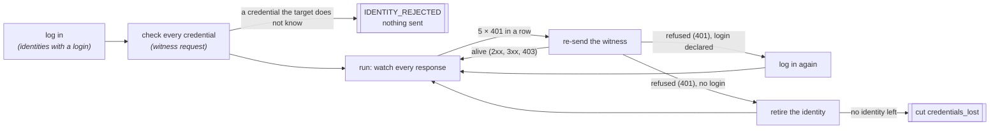

# Identities and sessions

A run sends most of its requests as one of the declared identities. Each identity
carries a credential, and a credential can stop working while the run is going:
it expires, a fuzzed logout revokes it, a password change invalidates it. A run
that kept sending a dead credential would spend its budget on `401`s and report the
endpoints behind them as tested. The engine prevents that by treating every valid
identity's credential as a **session** it opens, checks and watches:

1. it **logs in** every identity that declares how its credential is issued;
2. it **checks** every identity's credential before the first request, and refuses
   the run when the target does not know one;
3. it **watches** each credential over the run: once one looks dead, it re-sends a
   request the credential is known to pass, and renews the session or retires the
   identity depending on the answer;
4. it **confirms** only what a live credential can confirm.

The operations that end a session (a logout, a password change) are handled on
[Operations that end the session](session-endings.md); what a run does with the
secrets it learns is on [Secrets a run knows](run-secrets.md).

The whole mechanism lives in `runtime/sessions/`; `run()` wires it in
`runtime/facade.py`, in every mode but `replay` (see [Replay](#replay)).

## What a response says about a credential { #credential-answers }

One rule reads every response for what it says about the credential it went out
with (`credential_answer`, `runtime/sessions/answer.py`). Only an endpoint that
requires authentication speaks about a credential: a public endpoint's `401`
answers what the request sent, such as a login's wrong password.

| Answer | Statuses | Meaning |
| --- | --- | --- |
| `refused` | `401` | The target does not know the credential. |
| `recognized` | `2xx`, `3xx`, `403` | The target knows the caller: a `403` forbids the action, not the credential. |
| `silent` | anything else, `404`, `422`, `5xx` and `429` included, or no response | Says nothing about the credential: a route or a request is often judged before it. |

A re-sent witness is read by `witness_answer`, the same rule but for one status:
a `3xx` is `silent` there. The client follows no redirect, and a redirect from a
read that requires a login may be the way to a sign-in page, so it proves nothing
about the credential.

## Logging an identity in { #login }

An identity may declare, in a `login` table, the request that issues its
credential instead of a fixed header. The engine models it as a `LoginRecipe`
(`models/runtime/login.py`):

| Field | Default | What it says |
| --- | --- | --- |
| `method` | `POST` | A standard HTTP method. |
| `path` | required | The login's path, relative to the run's base URL: it starts with `/`, names no scheme and holds no path parameter. |
| `body` | none | A JSON object sent as the login's body. |
| `media_type` | `application/json` | `application/json`, or `application/x-www-form-urlencoded` with text, number or boolean fields only. |
| `token_at` | — | The dotted path of object keys to the token in the answer's JSON body (`data.token`); no array index. |
| `token_cookie` | — | The name of the cookie the answer sets the token in. Exactly one of `token_at` and `token_cookie` is declared. |
| `send_as` | `Authorization: Bearer {token}` | The header the token is sent in, `<Header-Name>: <value>`, the value holding `{token}` exactly once. |

Only an identity with a valid credential may declare a login, and its `headers`
may not also hold the header the login fills. The identities file that declares
it is on [Identities and sessions](../../user-guide/identities-and-sessions.md).

**When the login is sent.** `log_identities_in` sends every login before the
run's first request, in every mode, `replay` included, and the identity then sends
`send_as` with the token the answer carried. The login is a session request: it
is not counted in the run's requests nor recorded in its trace, so a trace never
holds an issued credential. A login that answers anything but a `2xx`, or a `2xx`
without a non-empty text where the recipe says the token is, refuses the run with
`IdentityRejectedError` (below).

**The credential is bound on the wire.** `RunCredentials.bind` puts the identity's
current credential on each attempt as it is sent. A request built before a renewal,
or retried after one, goes out with the credential the run holds now, never with
the one it replaced.

**A token issued to a fuzzed login is a secret, not the session.** The login
operation is fuzzed like any other, and a request of the run that reaches it may
be answered with a fresh token. `RunCredentials.note_issued` reads every response
from the login's own method and URL: a token it carries where the recipe says is
recorded as issued, blanked from the response the run keeps and followed by the
`SecretLedger` ([Secrets a run knows](run-secrets.md)), but it never becomes the
credential the identity sends. Only a renewal changes that.

**No cookie travels between requests.** The HTTP client the identities share keeps
no cookie jar, so a `Set-Cookie` one identity's request receives never reaches
another identity's request. A cookie-based session is declared with
`token_cookie` and a `send_as` such as `Cookie: sid={token}`.

## Checking each identity before the run { #check }

Before the first request, every valid identity that sends a credential is checked
on a **witness**: a request the credential must pass and that changes nothing.

**Choosing the witness.** `witness_candidates` keeps the endpoints of the run that
are a `GET` or a `HEAD`, require authentication, take no input (no path parameter
and no required query or header parameter) and do not
[end the session](session-endings.md). It ranks them:

1. a path whose segments name the caller first: `me`, `whoami`, `self`,
   `current`, `profile`, `account`, `session`;
2. `GET` before `HEAD`;
3. fewer path segments, then the path and the method, for a stable order.

Up to `WITNESS_CANDIDATES_TRIED` (3) candidates are tried per identity, in that
order, until one settles the question.

**Reading the answers** (`identity_verdict`, `runtime/sessions/check.py`):

| What the candidates answered | Verdict |
| --- | --- |
| a `2xx` | `accepted`, on that candidate; no further one is tried |
| a `403`, and no `2xx` | `accepted`, on the `403` candidate: the target knows the caller |
| no response at all | `unchecked`, `target_unanswered`; no further one is tried |
| a `401` on every candidate tried | the run is refused: `IdentityRejectedError`, cause `credential_refused` |
| anything else (`3xx`, `404`, `429`, `5xx`, a `401` beside them) | `unchecked`, `no_witness` |
| no candidate at all | `unchecked`, `no_witness` |
| an identity with no credential | `unchecked`, `no_credentials` |

An `unchecked` identity still runs; its credential simply went in without being
seen to work. A refused identity stops the run before anything else is sent.

`IdentityRejectedError` carries the identity's `label`, the `endpoint_id` that
refused it, the `status` (or `None`) and an `IdentityRejectionCause`:

| `IdentityRejectionCause` | When |
| --- | --- |
| `credential_refused` | Every witness candidate tried answered `401`. |
| `login_refused` | The identity's login answered other than `2xx`. |
| `login_token_missing` | The login answered `2xx` without a non-empty text where the recipe says the token is. |
| `login_unanswered` | The login got no answer. |

The core answers it [`IDENTITY_REJECTED`](../core/protocol/errors.md#identity-rejected).
A run with a producer is checked by the core with `check_identities` before any
contract is produced, so a rejected identity costs no inference; the engine checks
again when the run starts, with the witnesses its compiled endpoints offer.

## Watching a credential during the run { #watch }

`CredentialWatch` (`runtime/sessions/watch.py`) reads every response the run
gets, per identity.

- A `refused` answer extends the identity's streak of `401`s; a `recognized` one
  (`2xx`, `3xx`, `403`) restarts it; a `silent` one (`404`, `422`, `5xx`, …)
  neither counts nor breaks it.
- When the streak reaches `CREDENTIAL_REFUSAL_STREAK` (5, `constants.py`), the
  run re-sends the identity's witness. Responses that arrive meanwhile start a new
  streak.
- An identity whose check found no witness learns one from the run: the first safe
  request under it that requires authentication and was answered `2xx`, on an
  endpoint that does not end the session. Without a witness, a streak proves
  nothing and restarts.

What the re-sent witness answers (`witness_answer`) decides:

| Witness answer | What happens |
| --- | --- |
| `recognized` (`2xx`, `403`) | The credential works: the `401`s were about those requests. The endpoints of the streak are exempt from the identity's streaks from then on. |
| `refused` (`401`), the identity declares a login | The run logs it in again and re-sends the witness with the new credential. If the target does not refuse it, the session is **renewed**. |
| `refused` (`401`), no login, or the new credential refused too | The identity is **retired**. |
| `silent` (`3xx`, `5xx`, `429`, no response) | No verdict: nothing is decided, and the streak is dropped. |

**A renewal.** The streaks are dropped, since their `401`s answered the dead
credential, and a response to a request that went out on the replaced credential
is not counted. An identity may be renewed up to `MAX_SESSION_RENEWALS` (50) times
in one run: a fuzzed logout can end the session on every success. Past that, the
next refusal retires it.

**A retirement.** From then on the run sends nothing under the identity, in any
mode: no stateless or performance example, no stateful step, no access crossing,
no resilience attack. The identity's share of the work goes unsent rather than
being sent anonymously.

**The suspect.** On a renewal or a retirement the run names the operation
suspected of ending the session: the latest write (an unsafe method answered `2xx`
or `3xx`) sent before the streak's first `401`, the identity's own first, then
any identity's. The run remembers the last `SUSPECT_WRITES_KEPT` (32) writes per
identity. The suspect is `marked` when it was already known to end the session.

**The event.** Each renewal and retirement emits `CredentialLost` (`identity`,
`outcome` `retired` or `renewed`, `suspect_endpoint_id`, `suspect_identity`), which
the core announces as the [`credential_lost`](../core/protocol/events.md#the-event-catalog)
event. No credential value is ever carried.

**When no identity is left.** Once every watched identity is retired, the run
stops exploring with the cut `credentials_lost` (`TruncationReason.CREDENTIALS_LOST`),
on the endpoint it was sending to when the last identity was retired. When the
re-check before the [operations that end the session](session-endings.md#last)
retires the last identity, the run explores none of them and the cut names the
last endpoint it sent to before that re-check. The cut halts the run like a dead
target, but says nothing against the API: it may be perfectly healthy.

**Session requests are not the run's requests.** Witnesses and logins go through
`send_session_request`: retried like any request, never counted in
`total_requests`, never in the trace. `IdentitySessionStats.session_requests`
counts the witness requests sent under each identity, before and during the run.

## What the run reports { #report }

`RunStats.identities` holds one `IdentitySessionStats` per identity the run
checked, in the order the identities file declares them:

| Field | What it says |
| --- | --- |
| `label` | The identity. |
| `standing` | `accepted` or `unchecked` (`IdentityStanding`). |
| `unchecked_reason` | `no_witness`, `no_credentials` or `target_unanswered` (`UncheckedReason`); `None` when accepted. |
| `witness_endpoint_id` | The witness it held at the end, checked or learned; `None` without one. |
| `retired` | Whether the run retired it. |
| `suspect_endpoint_id`, `suspect_identity`, `suspect_marked` | The suspect named when it was retired, who sent it, and whether it was already known to end the session. |
| `renewals` | How many times the run logged it in again. |
| `session_requests` | The witness requests sent under it. |

The core publishes them as [`run.identities`](../core/protocol/vocabularies.md#run-identities),
and a retired identity degrades the run's signal with `identities_retired`.

## Confirming with retired identities { #confirming }

A finding is confirmed by re-sending its request. A re-send under a retired
identity would only meet the dead credential, so `Confirmable`
(`runtime/runners/confirmable.py`) decides what may still be re-sent:

- A finding sent under a retired identity is never re-sent. A group of findings
  whose every member was sent under a retired identity is left **`unverified`**.
- In a group with members of live and retired identities, the live ones are
  attempted first.
- A group whose identity was retired while it was being confirmed, and that
  confirmed nothing, is left `unverified`.
- A group that confirmed nothing, whose every miss was a re-send answered `401`
  on an endpoint that requires authentication, and whose refused identities are
  all retired by the end of the run, is left `unverified` rather than `flaky`: a
  re-send the credential refused is evidence about the credential, not about the
  finding. A group whose re-sends got real answers keeps its verdict.
- A finding sent without an identity, or under an identity the run does not watch
  (one that sends no credential), is confirmed as usual, the `credentials_lost` cut
  included: that cut stops the exploration, not the confirmation of what a live
  sender found.

The stateless, performance, stateful and resilience runners follow the same rule;
a server error reproduced on every re-send stays confirmed. A dead target and a
cancellation forbid every re-send, whatever the identities
([Engine internals](engine-internals.md)).

## Replay { #replay }

A replay re-sends a recorded trace. It logs every declared identity in when it
starts, as any run does, but it checks nothing, watches nothing and retires no
identity.

**It renews where the recorded run renewed.** The trace keeps each renewal the run
made, as `ExecutionTrace.session_renewals` (`SessionRenewal`: `identity_label`,
`at_ms`). The replay logs that identity in again just before the first recorded
request sent at or after that moment (`renewals_before`,
`runtime/replay/renewals.py`), so the requests that followed a sign-out meet a live
credential, as they did in the run. Before each replayed request an identity is
logged in at most once, however many renewals the run made in between: logging in
several times in a row ends where logging in once does. A renewal the login refuses is logged, and the
replay goes on with the credential it has.

A finding's request replayed alone that now gets a `401` while the recording got
none is `inconclusive` with `credentials_refused`, never `possibly_resolved`
([Credentials](../core/protocol/finding-replay.md#credentials)).

## Where to change what { #where-to-change }

| To change | Where |
| --- | --- |
| The length of the streak that sends a witness | `CREDENTIAL_REFUSAL_STREAK`, `constants.py` |
| How many candidates a check tries | `WITNESS_CANDIDATES_TRIED`, `runtime/sessions/constants.py` |
| Which methods may witness, and the words that name the caller | `WITNESS_METHODS`, `PREFERRED_WITNESS_WORDS`, same file |
| How many renewals an identity gets | `MAX_SESSION_RENEWALS`, same file |
| How many writes are kept as suspects | `SUSPECT_WRITES_KEPT`, same file |
| What a status says about a credential | `credential_answer`, `runtime/sessions/answer.py` |
| What a login may declare | `LoginRecipe`, `models/runtime/login.py` |

The decisions behind this page are [ADR-224](adr/sessions.md#adr-224),
[ADR-225](adr/sessions.md#adr-225) and [ADR-228](adr/sessions.md#adr-228).
