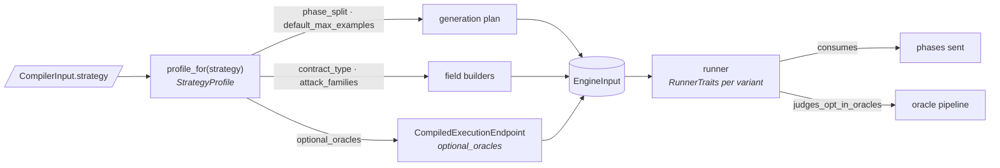

# Strategies and runner traits

A **strategy** decides what a run generates and how it judges what comes back. It
is one global choice on `CompilerInput.strategy`, never per endpoint, and it is
orthogonal to the execution mode: the mode decides *how* requests are sent
(one by one, chained, under load, crossed between identities), the strategy
decides *which* values they carry and which extra checks run on the answers.

Two registries meet here. The **profile** registry says what each strategy
decides. Each **runner** declares which part of a strategy it actually uses: its
**traits**. The core reads both through the engine's public surface and
derives, for every mode, strategy and producer, what choosing that strategy
changes ([Fuzz options](../core/protocol/fuzz-options.md)).



## The five strategies

`Strategy` (`models/strategy.py`) is a `StrEnum` whose values are the wire
spellings. Each member has one profile in `profiles/builtin.py`.

| Strategy | What it is for | Phase split | Examples per endpoint | Contract | Read-only fields | Opt-in oracles | Attack families |
| --- | --- | --- | --- | --- | --- | --- | --- |
| `default` | General schema-driven fuzzing | `valid` 0.60 · `boundary` 0.25 · `invalid` 0.15 | 200 | `BaseStrategyContract`, exact | omitted | — | every family |
| `security` | Adversarial values on every field | `valid` 0.40 · `boundary` 0.20 · `invalid` 0.10 · `attack` 0.25 · `mutation` 0.05 | 200 | `HackerStrategyContract` and subclasses | sent | — | every family |
| `conformance` | Auditing how faithfully the API keeps to its contract | `valid` 0.70 · `boundary` 0.30 | 200 | `BaseStrategyContract`, exact | omitted | `undeclared_response_field` | every family |
| `smoke` | A fast check that every endpoint answers a valid request | `valid` 1.0 | 20 | `BaseStrategyContract`, exact | omitted | — | every family |
| `exposure` | Mass assignment and sensitive data | `valid` 0.50 · `attack` 0.50 | 100 | `HackerStrategyContract` and subclasses | sent | — | `auth_bypass` only |

The `default` and `security` splits and the default budget of 200 are measured
([ADR-140](adr/measurement.md#adr-140), [ADR-141](adr/measurement.md#adr-141)).
Under `security`, an endpoint that declares an aggressiveness sets its own
`attack` share through `derive_attack_split`
([Strategy compiler](strategy-compiler.md#the-plan-arithmetic)).

**`security`** draws every phase the engine has. Its `attack` pass poisons one
field per request with family-tagged payloads, and its `mutation` pass breaks a
valid value in one place on every field, with or without an attack contract
([ADR-156](adr/strategies.md#adr-156)). It sends read-only fields, because writing
one is a probe of its own.

**`exposure`** keeps `security`'s contract type and read-only handling but narrows
the `attack` pass to the `auth_bypass` family: the mass-assignment body variant and
the per-field payloads of that family. Its own budget is smaller because it asks
fewer questions.

**`conformance`** generates like `default` and turns on the
`undeclared_response_field` oracle: a response object that holds a key its
declared schema does not name is a finding
([Findings](findings.md#taxonomy), [ADR-157](adr/strategies.md#adr-157)).

**`smoke`** sends valid requests only, 20 per endpoint, so a whole API is
exercised in seconds.

The core maps each strategy to the LLM profile an `inference` producer infers its
contracts with: `qa` for `default`, `conformance` and `smoke`; `security` for
`security` and `exposure` ([Inference](../core/inference.md)). The wire also
accepts `hacker` as an exact alias of `security`; the engine never sees it
([ADR-155](../core/adr/protocol.md#adr-155)).

## The profile

`StrategyProfile` (`models/strategy_profile.py`) is a frozen value object.
`profile_for(strategy)` returns the registered one and raises `PolicyError` when
none is; the compiler resolves it once per endpoint.

| Field | Type | What it decides |
| --- | --- | --- |
| `strategy` | `Strategy` | The strategy it describes |
| `phase_split` | `Mapping[Phase, float]` | The phases to compile and each one's share of the budget; `phases` lists them in allocation order |
| `allowed_fields_by_type` | `Mapping[SchemaType, frozenset]` | The allowed-field matrix the policy layer checks contracts against |
| `contract_type` | `type[BaseStrategyContract]` | The contract type the strategy requires |
| `allow_contract_subclasses` | `bool` | Whether `accepts(contract)` takes subclasses (`isinstance`) or the exact type |
| `default_max_examples` | `int` | The examples per endpoint when the endpoint's budget sets no `max_examples`; `DEFAULT_MAX_EXAMPLES` (200) unless the profile says otherwise |
| `optional_oracles` | `frozenset[str]` | The opt-in oracles the strategy turns on, by registry name |
| `attack_families` | `frozenset[AttackFamily] \| None` | The families an attack payload may belong to; `None` allows every family |
| `omits_read_only` | `bool` | Whether a `readOnly` field stays out of the body the strategy sends |
| `promotes_attack_hints` *(property)* | `bool` | Whether the fields an attack contract hints at are promoted to the attack contract; true when `contract_type` is `HackerStrategyContract` or a subclass |

Where each field is read:

| Field | Reader |
| --- | --- |
| `phase_split`, `default_max_examples` | `build_generation_plan(endpoint, profile)`: a budget that sets `max_examples` wins, otherwise the profile's count, then the risk weighting |
| `contract_type`, `allowed_fields_by_type` | `validate_endpoint_spec` and the phase registry, which resolves builders by the contract's type |
| `attack_families` | `GenerationContext.attack_families`: `allows(family)` filters the attack candidates, and the mass-assignment variant draws only when `auth_bypass` is allowed. Under a restriction, a payload with no family is dropped |
| `optional_oracles` | sealed on each `CompiledExecutionEndpoint.optional_oracles` by the compiler; `compile_strategies` first checks each name with `require_opt_in` |
| `omits_read_only`, `promotes_attack_hints` | the core, when it projects an endpoint's contracts for the compiler |

## Opt-in oracles

Most oracles judge every response. An **opt-in** oracle judges only on an endpoint
whose strategy names it. The flag is registry metadata, not part of the
`ResponseOracle` Protocol, so no oracle and no test double carries it:

```python
register_oracle(UndeclaredResponseFieldOracle(), opt_in=True, requires_contract=True)
```

`OracleRegistration` holds `opt_in` and `requires_contract` beside the oracle.
`check_response` passes the endpoint's `optional_oracles` to `evaluate`, and
`ordered_oracles` keeps an opt-in oracle only when its name is in that set. Every
place that judges a response (the stateless fold, the shrink, a stateful step, an
auth crossing) goes through `check_response`, so an opt-in finding minimizes under
the same set that found it.

`evaluate_contract_free`, the pipeline a replay judges with, runs only the
**intrinsic** oracles: those neither opt-in nor `requires_contract`. An opt-in
oracle never judges a replay.

`compile_strategies` calls `require_opt_in(profile.optional_oracles)` before it
compiles: a name with no registered oracle, or one that is not opt-in, raises
`PolicyError` (`unknown optional oracle ...`, `... always runs; it cannot be opted
into`).

## Runner traits { #runner-traits }

A runner does not read the profile. It reads the compiled plan, and what it takes
from it is fixed by how it runs. Each runner states that once, per **variant**,
as a `RunnerTraits` (`models/runtime/runner_traits.py`):

| Field | Meaning |
| --- | --- |
| `consumes` | `PlanPhases.ALL` (every phase the strategy plans) or the `frozenset[Phase]` the runner draws from; empty when it sends a fixed battery |
| `honors_examples_per_endpoint` | Whether the endpoint's example count changes what the runner sends |
| `examples_cap` | The runner's own ceiling when the caller asks for no count; `None` when it has none |
| `judges_opt_in_oracles` | Whether the strategy's opt-in oracles judge what the runner sends |

The `ExecutionRunner` Protocol has two methods for it: `variants()` returns the
runner's `Mapping[str, RunnerTraits]`, and `variant_for(options)` names the variant
a run with those resolved options takes. A runner that runs one way has one
variant, `default` (`DEFAULT_VARIANT`, built with `only_variant(traits)`);
`performance` has two, `flat` and `ladder`, picked by whether its options carry a
`concurrency_ladder`.

| Mode | Variant | `consumes` | Honors a count | Cap | Opt-in oracles |
| --- | --- | --- | --- | --- | --- |
| `stateless` | `default` | every planned phase | yes | — | yes |
| `stateful` | `default` | `valid`, `transition` | yes | 100 | yes |
| `performance` | `flat` | every planned phase | yes | — | yes |
| `performance` | `ladder` | `valid` | no | — | yes |
| `resilience` | `default` | `valid` | no | — | yes |
| `auth` | `default` | `valid` | no | — | yes |
| `replay` | `default` | nothing | no | — | no |

The ladder sends a fixed `LADDER_STEP_SAMPLES` per step, `auth` crosses one valid
request per identity, `resilience` attacks one valid base request per endpoint with
its chaos battery, and a replay re-sends a trace, so none of them honors a count. The stateful cap is
`DEFAULT_STATEFUL_MAX_EXAMPLES`, the default of `StatefulOptions.max_examples`.

Two public functions read the declarations:

- `runner_traits()` maps every `(mode, variant)` of every registered runner to its
  traits;
- `runner_traits_for(mode, options)` resolves the options as `run` would and
  returns the traits of the variant that run takes.

**The declaration is held to what the runner does.** `tests/test_runner_traits_gate.py`
drives every registered variant over an endpoint built to draw every phase, under
`security`, and checks that the phases sent equal `consumes`; that a larger count
changes what is sent exactly when `honors_examples_per_endpoint` says so; that
`examples_cap` is the runner's default `max_examples`; and that an opted-in oracle
judges only where `judges_opt_in_oracles` says so. Each runner's own tests also
check that what it sends stays within `consumes`.

## Adding a strategy

1. Add the member to `Strategy` (`models/strategy.py`).
2. Register its profile beside the built-ins in `profiles/builtin.py`, or from your
   own composition root:

    ```python
    from specforge_engine import Strategy, StrategyProfile
    from specforge_engine.models.contracts import ALLOWED_FIELDS_BY_TYPE, BaseStrategyContract
    from specforge_engine.models.phase import Phase
    from specforge_engine.profiles import register_profile

    register_profile(
        StrategyProfile(
            strategy=Strategy.MY_STRATEGY,  # the member added in step 1
            phase_split={Phase.VALID: 0.8, Phase.BOUNDARY: 0.2},
            allowed_fields_by_type=ALLOWED_FIELDS_BY_TYPE,
            contract_type=BaseStrategyContract,
            allow_contract_subclasses=False,
            default_max_examples=50,
        )
    )
    ```

3. In the core, add the member to `StrategyKind` (`schemas/strategy.py`) and its
   row to `STRATEGY_TO_AGENT_PROFILE` (`services/fuzz/constants.py`). A parity
   test fails while `StrategyKind` and `Strategy` differ, and a completeness test
   fails while a strategy has no LLM profile.
4. Add its row to the `strategy` table of the protocol README §8.1; the README
   vocabulary gate compares it with the enum.

The catalog's `fuzz_options` lists the new strategy and derives its row of the
effects matrix with no further change. The extensibility gate
(`TestNewStrategy`) checks that a profile's opt-in oracle reaches the compiled
endpoint.

## Adding an opt-in oracle

1. Write the oracle as any other ([Extension guide](extension-guide.md#add-an-oracle)),
   with its invariant ([Adding a new invariant](findings.md#adding-a-new-invariant)).
2. Register it opt-in, and say whether it judges against the endpoint's
   declarations, in `runtime/oracles/builtin.py`:

    ```python
    register_oracle(MyOracle(), opt_in=True, requires_contract=True)
    ```

3. Name it in the `optional_oracles` of the strategies that turn it on, by
   `InvariantViolation.MY_INVARIANT.value`.

`TestNewOptInOracle` checks that such an oracle judges only where a strategy names
it and never in a contract-free judgement.

## Declaring a new runner's traits

A new runner implements `variants()` and `variant_for(options)` beside `mode`,
`options_type` and `run` ([Extension guide](extension-guide.md#add-a-runner)):

```python
from specforge_engine.models.phase import Phase
from specforge_engine.models.runtime import DEFAULT_VARIANT, RunnerTraits, only_variant

_VARIANTS = only_variant(
    RunnerTraits(
        consumes=frozenset({Phase.VALID}),
        honors_examples_per_endpoint=False,
        examples_cap=None,
        judges_opt_in_oracles=True,
    )
)


class MyRunner:
    ...

    def variants(self):
        return _VARIANTS

    def variant_for(self, options):
        return DEFAULT_VARIANT
```

`runner_traits()` lists its variants as soon as it is registered, the gate drives
them, and the core publishes them in `fuzz_options.modes` once the mode is one the
core's `execution` parameter accepts.
