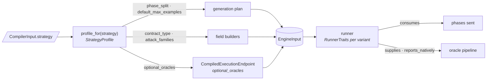

# Strategies and runner traits

A **strategy** decides what a run generates and how it judges what comes back. It
is one global choice on `CompilerInput.strategy`, never per endpoint, and it is
orthogonal to the execution mode: the mode decides *how* requests are sent
(one by one, chained, under load, crossed between identities), the strategy
decides *which* values they carry and which extra checks run on the answers.

Two registries meet here. The **profile** registry says what each strategy
decides. Each **runner** declares which part of a strategy it actually uses: its
**traits**. The core reads both through the engine's public surface and
derives, for every mode, strategy and producer, what choosing that strategy
changes and what it can find ([Fuzz options](../core/protocol/fuzz-options.md),
[What a run can find](reportable-invariants.md)).



## The five strategies

`Strategy` (`models/strategy.py`) is a `StrEnum` whose values are the wire
spellings. Each member has one profile in `profiles/builtin.py`.

| Strategy | What it is for | Phase split | Examples per endpoint | Contract | Read-only fields | Opt-in oracles | Attack families |
| --- | --- | --- | --- | --- | --- | --- | --- |
| `default` | General schema-driven fuzzing | `valid` 0.60 · `boundary` 0.25 · `invalid` 0.15 | 200 | `BaseStrategyContract`, exact | omitted | — | every family |
| `security` | Adversarial values on every field | `valid` 0.40 · `boundary` 0.20 · `invalid` 0.10 · `attack` 0.25 · `mutation` 0.05 | 200 | `HackerStrategyContract` and subclasses | sent | — | every family |
| `conformance` | Auditing how faithfully the API keeps to its contract | `valid` 0.70 · `boundary` 0.30 | 200 | `BaseStrategyContract`, exact | omitted | `undeclared_response_field` | every family |
| `smoke` | A fast check that every endpoint answers a valid request | `valid` 1.0 | 20 | `BaseStrategyContract`, exact | omitted | — | every family |
| `exposure` | Mass assignment and sensitive data | `valid` 0.50 · `attack` 0.50 | 100 | `HackerStrategyContract` and subclasses | sent | — | `auth_bypass` only |

The `default` and `security` splits and the default budget of 200 are measured
([ADR-140](adr/measurement.md#adr-140), [ADR-141](adr/measurement.md#adr-141)).
Under `security`, an endpoint that declares an aggressiveness sets its own
`attack` share through `derive_attack_split`
([Strategy compiler](strategy-compiler.md#the-plan-arithmetic)).

**`security`** draws every phase the engine has. Its `attack` pass poisons one
field per request with family-tagged payloads, and its `mutation` pass breaks a
valid value in one place, one field per request, on every field, with or without
an attack contract ([ADR-156](adr/strategies.md#adr-156),
[ADR-180](adr/compiler.md#adr-180)). It sends read-only fields, because writing
one is a probe of its own.

**`exposure`** keeps `security`'s contract type and read-only handling but narrows
the `attack` pass to the `auth_bypass` family: the mass-assignment body variant and
the per-field payloads of that family. Its own budget is smaller because it asks
fewer questions.

**`conformance`** generates like `default` and turns on the
`undeclared_response_field` oracle: a response object that holds a key its
declared schema does not name is a finding
([Findings](findings.md#taxonomy), [ADR-157](adr/strategies.md#adr-157)).

**`smoke`** sends valid requests only, 20 per endpoint, so a whole API is
exercised in seconds.

The core maps each strategy to the LLM profile an `inference` producer infers its
contracts with: `qa` for `default`, `conformance` and `smoke`; `security` for
`security` and `exposure` ([Inference](../core/inference.md)). The wire takes
the canonical names only ([ADR-155](../core/adr/protocol.md#adr-155)).

## The profile

`StrategyProfile` (`models/strategy_profile.py`) is a frozen value object.
`profile_for(strategy)` returns the registered one and raises `PolicyError` when
none is; the compiler resolves it once per endpoint.

| Field | Type | What it decides |
| --- | --- | --- |
| `strategy` | `Strategy` | The strategy it describes |
| `phase_split` | `Mapping[Phase, float]` | The phases to compile and each one's share of the budget; `phases` lists them in allocation order |
| `allowed_fields_by_type` | `Mapping[SchemaType, frozenset]` | The allowed-field matrix the policy layer checks contracts against |
| `contract_type` | `type[BaseStrategyContract]` | The contract type the strategy requires |
| `allow_contract_subclasses` | `bool` | Whether `accepts(contract)` takes subclasses (`isinstance`) or the exact type |
| `text` | `TermText` | The strategy's label and one-sentence summary for a person ([Labels and summaries](#labels-and-summaries)) |
| `default_max_examples` | `int` | The examples per endpoint when the endpoint's budget sets no `max_examples`; `DEFAULT_MAX_EXAMPLES` (200) unless the profile says otherwise |
| `optional_oracles` | `frozenset[str]` | The opt-in oracles the strategy turns on, by registry name |
| `attack_families` | `frozenset[AttackFamily] \| None` | The families an attack payload may belong to; `None` allows every family |
| `omits_read_only` | `bool` | Whether a `readOnly` field stays out of the body the strategy sends |
| `promotes_attack_hints` *(property)* | `bool` | Whether the fields an attack contract hints at are promoted to the attack contract; true when `contract_type` is `HackerStrategyContract` or a subclass |

Where each field is read:

| Field | Reader |
| --- | --- |
| `phase_split`, `default_max_examples` | `build_generation_plan(endpoint, profile)`: a budget that sets `max_examples` wins, otherwise the profile's count, then the risk weighting |
| `contract_type`, `allowed_fields_by_type` | `validate_endpoint_spec` and the phase registry, which resolves builders by the contract's type |
| `attack_families` | `GenerationContext.attack_families`: `allows(family)` filters the attack candidates, and the mass-assignment variant draws only when `auth_bypass` is allowed. Under a restriction, a payload with no family is dropped |
| `optional_oracles` | sealed on each `CompiledExecutionEndpoint.optional_oracles` by the compiler; `compile_strategies` first checks each name with `require_opt_in` |
| `omits_read_only`, `promotes_attack_hints` | the core, when it projects an endpoint's contracts for the compiler |
| `text` | the core, which publishes it as the strategy's `label` and `summary` |

## Opt-in oracles

Most oracles judge every response. An **opt-in** oracle judges only on an endpoint
whose strategy names it. Whether it is opt-in is registry metadata, not part of the
`ResponseOracle` Protocol, so no oracle and no test double carries it: the
registration lists `opt_in` among its needs.

```python
register_oracle(
    UndeclaredResponseFieldOracle(),
    reports=frozenset({InvariantViolation.UNDECLARED_RESPONSE_FIELD}),
    needs=OracleNeeds.all_of(OracleNeed.CONTRACT, OracleNeed.OPT_IN),
)
```

`OracleRegistration` holds `reports` and `needs` beside the oracle; `opt_in` and
`requires_contract` are properties read off `needs`, true when every alternative
of the needs waits on that one
([What each oracle declares](reportable-invariants.md#what-each-oracle-declares)).
`check_response` passes the endpoint's `optional_oracles` to `evaluate`, and
`ordered_oracles` keeps an opt-in oracle only when its name is in that set. Every
place that judges a response (the stateless fold, the shrink, a stateful step, an
auth crossing) goes through `check_response`, so an opt-in finding minimizes under
the same set that found it.

`evaluate_contract_free`, the pipeline a replay judges with, runs only the
**intrinsic** oracles: those whose registration is neither `opt_in` nor
`requires_contract`. An opt-in oracle never judges a replay.

`compile_strategies` calls `require_opt_in(profile.optional_oracles)` before it
compiles: a name with no registered oracle, or one that is not opt-in, raises
`PolicyError` (`unknown optional oracle ...`, `... always runs; it cannot be opted
into`).

## Runner traits { #runner-traits }

A runner does not read the profile. It reads the compiled plan, and what it takes
from it is fixed by how it runs. Each runner states that once, per **variant**,
as a `RunnerTraits` (`models/runtime/runner_traits.py`):

| Field | Meaning |
| --- | --- |
| `consumes` | `PlanPhases.ALL` (every phase the strategy plans) or the `frozenset[Phase]` the runner draws from; empty when it sends a fixed battery |
| `honors_examples_per_endpoint` | Whether the endpoint's example count changes what the runner sends |
| `examples_cap` | The runner's own ceiling when the caller asks for no count; `None` when it has none |
| `reports_oracle_verdicts` | Whether the oracles' verdicts on its responses become findings; `False` for `replay`, whose verdicts only mark the request it re-sent |
| `reports_natively` | The invariants the runner judges itself, outside the response oracles |
| `supplies` | The [oracle needs](reportable-invariants.md#oracle-needs) met for the oracles that reach its responses; one a strategy, a producer or the request supplies is met only when it declares it |
| `text` | The variant's label and one-sentence summary for a person |
| `selected_by_option` | The field of the runner's options that, once set, makes a run take this variant; `None` for the variant a run takes otherwise |
| `requires` | The `RunPrecondition`s without which the variant verifies nothing; what it can report assumes they are met. Empty by default |

`judges_opt_in_oracles`, a property, is `opt_in in supplies`: whether the
strategy's opt-in oracles judge what the runner sends. What a variant can report
follows from `reports_natively`, `supplies` and the oracle registrations
([What a run can find](reportable-invariants.md)).

The `ExecutionRunner` Protocol has two methods for it: `variants()` returns the
runner's `Mapping[str, RunnerTraits]`, and `variant_for(options)` names the variant
a run with those resolved options takes. A runner that runs one way has one
variant, `default` (`DEFAULT_VARIANT`, built with `only_variant(traits)`);
`performance` has two, `flat` and `ladder`: `ladder` declares
`selected_by_option="concurrency_ladder"`, so a run whose options carry a
`concurrency_ladder` takes it, and `flat` declares none. The core publishes the
selector as the run parameter it builds that option from, `load.concurrency_steps`
([Which variant a run gets](../core/protocol/fuzz-options.md#which-variant)).

**What a run must be given.** `requires` names what a variant cannot verify
anything without, as `RunPrecondition` members:

| Member | Value | What the run must be given |
| --- | --- | --- |
| `IDENTITIES` | `identities` | Identities to send its requests as |
| `DECLARED_ACCESS` | `declared_access` | A producer's contract declaring the endpoints' access policies |

Only `auth` declares any, both: it sends each request as the callers an access
policy refuses, so without identities it has no caller and without a declared
policy it crosses no endpoint. The core publishes `IDENTITIES` as the
requirement `identities` and `DECLARED_ACCESS` as `access_policies`, which a
producer's contracts meet, on the variant and on every preset with a run that
takes it
([Which variant a run gets](../core/protocol/fuzz-options.md#which-variant)).

| Mode | Variant | `consumes` | Honors a count | Cap | Opt-in oracles |
| --- | --- | --- | --- | --- | --- |
| `stateless` | `default` | every planned phase | yes | — | yes |
| `stateful` | `default` | `valid`, `transition` | yes | 100 | yes |
| `performance` | `flat` | every planned phase | yes | — | yes |
| `performance` | `ladder` | `valid` | no | — | yes |
| `resilience` | `default` | `valid` | no | — | no |
| `auth` | `default` | `valid` | no | — | yes |
| `replay` | `default` | nothing | no | — | no |

The ladder sends a fixed `LADDER_STEP_SAMPLES` per step, `auth` crosses one valid
request per identity, `resilience` attacks one valid base request per endpoint with
its chaos battery, and a replay re-sends a trace, so none of them honors a count. The stateful cap is
`DEFAULT_STATEFUL_MAX_EXAMPLES`, the default of `StatefulOptions.max_examples`.

Two public functions read the declarations:

- `runner_traits()` maps every `(mode, variant)` of every registered runner to its
  traits;
- `runner_traits_for(mode, options)` resolves the options as `run` would and
  returns the traits of the variant that run takes.

**The declaration is held to what the runner does.** `tests/test_runner_traits_gate.py`
drives every registered variant over an endpoint built to draw every phase, under
`security`, and checks that the phases sent equal `consumes`; that a larger count
changes what is sent exactly when `honors_examples_per_endpoint` says so; that
`examples_cap` is the runner's default `max_examples`; and that an opted-in oracle
judges only where `judges_opt_in_oracles` says so. Each runner's own tests also
check that what it sends stays within `consumes`. The invariant-claims gate holds
what each variant can report ([What holds it](reportable-invariants.md#what-holds-it)).

## Adding a strategy

1. Add the member to `Strategy` (`models/strategy.py`).
2. Register its profile beside the built-ins in `profiles/builtin.py`, or from your
   own composition root:

    ```python
    from specforge_engine import Strategy, StrategyProfile
    from specforge_engine.models.contracts import ALLOWED_FIELDS_BY_TYPE, BaseStrategyContract
    from specforge_engine.models.phase import Phase
    from specforge_engine.models.term_texts import TermText
    from specforge_engine.profiles import register_profile

    register_profile(
        StrategyProfile(
            strategy=Strategy.MY_STRATEGY,  # the member added in step 1
            phase_split={Phase.VALID: 0.8, Phase.BOUNDARY: 0.2},
            allowed_fields_by_type=ALLOWED_FIELDS_BY_TYPE,
            contract_type=BaseStrategyContract,
            allow_contract_subclasses=False,
            text=TermText(
                label="My strategy",
                summary="Valid values plus edge values, at a quarter of the default count.",
            ),
            default_max_examples=50,
        )
    )
    ```

    `register_profile` raises `RegistrationError` when the profile's `text` has a
    blank label or summary.

3. In the core, add the member to `StrategyKind` (`schemas/strategy.py`) and its
   row to `STRATEGY_TO_AGENT_PROFILE` (`services/fuzz/constants.py`). A parity
   test fails while `StrategyKind` and `Strategy` differ, and a completeness test
   fails while a strategy has no LLM profile.
4. Add its row to the `strategy` table of the protocol README §8.1; the README
   vocabulary gate compares it with the enum.

The catalog's `fuzz_options` lists the new strategy and derives its row of the
effects matrix and the needs it meets (`strategy_supplies`) with no further change. The extensibility gate
(`TestNewStrategy`) checks that a profile's opt-in oracle reaches the compiled
endpoint.

## Adding an opt-in oracle

1. Write the oracle as any other ([Extension guide](extension-guide.md#add-an-oracle)),
   with its invariant ([Adding a new invariant](findings.md#adding-a-new-invariant)).
2. Register it with `opt_in` among its needs, and `contract` when it judges
   against the endpoint's declarations, in `runtime/oracles/builtin.py`:

    ```python
    register_oracle(
        MyOracle(),
        reports=frozenset({InvariantViolation.MY_INVARIANT}),
        needs=OracleNeeds.all_of(OracleNeed.CONTRACT, OracleNeed.OPT_IN),
    )
    ```

3. Name it in the `optional_oracles` of the strategies that turn it on, by
   `InvariantViolation.MY_INVARIANT.value`.

`TestNewOptInOracle` checks that such an oracle judges only where a strategy names
it and never in a contract-free judgement. Pin what it adds in the invariant-claims
gate, and give it a target in the reachability gate.

## Declaring a new runner's traits

A new runner implements `variants()` and `variant_for(options)` beside `mode`,
`options_type`, `text` and `run` ([Extension guide](extension-guide.md#add-a-runner)):

```python
from specforge_engine.models.phase import Phase
from specforge_engine.models.runtime import (
    ADMITTED_JUDGEMENT,
    DEFAULT_VARIANT,
    DEFAULT_VARIANT_LABEL,
    RunnerTraits,
    only_variant,
)
from specforge_engine.models.term_texts import TermText

_VARIANTS = only_variant(
    RunnerTraits(
        consumes=frozenset({Phase.VALID}),
        honors_examples_per_endpoint=False,
        examples_cap=None,
        reports_oracle_verdicts=True,
        reports_natively=frozenset(),
        supplies=ADMITTED_JUDGEMENT,
        text=TermText(
            label=DEFAULT_VARIANT_LABEL,
            summary="Builds one valid request per endpoint and sends it once.",
        ),
    )
)


class MyRunner:
    mode = ...  # the ExecutionMode member it serves
    options_type = None
    text = TermText(label="My mode", summary="Sends each endpoint one valid request.")

    def variants(self):
        return _VARIANTS

    def variant_for(self, options):
        return DEFAULT_VARIANT
```

`register_runner` raises `RegistrationError` when the runner or one of its
variants has a blank label or summary, or when a variant's `selected_by_option`
names no field of the runner's `options_type`. A variant selected by an option
reaches the published options only once the core maps that option to the run
parameter it builds it from (`OPTION_PARAMETERS` in
`services/catalog/variant_selection.py`). A variant that verifies nothing without identities or a declared
access policy says so in `requires`, for example
`requires=frozenset({RunPrecondition.IDENTITIES})`. `runner_traits()` lists its variants as
soon as it is registered, the gates drive them, and the core publishes them, with what each can
report, in `fuzz_options.modes` once the mode is one the core's `execution`
parameter accepts.

## Labels and summaries { #labels-and-summaries }

Every term a run picker shows has a `TermText(label, summary)` in the engine: a
short label and one sentence for a person on what the term does to a run. The core
publishes them; no client writes its own. A registered term carries its own text,
so it cannot be registered without one:

| Term | Where its text lives | Checked by |
| --- | --- | --- |
| execution mode | the runner's `text` | `register_runner`, which raises `RegistrationError` on a blank label or summary |
| runner variant | `RunnerTraits.text` of each variant | `register_runner`, the same way |
| strategy | `StrategyProfile.text` | `register_profile`, the same way |
| generation phase | `PHASE_TEXTS` (`models/term_texts.py`), keyed by `Phase` | a test over every member |
| attack family | `ATTACK_FAMILY_TEXTS` (`strategy_compiler/fields/attack/texts.py`), keyed by `AttackFamily`; no two families share a label | a test over every member |
| finding category | `CATEGORY_TEXTS` (`models/runtime/finding_texts.py`), keyed by `FindingCategory` in declaration order: what kind of defect it holds; no two share a label | a test over every member and its order |
| severity | `SEVERITY_TEXTS` (`models/runtime/finding_texts.py`), keyed by `Severity`, most severe first: what defects it holds; no two share a label | a test over every member and its order |
| invariant | `INVARIANT_SUMMARIES` (`models/runtime/invariant_summaries.py`), keyed by `InvariantViolation`: one sentence on what a finding of it means | a test over every member |

`mode_texts()` maps every registered mode to its runner's text; a variant's text
and a strategy's are read off `runner_traits()` and `profile_for()`. A mode's
summary says what the mode sends: what a finding means is its invariant's summary,
and what a mode needs before it starts is what the core publishes as its variants'
`requires`.

A count a summary states is computed from the constant that sets it, never typed:
the ladder's `LADDER_STEP_SAMPLES` (120 per step), the resilience battery's broken
versions (10) and `REPEATED_REQUEST_COUNT` (5), and a stateful sequence's
`DEFAULT_STATEFUL_STEP_COUNT` (about 10 calls) and `DEFAULT_STATEFUL_MAX_EXAMPLES`
(100); so are the resource-abuse string's length (1,000,000 characters) and its
numbers' digits (50). Tests check that each table covers its whole vocabulary and
nothing else, that no label or summary is blank, and that each count is stated.

An invariant's summary is not its rule: an intrinsic rule's text stays in the
taxonomy, which the core publishes as the invariant's `description`, and reaches
each finding's `rule` ([Findings](findings.md#taxonomy)).
