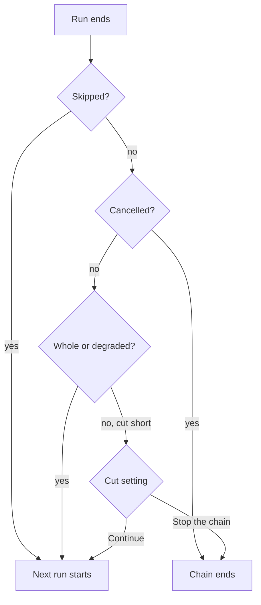

# New run

The **Fuzz** screen plans a run in three steps: **Choose a test**, **Check what runs**, and
**Rules and start**. Nothing is sent to your API until you press Start on step 3. The **Guide**
button in the header opens a side panel that explains the map, the modes, the strategies, the
rules, the checks and chains.

Every mode, strategy, preset and check the screen offers is read from the core's
[fuzz options](../../modules/core/protocol/fuzz-options.md). A term the app has no description
for is still shown, by its id, in a neutral colour.

## Step 1: choose a test

A test is a preset or Custom. A preset is a ready-made sequence of one or more runs; Custom starts
one empty run that you build on the map.

| Card | What it runs | Asks |
| --- | --- | --- |
| Custom | One run whose mode and strategy you choose on the map | — |
| Quick check | `stateless` + `smoke` | Does every endpoint answer? |
| Contract audit | `stateless` + `conformance` | Do responses match the contract? |
| Security scan | `stateless` + `security` | Attack and mutated inputs on every endpoint. |
| Exposure scan | `stateless` + `exposure` | Can clients set privileged fields like role or is_admin? |
| Load | `performance` (steady load) + `default` | Steady load; set a latency limit to judge speed. |
| Full | `stateless` + `default`, then `stateful` + `default` | Each endpoint alone, then call sequences. |
| Call sequences | `stateful` + `default` | Create, read, change, delete in order. |
| Resilience check | `resilience` + `default` | Broken traffic: rejected cleanly? |
| Access check | `auth` + `default` | Can a caller reach what its access policy refuses? |
| Stress ladder | `performance` (concurrency ladder, steps 1, 4, 16) + `default` | Rising load: who slows down first? |

Every card but Custom is one of the core's [presets](../../modules/core/protocol/fuzz-options.md#presets),
in the order the core lists them, with the core's title and question. A card marked **Needs
users** needs a [users file](#users-and-side-effects); a card marked **Needs rules** has nothing
to test with the spec alone. If the core runs without the engine package there is no test to choose, and
the screen links to Doctor.

Editing any run of a preset turns the plan into Custom, and the header says which preset it
started from (`Custom, from security-scan`). Putting it back the way the preset had it turns it
back into the preset.

## Step 2: check what runs

Each run is drawn as one map, read left to right:

| Column | What it shows |
| --- | --- |
| Mode and strategy | How the API is walked, and what kind of values are sent |
| What is sent | The phases of the run and each one's share: valid, edge, wrong, attack, mutated values, business rules, state checks |
| Target | Your API, the project's base URL |
| What it checks | The checks every response is judged by, each with what it catches, an example and why it matters |

Hover or focus a node to read it; click the mode or the strategy to change it. Under the map a
sentence says what the run does, for example "It sends up to 20 requests to each endpoint, one
endpoint at a time: 60% valid values, 20% edge values, 20% wrong values."

Items drawn dashed **need rules**: business-rule checks, the business-rules phase and the
`auth` mode have nothing to work with when the rules come from the spec only. Clicking one takes
you to the rule choice.

The strategy picker compares each strategy with Default in the chosen mode. A strategy that sends
exactly what Default would send in that mode reads **Same as Default here**, and the map offers
to switch back to Default or to try the strategy in a mode where it does change something.

### The settings of a run

The chips under each map open that run's settings. Which ones appear depends on the mode:

| Setting | Applies to | Blank means |
| --- | --- | --- |
| Requests per endpoint | `stateless`, `performance` steady load | The strategy's count |
| Call sequences | `stateful` (about 10 calls each) | The strategy's count, up to 100 |
| Load steps | `performance` concurrency ladder | `1, 4, 16` |
| Slow-down tolerance | `performance` concurrency ladder | `0.5`: a step's p95 may grow 50% beyond what queueing explains |
| Latency limit (ms) | `performance` | No limit; with one, a clean response slower than it is a finding |

`resilience`, `auth` and the concurrency ladder send a fixed set of requests, so no count can be
set on them. Load steps must be at least two whole numbers, each higher than the one before, and
the last no higher than the project's max concurrency (20 unless the project or the Developer
section sets another).

### Chains of runs

**Then run…** under the last map adds a run that starts when the previous one ends. A chain holds
up to **five runs**. Runs can be moved earlier or later and removed; each run is saved as its own
run, with its own run detail.

Each run is its own call to the core. When static code analysis is on, the first run also traces
the code before fuzzing (`run_pipeline`); the runs after it are plain `fuzz` calls.

A run is **cut short** when it did not go through its whole plan: it ended `truncated`,
`aborted` or `safety_breached` (see [run status](../../modules/core/protocol/vocabularies.md#run-status)).
A **degraded** run is a whole run and never stops a chain. A call the core could not answer ends
the chain. What a cut does to the rest is one setting for the whole chain, shown between every pair
of runs:

| Setting | When a run is cut short |
| --- | --- |
| Stop the chain (default) | The runs after it do not start |
| Continue | The next run starts anyway |

While a chain runs, the screen that follows it offers two ways out:

| Control | What it does |
| --- | --- |
| Skip this run | Cancels only the current run; the chain goes on with the next. The run is kept, marked skipped |
| Stop the chain | Cancels the current run and starts no other |

Cancelling a run any other way ends the chain, whatever the cut setting. In both cases the core
keeps what it already sent.

When the chain ends, one summary lists each run with its outcome and saved run number, and the
runs that never started. Its colour is the worst any run earned: a clean last run never paints
the chain green when an earlier run was cut, skipped, ran past the cost cap or did not run.

## Step 3: rules and start

### Where the rules come from

Rules say what the API must do beyond the shape the spec declares: business rules, and who may
call what. One source applies to every run of the plan.

| Source | What it reads | Cost |
| --- | --- | --- |
| Spec only | The OpenAPI spec alone. Business-rule checks never fire and `auth` has nothing to test | Free |
| LLM reads your code | Business rules and access policies the model deduces from your code | Paid; you approve the estimate at Start |
| Rules you wrote | One JSON file per endpoint in a folder of the project, in the format the LLM produces | Free and repeatable |

LLM rules, their cost estimate and the cap are covered in
[LLM rules and side effects](llm-rules-and-side-effects.md#llm-rules).

**Code analysis first, free** says that the first run traces each endpoint to its handler before
fuzzing, with any rule source, and how many endpoints it traced.

### Users and side effects

**Who calls your API** takes a users file (`identities.toml`, relative to the project root):
named users with the headers they log in with. Every endpoint that needs a login is called as
them, in any mode, and `auth` needs at least one. Credentials never leave your machine. Users say
who calls; who may do what is part of the rules.

**Allow side effects** is one switch for every run of the plan. What it lets through is described
in [Side effects](llm-rules-and-side-effects.md#side-effects).

### The Developer section

**Developer**, in the header while you are on step 3, opens the settings shared by every run and the exact
request each run will send.

| Field | Blank means |
| --- | --- |
| Static code analysis before the first run | On; off sends plain `fuzz` |
| Base URL | The project target |
| Timeout (s) | `engine.timeout_s`, per request |
| Max concurrency | `engine.max_concurrency`, requests in flight at once |
| Deadline (ms) | No time budget per endpoint |

Blank fields use the project's `specforge.toml`.

### Starting

The footer shows one chip per run, the rule source and the cost. Whatever keeps the plan from
starting is said there, naming the run it is about (`Run 2: choose a mode on the map.`), with a
one-click way out when there is one: choose LLM rules or your rules, choose a users file, or open
Settings to add an LLM key.

The start button says what pressing it does:

| Label | When |
| --- | --- |
| Start run / Start N runs | Nothing to approve or review |
| Approve USD X and start | LLM rules with a priced estimate: pressing it approves exactly that amount |
| Review and start | Side effects are allowed, or the model has no price: a review opens first |
| Estimating cost… | The estimate for the plan as it stands has not arrived yet |

The review, **Before the run starts** (or **Before the chain starts**), lists what you are
agreeing to: side effects in every run, the LLM cost, and for a chain the order and what a cut
does. Nothing is sent until you confirm.

**Run again** on the Workspace opens this screen on step 2 with the last run's mode and strategy,
as Custom, or with the whole plan you last started when it began with that run.
